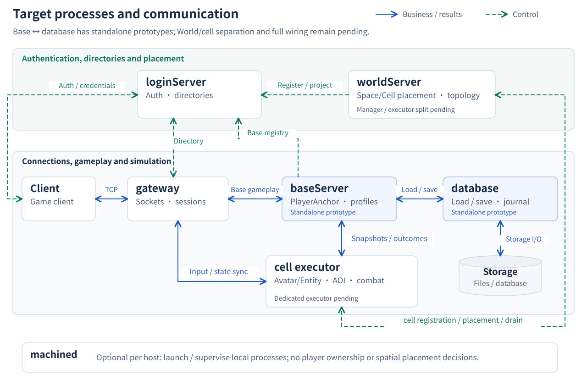
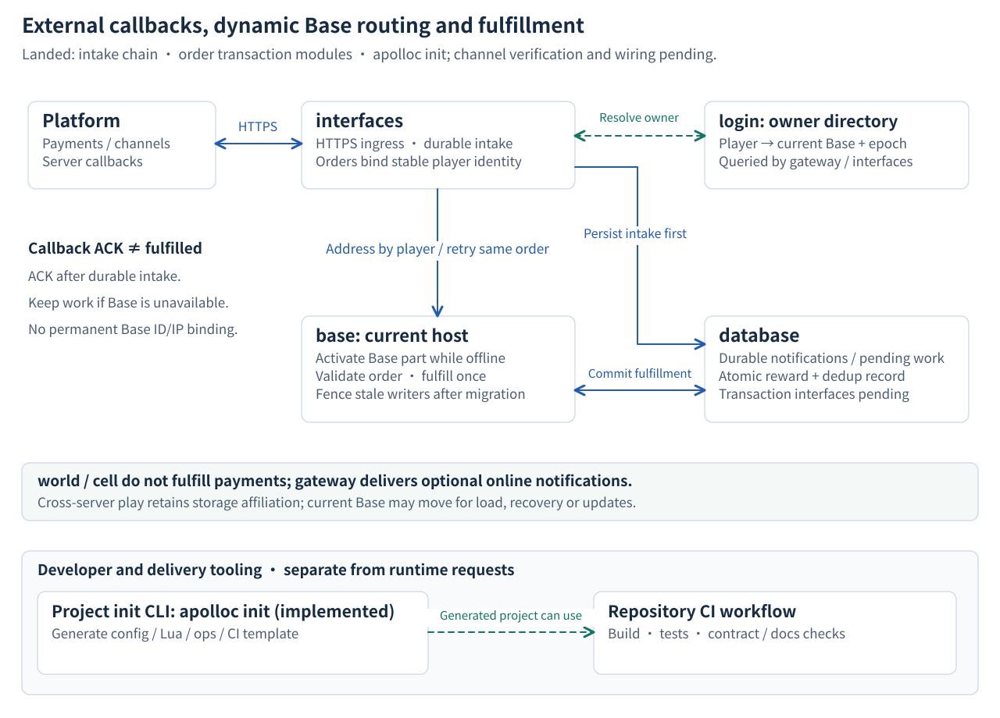

[English](README.md) | [中文](README.zh.md)

<p align="center">
  
</p>

# Apollo

**A lightweight instance-based multiplayer game server engine.**

[](https://github.com/cuihairu/apollo/releases)
[](https://github.com/cuihairu/apollo/blob/main/LICENSE)
[](https://github.com/cuihairu/apollo)
[](https://github.com/cuihairu/apollo)
[](https://github.com/cuihairu/apollo/actions/workflows/ci.yml)
[](https://codecov.io/gh/cuihairu/apollo)

> Lightweight instance-based multiplayer game server engine

## Introduction

Apollo is a C++20 server runtime for lightweight multiplayer games organized around instances and matches, such as tower defense, co-op, PvE/PvP, arenas, and dungeons. It currently delivers lightweight instances while reserving future seamless Space/Cell, authority, and visibility boundaries.

The runnable processes are `gateway`, `login`, `base`, `world`, `database`, `interfaces`, and `machined`; the `loginServer`/`baseServer`/`worldServer` words in the design docs name the roles of the `login`/`base`/`world` binaries, and `cell` is the cell execution role of the `world` binary (`--role=cell`). Cell means a spatial partition.

<picture>
  <source media="(max-width: 640px)" srcset="docs/public/architecture/system-en-mobile.svg" />
  
</picture>

Target design: standalone Base ↔ database prototypes exist; World/cell separation and full wiring remain pending.

baseServer owns persistent-player data and base gameplay; worldServer manages executors/topology and cell runs entities/temporary gameplay. Cross-server play retains the original Base and storage affiliation. A World can serve players from multiple Bases using per-player Base associations, without database credentials or local machined.

Protocol-capable upgrades replace Base, cell, or World management independently through state conversion, exclusive handoff, route switching, and source cleanup. Complete active matches require Instance state transfer. The role split and corresponding runtime wiring remain implementation tasks; see [architecture](docs/en/guide/architecture.md), [applications](docs/en/apps/index.md), and [cross-server scenes](docs/en/design/cross-server-scenes.md).

### Entry and Delivery Surfaces

- Gameplay WS/WSS (accepted): gateway listens on TCP / WS / WSS together; login, session resume, and async downlink share one game-frame path. WSS covers certificate-chain/hostname rejection and key-configuration negatives; drops resume across transports within the retention window.
- HTTP callbacks (intake implemented): payment/channel server callbacks enter a standalone interfaces HTTP/HTTPS ingress — byte-exact raw-request retention, request-timeout and queue budgets, and a bounded single-writer intake chain that never blocks simulation; the channel verification executor is planned.
- Dynamic Base resolution and durable fulfillment (modules implemented): orders are accepted by stable player identity and journaled durably; each delivery attempt re-resolves the current Base plus epoch, so offline players, unreachable Bases, and migration windows never lose pending work; fulfillment commits a dedup credential atomically, converging duplicate notifications, lost ACKs, and crash restarts into one delivery. Inter-process wiring (interfaces→order intake, baseServer write-authority lifecycle, reward apply executor) is planned.

<picture>
  <source media="(max-width: 640px)" srcset="docs/public/architecture/callbacks-en-mobile.svg" />
  
</picture>

### Processes, Tools, and CI

| Kind | Members | Boundary |
|---|---|---|
| Runtime processes | `gateway`, `login`, `base`, `world`, `database`, `interfaces`, `machined` | Online services; `cell` runs as a role of the `world` binary |
| CLI tools | `apolloc` (project init), `fleetctl`, `admin`, `logger` | Development/ops tools, not online services |
| CI | GitHub Actions: build/tests, contracts, docs | Runs in the repository, not in the online path |

## Use Cases

**A good fit** — games whose natural play boundary is an instance or match:

| Scenario | Instance Form |
|------|----------|
| Tower defense and fixed maps | One instance per match; instance state is released at match end |
| Dungeons / Roguelike | One instance per run |
| Arena / battle royale | One instance per match |
| Multiplayer PvE / survival / co-op | An instance for the group |
| Multiplayer PvP | An instance for the match |

**Seamless maps are deferred.** Initially one executor hosts one Cell per Space. Reserve multiple Cells per Space, neighboring visibility, and authority handoff within the same architecture.

> MMO describes a game scale and product form; it does not define this engine's topology. Apollo can support MMO features built from instances and matches, while prioritizing instances and reserving seamless-map boundaries.

[BigWorld–Apollo mapping](docs/en/design/bigworld-apollo-mapping.md)

## Core Concepts

Core gameplay terms (the [concept guide](docs/en/guide/concepts.md) describes current code components):

| Concept | Responsibility | Existing code / boundary |
|---|---|---|
| baseServer | Persistent-player objects and base gameplay | Standalone baseServer and remote storage exist; ownership/default routing migration remains pending |
| worldServer | Executor registration, Space/Cell topology and migration | Split current WorldApp management/execution |
| cell | Local Cell simulation, entities, AOI, combat | Reuse WorldHost, Scene, Instance, Avatar; dedicated entry pending |
| Space / Cell | Runtime space / spatial partition | Space matches current Scene semantics without duplicate containers |
| database | Load/save, storage routing, durable results | Dedicated database hosts profiles/journal; complete write authority/queues remain pending |
| Instance | Temporary group activity | Existing eight-state lifecycle |
| AOI | Scene visibility | SceneAoi |
| loginServer / gateway / machined | Authentication/directories, connections, local supervision | Existing entries require routing/deployment updates |

### Key Features

- **Minimalist constructor-injection DI** - `apollo::core::di`: type-keyed bean graph, topologically ordered assembly, `ApplicationHost` frame-driven lifecycle
- **Entity contract system** - XML+XSD contracts + standalone generator `apollo_gen`; the generator is not in the runtime link graph
- **Async networking** - non-blocking sockets + select()/epoll event loop (Windows polls via select(); no IOCP)
- **Transport codec (target state)** - protobuf reflection as default + zstd (planned); the current implementation uses hand-written encoding
- **AOI 3×3 grid** - `SceneAoi` single implementation + `ViewerState` per-observer watermarks; the event surface is delivered
- **Battle system** - `BattleRuntime` deterministic battle domain (five-phase lifecycle, hash-chain fingerprint) with settlement routed through the owning Base and database
- **Data storage** - atomic player profile file writes + `PersistJournal` write-behind; external DB/Redis not wired up
- **Observability** - self-built logging, structured events, MetricRegistry, and span/trace primitives; no dedicated Profiler or OpenTelemetry SDK/exporter integration
- **BigWorld compatibility layer** - BigWorld-style C++ API facade (`docs/33-BigWorld_Compatibility.md`)

## Update Modes

Protocol updates start a new Base, cell, or World management process, convert/restore state, commit exclusive authority/routes, and retire the old process. cell transfers simulation, World transfers topology/pending management records, and Base transfers persistent objects while retaining storage affiliation. Version-specific message decoding, state conversion, rollback limits, and unchanged-client compatibility require explicit acceptance. A handshake compatibility window alone is insufficient.

Code-only updates preserve contract IDs, fields, and wire format. Lua can prepare/commit, observe, and roll back modules; C++ uses process replacement. Preserve gateway to retain its TCP connections; replacing gateway requires drain or client recovery. Current primitives do not establish the full target-role upgrade workflow.

See [update boundaries](docs/en/design/gateway-topology-survey.md) and [contract versioning](docs/en/design/sdk-contract.md).

## Architecture

> See [Architecture Overview](docs/en/guide/architecture.md) for the target instance-based model and [Server Applications](docs/en/apps/index.md) for the current executable prototypes.

### Tech Stack

- **Language**: C++20
- **Build system**: CMake + Ninja, vcpkg manifest mode for dependency management
- **Networking library**: hand-written cross-platform network layer
- **Serialization/contracts**: XML+XSD contracts define game data semantics; `apollo_gen` generates client/server contract artifacts (`docs/design/sdk-contract.md`). Protobuf is a dependency used by tests, not the current message path; the implementation uses hand-written encoding.
- **Database**: no external storage dependency is currently required. Player profiles use JSON files and `PersistJournal`; MySQL, Redis, and ClickHouse integration remains planned.
- **Message queue**: Kafka for the observability pipeline (planned, decision #14); inter-service messaging uses a hand-written message bus (planned, `docs/design/net-abstraction.md`)
- **Monitoring**: Prometheus + Grafana (planned, batch 8)
- **Logging**: hand-written multi-level logging (`apollo::core::log`); target pipeline LogAgent→Kafka→ClickHouse (decision #14)
- **Test framework**: zero-dependency assertion-style unit tests (unified tree, gated by ctest); legacy GTest batch is off by default
- **CI/CD**: GitHub Actions

## Quick Start

### Requirements

- C++20 or later
- CMake 3.16+
- GCC 9+ / Clang 10+ / MSVC 2019+

> The current build and runtime have zero external storage dependencies (player profiles are local files + journal); MySQL/Redis runtime wiring is planned, so no pre-installation is needed.

### Build

```bash
# Clone the project
git clone https://github.com/cuihairu/apollo.git
cd apollo

# Install vcpkg (for dependency management)
git clone https://github.com/microsoft/vcpkg.git
./vcpkg/bootstrap-vcpkg.sh

# Create a build directory
cmake -B build -G Ninja \
  -DCMAKE_BUILD_TYPE=Release \
  -DCMAKE_TOOLCHAIN_FILE="$PWD/vcpkg/scripts/buildsystems/vcpkg.cmake" \
  -DVCPKG_TARGET_TRIPLET=x64-linux   # macOS: x64-osx / arm64-osx

# Build
cmake --build build --parallel

# Run the example
./build/examples/session_demo
```

### Local Testing Triage

CI and local development split by change surface in three ways — editing one line of
documentation should not trigger a full compile.

1. **Documentation changes** (`*.md`, `docs/**`, images): no compile. The main CI workflow's
   `paths-ignore` already skips these paths.
2. **Code changes**: run only the changed subset, never the full suite.
   - `ctest -R '<changed-test>' -C Debug`
3. **Full suite** (`ctest --output-on-failure -C Debug`): triggered only by changes to
   `CMakeLists.txt`, `.github/**`, Docker/Compose configuration, or before a release.

### Minimal Example

About 40 lines to run a hosted game service (see [quick-start](docs/guide/quick-start.md) for the complete compilable version, verified against the actual API):

```cpp
#include <apollo/runtime/application_host.hpp>
#include <apollo/game/world/scene_aoi.hpp>

using apollo::game::world::SceneAoi;

class GameServer : public apollo::runtime::IHostedService {
public:
    std::string_view service_name() const override { return "game-server"; }

    bool start() override {
        aoi_ = std::make_unique<SceneAoi>(1000.0f, 1000.0f, 100.0f, 30.0f);
        aoi_->set_event_sink([](const SceneAoi::Event&) { /* downstream delivery */ });
        for (int i = 1; i <= 100; ++i) {
            aoi_->enter(apollo::game::core::EntityId{static_cast<std::uint64_t>(i)},
                        {static_cast<float>(i), 0.0f, 0.0f});
        }
        return true;
    }

    void stop() override {}
    bool is_running() const override { return true; }
    void tick() override { /* per-frame business logic */ }

private:
    std::unique_ptr<SceneAoi> aoi_;
};

int main() {
    apollo::runtime::ServiceHost host;
    host.add_service(std::make_shared<GameServer>());
    if (!host.start()) return 1;
    while (host.is_running()) host.run_once();
    host.stop();
}
```

### Windows (Visual Studio)

```bash
# Use Visual Studio 2019 or later
git clone https://github.com/cuihairu/apollo.git
cd apollo

git clone https://github.com/microsoft/vcpkg.git
.\vcpkg\bootstrap-vcpkg.bat

cmake -B build -G "Visual Studio 16 2019" ^
  -DCMAKE_TOOLCHAIN_FILE=%cd%\\vcpkg\\scripts\\buildsystems\\vcpkg.cmake ^
  -DVCPKG_TARGET_TRIPLET=x64-windows

# Open build\\Apollo.sln to build
```

## Modules

### Base Infrastructure (modules/base)
- **Role**: pure infrastructure with no framework semantics; usable standalone in any C++ project (no dependency on other Apollo modules)
- **Components**: Time utilities, ThreadPool, IdPool, String utilities, Memory utilities, Terminal utilities
- See [Base module docs](docs/modules/base.md) for details

### Core Framework (modules/core · modules/runtime)
- **Dependency injection**: `apollo::core::di` minimalist constructor-injection container — type-keyed bean graph, topologically ordered assembly, only Singleton/Prototype scopes
- **Application lifecycle**: `ApplicationHost` frame-driven hosting — `IHostedService` start/stop/tick + six-phase state machine (Boot→…→Stopped)
- **Configuration**: `apollo::core::config::ConfigRegistry` key-value registry; hot reload is planned to swap ConfigSnapshot at tick boundaries (architecture-review §17.6)

### Game Logic
- **AOI system**: `SceneAoi` 3×3 grid (owned by Scene, isolated by scene_id) + `ViewerState` per-observer watermarks; Enter/Sync/Leave event dispatch is delivered, the gateway downstream delivery surface is left for P3-2
- **Battle system**: `BattleRuntime` deterministic battle domain — five-phase lifecycle, seed/substream RNG, hash-chain fingerprint, one-way reward settlement via `IRewardSink`; attached to `Instance` (P2-2). Skills/buffs content comes with gameplay batches
- **Attribute system**: `AttributeContainer`/`AttributeManager` attribute container and definition registration; per-viewer delta sync pipeline not wired (the `attr_batch` contract is already in messages.xml)
- **Scene management**: multi-scene support + scene transfer (`scene_transfer`, prepare→detach→attach→resume + rollback on failure)

### Network
- **Transport layer**: Socket wrappers, supporting TCP/WebSocket
- **Message layer**: message routing and handling (hand-written encoding today; target protobuf+zstd with schemas generated from def contracts, planned)
- **RPC framework**: remote procedure call framework

### Storage
- **Player profiles**: JSON file profiles (tmp+rename atomic write) + `SaveQueue` async save queue; a load miss fails immediately (no default-profile bootstrap)
- **Write-ahead journal**: `PersistJournal` — append to disk → quota-based drain → snapshot compaction → crash replay continuation (P1-4/P1-5)
- **Serialization**: symmetric toJson/fromJson profile serialization; connection pools/external DB/Redis clients are planned (P1-4 removed five legacy implementations)

### Utils
- **Logging**: multi-level logging, file/console output
- **Thread pool**: task scheduling
- **Memory pool**: memory management
- **Configuration**: `ConfigRegistry` key-value registry (in-memory)

### Compatibility Layer
- **BigWorld Compatibility Layer**: BigWorld-style C++ API facade (see `docs/33-BigWorld_Compatibility.md`)
- **BigWorld API Tests**: `tests/test_bigworld_api.cpp` (CTest: `BigWorldApiTests`)

## Examples

### Server Base Framework

```cpp
#include "apollo/core/di/application_context.hpp"
#include "apollo/runtime/application_host.hpp"

// Business bean: a plain class, dependencies via constructor (no annotations, no registration macros)
struct GameClockService {
    std::string name = "game_clock";
};

class LoginPipeline {
public:
    explicit LoginPipeline(GameClockService& clock) : clock_(clock) {}
private:
    GameClockService& clock_;
};

// Hosted service: implements IHostedService, frame-driven by ApplicationHost
class GameServerService : public apollo::runtime::IHostedService {
public:
    explicit GameServerService(apollo::core::di::ApplicationContext& ctx)
        : clock_(ctx.get<GameClockService>()) {}

    std::string_view service_name() const override { return "game_server"; }
    bool start() override { return true; }
    void stop() override {}
    bool is_running() const override { return true; }
    void tick() override { /* per-frame business logic */ }

private:
    GameClockService& clock_;
};

int main() {
    // Assembly: the bean graph = a chain of add_singleton calls, dependencies are template parameters
    apollo::core::di::ApplicationContextBuilder builder;
    builder.add_singleton<GameClockService>().name("game_clock");
    builder.add_singleton<LoginPipeline, GameClockService>().name("login_pipeline");
    auto context = builder.build();
    if (!context.initialize()) {
        return 1;  // topologically ordered construction; exit on failure
    }

    // Hosting: start → run_once frame loop → stop
    apollo::runtime::ServiceHost host;
    host.add_service(std::make_shared<GameServerService>(context));
    if (!host.start()) {
        return 1;
    }
    while (host.is_running()) {
        host.run_once();
    }
    host.stop();
    return 0;
}
```

> See `tests/test_runtime.cpp` (ApplicationHost cases) for the complete runnable version. Assembly happens only at application entry points (apps/); modules internally never know about the container.

### Using the AOI System

```cpp
#include "apollo/game/world/scene_aoi.hpp"

using apollo::game::core::EntityId;
using apollo::game::world::SceneAoi;

// 3×3-grid interest management: each Scene owns one instance (naturally isolated by scene)
SceneAoi aoi(1000.0f, 1000.0f, 100.0f, 30.0f);  // width, height, cell size, view radius

// Event surface: Enter / Sync / Leave (the sink defaults to silent; Scene/host injects delivery)
aoi.set_event_sink([](const SceneAoi::Event& e) {
    // e.kind / e.observer / e.subject — the viewer-set diff baseline lives in ViewerState
});

// Entity enter / move / leave
aoi.enter(EntityId{1001}, {100.0f, 0.0f, 100.0f});
auto viewers = aoi.viewers_of(EntityId{1001});   // entities in view (including self)
aoi.move(EntityId{1001}, {120.0f, 0.0f, 100.0f});
aoi.leave(EntityId{1001});
```

### Using the Battle System

```cpp
#include <apollo/game/battle/battle_runtime.hpp>
#include <apollo/game/core/entity.hpp>
#include <apollo/game/world/instance.hpp>

using namespace apollo::game;
core::PlayerId player_id{1001};

// Reward sink: battle settles one-way into the player's long-term state
struct ScoreSink : battle::IRewardSink {
    void on_reward(std::uint64_t player_id, std::int64_t score) override {
        // write into base::Avatar (mark_dirty)
    }
};

// Instance = eight-state lifecycle; the Waiting window hosts the battle
// payload, and enter collects participants before the battle begins
world::Instance instance(1, 1, "demo");
instance.initialize();
instance.ready();

ScoreSink sink;
auto battle = std::make_unique<battle::BattleRuntime>(1, /*seed*/ 42, &sink);
instance.attach_battle(std::move(battle));
instance.enter(player_id);
instance.start();  // → Running (battle begins with the collected participants)

// Deterministic ticks: same seed + same input sequence ⇒ same outcome,
// fingerprinted by a rolling hash chain (1 = attack intent)
instance.battle()->tick(0, {{0, player_id.value(), 1}});
instance.battle()->finish();  // → Rewarding → Finished
```

## Performance Targets

| Metric | Target | Notes |
|------|--------|------|
| Capacity per server | 5000+ CCU | Concurrent users on a single GameServer |
| Response latency | P99 < 50ms | Core operation response time |
| Memory usage | < 2GB | Memory footprint at 5000 users |
| Network throughput | 100MB/s | Peak network bandwidth |
| Database connections | 1000+ | Max connection pool size |

## Testing

The project includes comprehensive unit tests and example code:

```bash
# Run all tests (full list in tests/CMakeLists.txt)
cd build && ctest

# Run only the BigWorld compatibility layer tests
cd build && ctest -R BigWorldApiTests
```

Test coverage:
- Network and protocol tests (network/net/protocol/channel)
- Data and persistence tests (data, `PersistJournalTests`, `PersistenceChainTests` — file profile write→restart→read-back)
- World and lifecycle tests (game/scene/instance/avatar/session_world/world_host)
- Session and recovery tests (`PlayerDirectoryTests`, `RecoveryTests`, `ReconnectTests`)
- Infrastructure tests (logging/timers/config/thread pool/serialization, etc.)
- BigWorld compatibility layer API tests (`BigWorldApiTests`)

## Directory Structure

```
apollo/
├── apps/                   # Executable prototypes and tools; see docs/en/apps/index.md for current status
├── modules/                # Modular source: base/core/data/game/net/runtime, etc.
├── include/                # Public headers and compatibility layer headers
├── src/                    # Public implementations and compatibility layer implementations
├── tests/                  # Test code
├── examples/               # Example code
├── sdks/                   # Unity client SDK and contract tooling (contract + gen generator + cpp generated code)
├── skds/                   # Cocos / Laya / legacy SDK workspace
├── docs/                   # VitePress documentation site
├── cmake/                  # CMake helper scripts
└── build*/                 # Build output
```

See [Directory Structure](docs/Directory_Structure.md) for details.

## Client SDK

### Unity SDK

Parts of the Unity SDK are delivered (module status: see [SDK_Structure](docs/sdks/unity/SDK_Structure.md)):

- Network communication management (NetworkManager, available)
- Login authentication (AuthManager, available)
- Attribute sync (Attributes, in development)
- Message serialization/deserialization (Messaging, planned)

```csharp
// Unity SDK usage example
var config = new ApolloClientConfig {
    ServerAddress = "game.example.com",
    Port = 7700,
    Protocol = TransportProtocol.Tcp
};

var client = new ApolloClient(config);
await client.ConnectAsync();
await client.LoginAsync(loginRequest);
```

## Contributing

Contributions are welcome! Please follow these steps:

1. Fork the project
2. Create a feature branch (`git checkout -b feature/AmazingFeature`)
3. Commit your changes (`git commit -m 'Add some AmazingFeature'`)
4. Push to the branch (`git push origin feature/AmazingFeature`)
5. Open a Pull Request

### Code Style

- Follow the [Google C++ Style Guide](https://google.github.io/styleguide/cppguide.html)
- Use meaningful variable and function names
- Add appropriate comments
- Write unit tests

## License

This project is licensed under the [MIT License](LICENSE).

## Origin and Acknowledgements

Apollo is an original implementation of this repository, not a fork of any existing project; its architecture concepts and terminology reference the following open-source projects, with sources cited where referenced:

- **BigWorld**: BigWorld-style C++ API facade (`docs/33-BigWorld_Compatibility.md`); the architecture audit includes source-level comparison of BigWorld / KBEngine / skynet (`docs/analysis/mmo-mechanism-deep-dive.md`)
- **KBEngine**: several entries in `docs/qa/` analyze its source mechanisms
- **skynet**: design precedents such as the observability channel (`docs/analysis/architecture-review.md`)

Third-party dependencies: [vcpkg](https://github.com/microsoft/vcpkg) (dependency management), [nlohmann/json](https://github.com/nlohmann/json), [protobuf](https://github.com/protocolbuffers/protobuf) (currently a dependency + tests, not on the message path), [GTest](https://github.com/google/googletest), OpenSSL, libcurl, pugixml, readline, crashpad, [VitePress](https://vitepress.dev) (docs site), GitHub Actions and Codecov (CI and coverage). The transport layer is self-built (`modules/net/link`), no nng.

## Contact

- Project home: https://github.com/cuihairu/apollo
- Issues: [Issues](https://github.com/cuihairu/apollo/issues)
- Email: cuihairu@example.com

---

**Apollo - Instance-based multiplayer game server engine**

## Temporary instance lifecycle

A group requests an activity → World creates an Instance and temporary Scene → members pass admission and enter → clear enemies and complete objectives → settle → players leave → destroy the Instance, scene, and temporary resources.

Reuse the existing eight-state Instance lifecycle. worldServer owns topology and cell owns simulation; Base owns persistent data and validates settlement through database. Rewire existing tests to this boundary and validate durable settlement, full Instance migration, and cross-gateway recovery separately.
