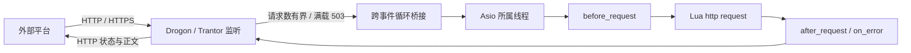
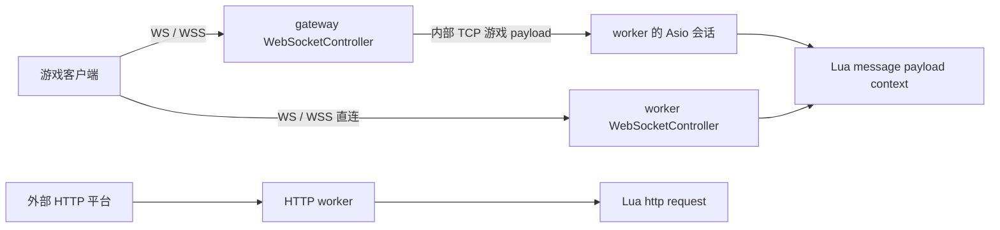

# Mistlane 与旧 FOGS 的架构核对

核对日期：2026-10-18。对象是相邻独立仓库 `mistlane`（commit `030cca63c86c227d2dbdb79bbc3281e9b1926f8d`）及其来源 `game-fogs`（commit `37b640aac388d34dcbccca401d3b2916f14bfd7d`）。本报告没有修改两仓代码；复用结论不等于迁移批准。

## 先区分两个项目

当前 Mistlane 是从旧游戏提取后重新实现的研究框架，只有 gateway/router/worker/cross/shard 等通用角色。旧 FOGS 才包含完整游戏角色、场景、支付及跨区玩法。不能把来源项目的业务能力算成当前 Mistlane 已提供的能力。[Mistlane 定位](https://github.com/cuihairu/mistlane/blob/030cca63c86c227d2dbdb79bbc3281e9b1926f8d/README.zh-CN.md)

| 关注点 | Mistlane / 旧 FOGS 实际证据 | 对 Apollo 的判断 |
|---|---|---|
| 同一二进制多角色 | Mistlane main 分派 worker/router/gateway/cross/shard，也有 init/test/bot 子命令 | 可以借鉴角色装配；不意味着已自动监督派生进程，Apollo 的 World/cell 自动管理仍需实现 |
| Base/Cell | 旧 World 保有角色摘要和路由；Hegel 的 Charactor 同时持完整资料、脏字段保存与战斗/场景状态 | 不是 BigWorld 式长期 Base 与 Cell 模拟分权；不能把 Hegel 直接改名 Cell 就当完成拆分 |
| 玩家路由 | 旧 UserRouter 以 aid 查 hid，切换 Hegel 会修改 hid；Mistlane 通用会话则固定上游 | 角色身份与位置必须分开；Apollo 还要补持久归属决定、代次和旧写端隔离 |
| 空间路由 | Mistlane 使用 group/room 的 FNV-1a 哈希模 shard 数量，列表静态配置 | 可参考准入；不是一致性哈希、动态空间调度或无缝 Cell 分区 |
| Lua 更新 | SIGHUP 创建候选 VM，start 成功后替换；模块状态重置 | 只证明脚本替换及启动失败保留旧 VM，不证明活动连续或协议更新 |
| 外部 HTTP | Drogon HTTP/HTTPS 接收请求，经有界桥接调 Lua http(request) | 可以研究其事件循环边界；支付验签、持久待办、归属解析和发货业务并未随框架提供 |
| 工具链 | init 生成逐进程配置、Lua 示例、启停脚本及 systemd 模板；CI 是仓库 workflow | Apollo 有仓库开发编队和 CI，但缺项目初始化 CLI，需单列脚手架任务 |

证据：[Mistlane CLI](https://github.com/cuihairu/mistlane/blob/030cca63c86c227d2dbdb79bbc3281e9b1926f8d/src/main.cpp#L143)、[模板生成](https://github.com/cuihairu/mistlane/blob/030cca63c86c227d2dbdb79bbc3281e9b1926f8d/src/scaffold.cpp#L28)、[跨服 hash/准入](https://github.com/cuihairu/mistlane/blob/030cca63c86c227d2dbdb79bbc3281e9b1926f8d/include/mistlane/cross.hpp#L39)、[Lua 替换](https://github.com/cuihairu/mistlane/blob/030cca63c86c227d2dbdb79bbc3281e9b1926f8d/src/node.cpp#L514)。

## 外部 HTTP 真实调用路径

Mistlane 的 WS/WSS 游戏消息走另一条 message(payload, context) 入口，不能与 HTTP 回调混为一谈。HTTP 请求的 method/path/query/body/headers 被转换为 WebRequest，Lua 返回 status/headers/body；Node 把回调 post 到 Asio 线程，因此 Lua 不在 Trantor 线程执行。[HTTP 监听与有界受理](https://github.com/cuihairu/mistlane/blob/030cca63c86c227d2dbdb79bbc3281e9b1926f8d/src/web.cpp#L95)、[线程转交](https://github.com/cuihairu/mistlane/blob/030cca63c86c227d2dbdb79bbc3281e9b1926f8d/src/node.cpp#L460)、[Lua HTTP 生命周期](https://github.com/cuihairu/mistlane/blob/030cca63c86c227d2dbdb79bbc3281e9b1926f8d/src/lua_service.cpp#L450)

这只是通用 HTTP handler。当前未提供支付订单、验签适配或可恢复发货链路；不能将 examples/http.lua 当成已经可收真实支付的 interfaces。Apollo 的目标是下图，接口/订单事务仍待实现。

<ArchitectureDiagram kind="callbacks" />

## WS/WSS 游戏消息不是 HTTP 回调

当前 Mistlane 两条游戏路径均存在：worker 直接监听 WS/WSS，以及 gateway 接收 WS/WSS 后转发内部 TCP worker；与 HTTP worker 的 http(request) 分开。transport.websocket 测试循环覆盖 ws 和 wss、直连与 gateway 转发，并检查不可信证书和主机名不匹配被拒绝。本次单独重跑通过。[协议分派](https://github.com/cuihairu/mistlane/blob/030cca63c86c227d2dbdb79bbc3281e9b1926f8d/src/web.cpp#L108)、[真实测试](https://github.com/cuihairu/mistlane/blob/030cca63c86c227d2dbdb79bbc3281e9b1926f8d/src/test_cases.cpp#L212)

但 Session 仍按“读一条 → 执行/转发 → 等响应 → 回客户端 → 再读下一条”运行；Lua 没有稳定会话寻址的主动发送、广播和 AOI 推送 API。WebSocket 传输支持不等于完整游戏网关能力，也不能证明高频并发/连续同步已完成。Apollo 的 WS/WSS 接线必须进入 gateway 的游戏帧/意图链，分别访问 Base/cell，不借用 interfaces 的 HTTP handler；相关任务见 todo.md。

## 旧角色与离线支付的实际行为

旧 Hegel Charactor 初始化时保有 charData、属性和 dirty；save() 把脏字段编码给 Cache，随后 World 的订单状态更新是另一条调用链。不能据此声称订单完成与玩家奖励原子持久提交。[角色初始化](https://github.com/cuihairu/game-fogs/blob/37b640aac388d34dcbccca401d3b2916f14bfd7d/game/Hegel/Charactor/Charactor.lua#L35)、[脏字段保存](https://github.com/cuihairu/game-fogs/blob/37b640aac388d34dcbccca401d3b2916f14bfd7d/game/Hegel/Charactor/Charactor.lua#L743)

旧 PayLogic 收到订单后查在线角色，在线时按 UserRouter.getHegel(aid) 转交；离线分支只记录未在线。checkCharLogin 再读取 state=0 的订单补发。这是“持久挂单、登录补发”的已见路径，不是 Apollo 讨论的“离线激活 Base 后发货”；本次未穷尽所有渠道代码，不断言其他路径都不存在。[支付分派](https://github.com/cuihairu/game-fogs/blob/37b640aac388d34dcbccca401d3b2916f14bfd7d/game/World/Pay/PayLogic.lua#L7)、[登录补查](https://github.com/cuihairu/game-fogs/blob/37b640aac388d34dcbccca401d3b2916f14bfd7d/game/World/Charactor/CharactorManager.lua#L635)

旧 UserRouter 的 switchHegel 会直接更新 hid；旧 Hegel 离线缓存还有用登出时间差判断复用的逻辑。它们说明旧项目确实处理动态落点及离线保留，但不构成分布式写权隔离证明。Apollo 应复用问题经验，不能照搬时间差代替授权代次。[旧路由](https://github.com/cuihairu/game-fogs/blob/37b640aac388d34dcbccca401d3b2916f14bfd7d/game/Data/UserRouter.lua#L113)、[旧离线复用](https://github.com/cuihairu/game-fogs/blob/37b640aac388d34dcbccca401d3b2916f14bfd7d/game/Hegel/Charactor/CharactorManager.lua#L86)

## 已发现的实现问题

| 优先级 | 发现 | 证据与验证边界 |
|---|---|---|
| P1 | 启用探针 token 后，cross 的探测请求字段顺序错误 | Peer 校验 nonce/token/command；cross 发 nonce/command/token。同一 token 的直接探测返回 ready，cross 加入返回 MLC1 ERR UPSTREAM，已本地复现 |
| P1 | ProbeServer 持续保留已结束 Peer | accept 插入 peers_，成功/失败关闭不从集合删除，仅 stop 清空。3000 次串行探测后 RSS 从 14256 KiB 到 17164 KiB，增加 2908 KiB；RSS 不是逐对象内存证明，但与静态保留路径相符 |
| P1 | 探针响应引用临时字符串作为异步缓冲 | async_write(buffer(text+'\\n')) 的临时结果在表达式结束后销毁；lambda 捕获原 text 不延长临时结果寿命。静态确认违反缓冲生命周期要求，本次未取得 sanitizer 崩溃复现 |
| P2 | 探针受理没有独立连接数/请求行字节上限 | 2 秒超时不等于有界内存；streambuf 在读到换行前可以增长。应补控制面的独立预算，本次未做恶意流量压测 |
| P2 | 配置文档局部滞后 | 架构对比表仍称核心不解析原生配置，但 main 已支持 --config；跨服页局部“指标/压测未集成”也与后文现有能力不一致 |

源码：[Peer 读写/集合](https://github.com/cuihairu/mistlane/blob/030cca63c86c227d2dbdb79bbc3281e9b1926f8d/src/node.cpp#L78)、[cross 探测请求](https://github.com/cuihairu/mistlane/blob/030cca63c86c227d2dbdb79bbc3281e9b1926f8d/src/node.cpp#L301)、[Asio 1.92 async_write 缓冲生命周期契约](https://www.boost.org/doc/libs/1_92_0/doc/html/boost_asio/reference/async_write/overload1.html)。这些问题不能反推旧游戏历史崩溃原因。

## Apollo 的采用边界

可以借鉴：单二进制按角色装配、逐实例配置、可审查的 init 模板、独立 HTTP 入口、有界跨线程投递、明确的拒收/就绪状态、失败重载保留旧 VM。具体库能否复用仍需核对 Apollo 的线程和网络抽象，不为此新增另一套传输栈。

不能直接继承：旧 Hegel 的全资料与模拟混合、静态 shard 模路由作为动态 Cell 管理、在线才发货作为唯一订单路径、Lua VM 重建作为完整活动迁移、配置 epoch 作为存储写权隔离、连接数作为完整 tick/CPU 容量证明。

Apollo 后续任务见根目录 todo.md：角色命名迁移、项目初始化 CLI、interfaces HTTP/订单链路，以及 World/cell 管理和迁移各自验收。当前 scripts/dev_fleet.sh、CMake 与 CI 可用于仓库开发，不能替代面向新游戏项目的初始化 CLI；二进制 --help 中也没有 init 项。

## 本次验证

- 当前 Mistlane 构建目标 mistlane 成功；既有 Debug CTest 14/14 通过，包含本机临时数据库/Redis 集成配置。
- 额外隔离回环实验复现 token 路径失败，并记录 3000 次探测后的 RSS 变化；实验进程均已退出，未使用原生产配置。
- 静态核对角色、路由、持久化、Lua 更新及 HTTP 链路；没有运行原 FOGS 游戏、复现其历史事故或测定生产容量。
