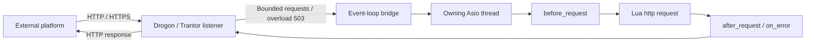
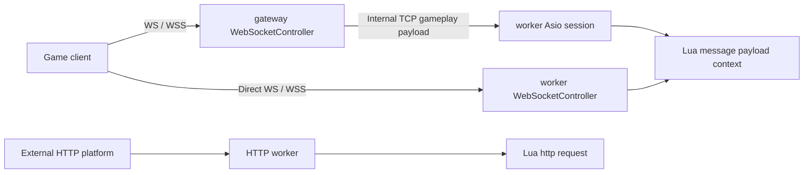

# Mistlane and Legacy FOGS Architecture Review

Reviewed on 2026-10-18: sibling Mistlane at commit `030cca63c86c227d2dbdb79bbc3281e9b1926f8d`, with source game-fogs at `37b640aac388d34dcbccca401d3b2916f14bfd7d`. Neither repository's code changed. Review findings do not authorize wholesale migration.

## Separate the Two Projects

Current Mistlane is a research framework reimplemented from legacy code, with generic gateway/router/worker/cross/shard roles. Legacy FOGS contains actual characters, scenes, payments, and cross-server gameplay. Source-project functionality is not functionality delivered by the extracted framework. [Mistlane scope](https://github.com/cuihairu/mistlane/blob/030cca63c86c227d2dbdb79bbc3281e9b1926f8d/README.md)

| Concern | Observed implementation | Implication for Apollo |
|---|---|---|
| Shared binary | Mistlane dispatches worker/router/gateway/cross/shard plus init/test/bot | Role assembly is reusable; automatic child supervision is separate work |
| Base/Cell | Legacy World holds summaries/routes; Hegel Charactor combines full profiles, dirty saves, and simulation | Not a clean persistent-Base/Cell split; renaming Hegel to Cell would not implement one |
| Player routing | Legacy UserRouter resolves aid to mutable hid; current generic sessions pin upstreams | Separate identity from location; add durable ownership decisions, epochs, and fencing |
| Space placement | FNV-1a group/room hash modulo a static shard count | Admission reference, not consistent hashing, dynamic placement, or seamless partitioning |
| Lua update | Candidate VM starts before swap; module state resets | Script replacement and startup-failure retention, not activity or protocol continuity |
| External HTTP | Drogon HTTP/HTTPS through bounded handoff to Lua http(request) | Useful event-loop boundary; no supplied payment verification or durable fulfillment |
| Tooling | init emits per-process config, Lua, operations scripts, systemd; CI lives in workflow | Apollo has repository scripts/CI but lacks a game-project initialization CLI |

Sources: [CLI](https://github.com/cuihairu/mistlane/blob/030cca63c86c227d2dbdb79bbc3281e9b1926f8d/src/main.cpp#L143), [templates](https://github.com/cuihairu/mistlane/blob/030cca63c86c227d2dbdb79bbc3281e9b1926f8d/src/scaffold.cpp#L28), [hash/admission](https://github.com/cuihairu/mistlane/blob/030cca63c86c227d2dbdb79bbc3281e9b1926f8d/include/mistlane/cross.hpp#L39), [VM replacement](https://github.com/cuihairu/mistlane/blob/030cca63c86c227d2dbdb79bbc3281e9b1926f8d/src/node.cpp#L514).

## Actual HTTP Callback Path

Game WS/WSS traffic uses a separate message(payload, context) path. HTTP method/path/query/body/headers become WebRequest; Lua returns status/headers/body. Node posts execution onto Asio, keeping Lua off Trantor threads. [HTTP acceptance](https://github.com/cuihairu/mistlane/blob/030cca63c86c227d2dbdb79bbc3281e9b1926f8d/src/web.cpp#L95), [thread handoff](https://github.com/cuihairu/mistlane/blob/030cca63c86c227d2dbdb79bbc3281e9b1926f8d/src/node.cpp#L460), [Lua HTTP lifecycle](https://github.com/cuihairu/mistlane/blob/030cca63c86c227d2dbdb79bbc3281e9b1926f8d/src/lua_service.cpp#L450).

This is a generic HTTP handler, without payment orders, signature adapters, or recoverable fulfillment. An HTTP example is not a completed payment interfaces service. Apollo's proposed boundary follows; interfaces and order transactions remain unimplemented.

<ArchitectureDiagram kind="callbacks" />

## Gameplay WS/WSS Is Separate from HTTP Callbacks

Mistlane implements both direct WS/WSS worker and WS/WSS gateway forwarding to an internal TCP worker. HTTP workers invoke http(request) separately. transport.websocket exercises ws/wss, direct/forwarded topology, and rejection of untrusted certificates/hostname mismatch; a dedicated rerun passed. [Dispatch](https://github.com/cuihairu/mistlane/blob/030cca63c86c227d2dbdb79bbc3281e9b1926f8d/src/web.cpp#L108), [tests](https://github.com/cuihairu/mistlane/blob/030cca63c86c227d2dbdb79bbc3281e9b1926f8d/src/test_cases.cpp#L212).

Session still reads one request, executes/forwards, awaits a reply, responds, then reads again. Lua has no stable session-addressed push/broadcast/AOI delivery API. WebSocket transport support is not a complete gameplay gateway or proof of concurrent continuous synchronization. Apollo WS/WSS must enter gateway's gameplay frame/intent path to Base/cell, not interfaces HTTP handlers; todo.md tracks integration.

## Legacy Characters and Offline Payments

Hegel Charactor stores charData, properties, and dirty changes; save encodes dirty fields to Cache. World updates order state through another path, so these calls do not prove atomic reward/order persistence. [Initialization](https://github.com/cuihairu/game-fogs/blob/37b640aac388d34dcbccca401d3b2916f14bfd7d/game/Hegel/Charactor/Charactor.lua#L35), [saving](https://github.com/cuihairu/game-fogs/blob/37b640aac388d34dcbccca401d3b2916f14bfd7d/game/Hegel/Charactor/Charactor.lua#L743).

World PayLogic resolves an online character and routes to UserRouter.getHegel(aid). The offline branch logs absence; checkCharLogin later reloads state=0 orders. This is an observed pending-order/login-redelivery path, not offline Base activation. Other channel implementations were not exhaustively audited. [Dispatch](https://github.com/cuihairu/game-fogs/blob/37b640aac388d34dcbccca401d3b2916f14bfd7d/game/World/Pay/PayLogic.lua#L7), [login redelivery](https://github.com/cuihairu/game-fogs/blob/37b640aac388d34dcbccca401d3b2916f14bfd7d/game/World/Charactor/CharactorManager.lua#L635).

Legacy switchHegel changes hid directly; offline cache reuse checks logout timestamps. These show dynamic placement/offline retention, not distributed writer fencing. Do not replace authorization epochs with timestamp heuristics. [Routing](https://github.com/cuihairu/game-fogs/blob/37b640aac388d34dcbccca401d3b2916f14bfd7d/game/Data/UserRouter.lua#L113), [cache reuse](https://github.com/cuihairu/game-fogs/blob/37b640aac388d34dcbccca401d3b2916f14bfd7d/game/Hegel/Charactor/CharactorManager.lua#L86).

## Implementation Findings

| Priority | Finding | Evidence and limits |
|---|---|---|
| P1 | Token-enabled cross probe has wrong field order | Peer expects nonce/token/command; cross sends nonce/command/token. Same-token direct readiness succeeds while cross join returns MLC1 ERR UPSTREAM; reproduced locally |
| P1 | Completed probe Peers remain retained | accept inserts into peers_; close paths never erase, only stop clears. 3000 probes increased RSS from 14256 to 17164 KiB, a 2908 KiB increase consistent with retention, not a per-object allocation proof |
| P1 | Temporary string backs an asynchronous write | buffer(text+'\\n') refers to a temporary; capturing original text does not preserve that temporary. Static violation of buffer lifetime; no sanitizer crash reproduced |
| P2 | Probe connections/request lines lack independent bounds | A two-second timeout is not a byte/connection budget; streambuf can grow before newline. No adversarial load test performed |
| P2 | Documentation has stale statements | Comparison table says native configuration is unsupported although main handles --config; portions of cross-server docs still describe delivered metrics/load tooling as absent |

Sources: [Peer lifetime/registry](https://github.com/cuihairu/mistlane/blob/030cca63c86c227d2dbdb79bbc3281e9b1926f8d/src/node.cpp#L78), [outgoing probe](https://github.com/cuihairu/mistlane/blob/030cca63c86c227d2dbdb79bbc3281e9b1926f8d/src/node.cpp#L301), [Asio 1.92 async_write lifetime contract](https://www.boost.org/doc/libs/1_92_0/doc/html/boost_asio/reference/async_write/overload1.html). These findings do not establish the causes of historical game crashes.

## Adoption Boundary

Reuse ideas: role-based assembly, per-instance configuration, reviewable initialization templates, separate HTTP ingress, bounded handoff, explicit rejection/readiness, and retaining the old VM after failed replacement startup. Check Apollo's existing transport/thread model before reusing code or adding another network stack.

Do not inherit mixed profile/simulation ownership, static modulo placement as dynamic Cell management, login-only fulfillment as the sole payment path, VM reset as activity migration, configuration epoch as storage fencing, or connection counts as complete tick/CPU capacity evidence.

Root todo.md tracks naming, initialization CLI, interfaces/order handling, and World/cell management separately. Apollo's dev_fleet script, CMake, and repository CI are useful developer facilities but not a game-project initialization CLI; current service help has no init entry.

## Validation

- Existing Mistlane target builds; Debug CTest passes 14/14, including configured disposable local database/Redis integration.
- An isolated loopback experiment reproduced token failure and measured RSS after 3000 probes. All experimental processes exited; production configurations were not used.
- Static review covers ownership, routing, persistence, Lua update, and HTTP. Legacy gameplay, historical incidents, and production capacity were not executed or validated.
