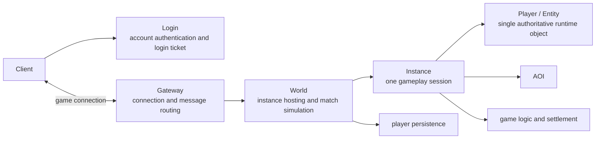

# Architecture Overview

Apollo targets lightweight multiplayer games organized around instances and matches, such as tower defense, co-op, arenas, and dungeons. An instance hosts one gameplay session; one `World` process can host multiple instances. Apollo is not designed around a persistent seamless world or spatially partitioned processes.

## Target model

| Name | Responsibility |
|---|---|
| `Login` | Authenticates accounts and issues credentials to enter the game. |
| `Gateway` | Accepts game connections and routes messages by session. It does not own authoritative match state. |
| `World` | Creates, runs, and destroys instances; executes authoritative game logic in each instance. One process can host multiple instances. |
| `Instance` | The lifecycle and temporary state of one match. It is reclaimed when the match ends. |
| `Player` / `Entity` | A player's runtime object in the current match. Each player has one authoritative object at a time. |

Cross-server play transfers the player's authoritative object. The source `World` pauses authoritative processing, the destination receives the state and confirms ownership, Gateway routing is updated, and the source object is then removed. Transfer data may briefly exist at both ends, but only one process may handle requests, advance state, or commit authoritative writes.

## Update boundary

Gateway provides connections and routing; it does not by itself provide zero-downtime updates. A rolling `World` update can keep the service available by stopping new instance assignments, letting existing instances finish, and then exiting the old process. This does not guarantee uninterrupted TCP connections or preserve active instances across versions. Continuing active instances across an update requires instance-state transfer, route switching, and rollback to be implemented and verified separately.

## Repository status

The diagram describes the target conceptual model, not the current deployment topology. The repository still contains prototype executables such as `login-app`, `gateway-app`, `base-app`, `world-app`, `baseappmgr`, and `machined`. `world-app` now uses the target responsibility name, though the prototype still lacks a complete multi-Instance lifecycle. See [Server Applications](../apps/index.md) for current implementation status. BigWorld/KBEngine terms are retained only as references in [compatibility and engine comparison documentation](/33-BigWorld_Compatibility).

## Temporary instance lifecycle

A group requests an activity → World creates an Instance and temporary Scene → members pass admission and enter → clear enemies and complete objectives → settle → players leave → destroy the Instance, scene, and temporary resources.

Reuse the existing eight-state Instance lifecycle. Scene owns entities, AOI, and ticks; Instance owns gameplay start and completion. The state machine exists, while group-triggered creation, objective settlement, and automatic resource cleanup still need application integration and validation.
