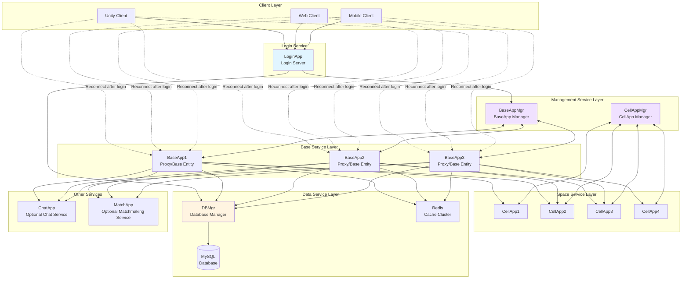
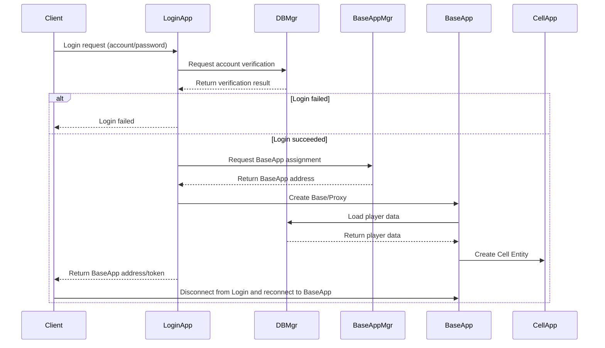
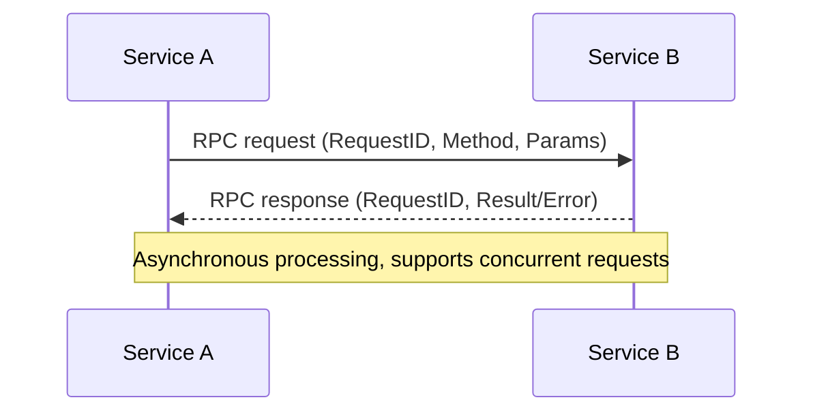

> This is general knowledge or an external-engine reference, not an Apollo architecture or implementation claim. See [Apollo's architecture status](../analysis/architecture-review.md) for target terminology and verified implementation boundaries.

# Q1: Draw an MMORPG server architecture diagram you are familiar with, and explain the responsibilities of each component and how they communicate

## Problem Analysis

This question tests your understanding of the overall MMORPG server architecture. You need to:
1. Draw a complete server architecture diagram
2. Explain the responsibilities of each component
3. Explain how the components communicate with each other

## Reference Architecture: BigWorld/KBEngine Style

> Note: This answer uses the typical BigWorld/KBEngine process model, without mixing in a generic `Gateway` front-end architecture.

### Overall Architecture Diagram



### Login Flow Diagram



---

## Detailed Component Responsibilities

### 1. Client Layer

| Component | Description |
|------|------|
| Unity Client | Mainstream game engine for PC |
| Web Client | H5 mini-games, web games |
| Mobile Client | iOS/Android native or Unity export |

### 2. Access Layer

#### LoginApp + BaseApp/Proxy (main access path)
**Responsibilities**:
- `LoginApp` handles first access, account verification, and assigning the target `BaseApp`
- The `Proxy` in `BaseApp` serves as the player's long-term session anchor
- Handles client message encoding/decoding, session management, and disconnect/reconnect
- Forwards messages that require spatial computation to `CellApp`

**Communication**:
- With clients: usually TCP long connections + custom binary protocol/Protobuf
- With internal services: inter-process TCP + internal messages/RPC

### 3. Login Service

#### LoginApp (Login Server)
**Responsibilities**:
- Account/password verification
- Coordinates with `BaseAppMgr` to assign the target `BaseApp`
- Creates login tickets or connection information
- Returns the address for subsequent access

**Communication**:
- With DBMgr: RPC
- With BaseAppMgr: RPC

### 4. Management Service Layer

#### BaseAppMgr (BaseApp Manager)
**Responsibilities**:
- Manages all BaseApp instances
- Handles new player connection assignment
- BaseApp load balancing
- Tracks BaseApp status

#### CellAppMgr (CellApp Manager)
**Responsibilities**:
- Manages all CellApp instances
- Space partitioning load balancing
- Dynamically adjusts Cell boundaries
- Entity cross-CellApp migration scheduling

### 5. Base Service Layer

#### BaseApp (Base Application)
**Responsibilities**:
- Manages the player's `Base` / `Proxy`
- Handles non-spatial logic:
  - Inventory system
  - Friend system
  - Mail system
  - Quest system
  - Mall transactions
- Serves as the communication anchor for the client
- Forwards space-related requests to `CellApp`
- Responsible for player data loading, saving, and lifecycle management

**Communication**:
- With clients: long connection
- With CellApp: long-connection RPC
- With DBMgr: asynchronous RPC

### 6. Space Service Layer

#### CellApp (Cell Application)
**Responsibilities**:
- Manages space regions (Cells)
- Handles spatial logic:
  - Player movement
  - AOI system
  - Combat system
  - NPC AI
  - Skill casting
  - Scene object management
- Entity position management

**Communication**:
- With BaseApp: long-connection RPC
- With adjacent CellApps: Entity synchronization

### 7. Data Service Layer

#### DBMgr (Database Manager)
**Responsibilities**:
- Database connection pool management
- Asynchronous data access
- Player data persistence
- Account data management

**Database partitioning**:
- **AccountDB**: account information, login records
- **CharacterDB**: character data, attributes, inventory
- **WorldDB**: world data, guilds, rankings

#### Redis (Cache Cluster)
**Responsibilities**:
- Hot data caching (in practice usually accessed by services such as `BaseApp`)
- Real-time leaderboard computation
- Session/state auxiliary storage
- Distributed coordination auxiliary capability

### 8. Other Services

#### ChatApp (Chat Service)
**Responsibilities**:
- Channel chat (world, guild, team)
- Private chat
- System broadcast
- Sensitive word filtering

#### MatchApp (Matchmaking Service)
**Responsibilities**:
- Player matchmaking (PVP, instances)
- Team formation
- Matchmaking algorithms (ELO, rank tiers)

---

## Communication Summary

### Communication Protocol Stack

```
┌─────────────────────────────────────────────────────────────┐
│                      Business Protocol Layer                 │
│   Protobuf message definitions + RPC interface definitions  │
└─────────────────────────────────────────────────────────────┘
                            ↓
┌─────────────────────────────────────────────────────────────┐
│                      Transport Protocol Layer                │
│   Client↔Login/Base: TCP long connection                    │
│   Internal services: TCP long connection                    │
└─────────────────────────────────────────────────────────────┘
                            ↓
┌─────────────────────────────────────────────────────────────┐
│                      Network Layer                           │
│   IP + routing                                               │
└─────────────────────────────────────────────────────────────┘
```

### Message Format

```
┌──────────────┬──────────────┬──────────────┬──────────────┐
│   PacketLen  │   MsgType    │   MsgID      │   Body       │
│   (4 bytes)  │   (2 bytes)  │   (4 bytes)  │   (Protobuf) │
└──────────────┴──────────────┴──────────────┴──────────────┘
```

### RPC Call Flow



---

## Architecture Characteristics Summary

| Characteristic | Description |
|------|------|
| **Layered design** | Client → LoginApp/BaseApp → CellApp/data services, with clear responsibilities |
| **Space separation** | BaseApp handles non-spatial logic, CellApp handles spatial logic |
| **Horizontal scaling** | BaseApp/CellApp can be dynamically added or removed |
| **High availability potential** | Cell/Base can scale horizontally, but LoginApp, Mgr, and DBMgr still need additional HA solutions |
| **Asynchronous communication** | Internal asynchronous RPC improves throughput |

---

## References

- [KBEngine Technical Overview - Software Components](https://imgamer.gitbooks.io/kbengine-overview/content/content/5_2DesignIntroduction.html)
- [BigWorld Cell Architecture Design Introduction](https://blog.csdn.net/monokai/article/details/151142091)
