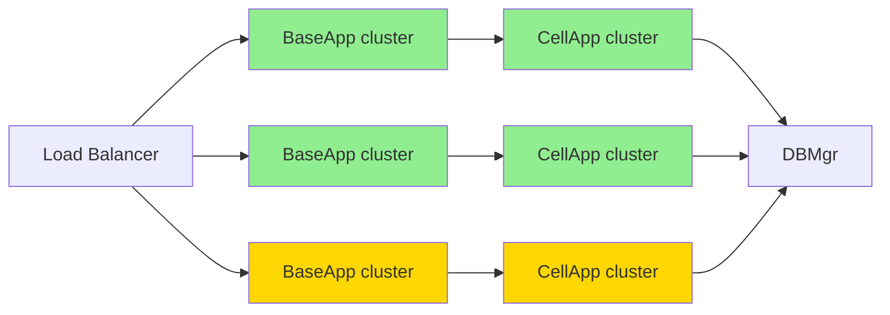

> This is general knowledge or an external-engine reference, not an Apollo architecture or implementation claim. See [Apollo's architecture status](../analysis/architecture-review.md) for target terminology and verified implementation boundaries.

# Q100: How to do server capacity planning?

## Problem Analysis

This question tests the understanding of capacity planning:
- Performance baselines
- Capacity calculation
- Scaling strategies
- KBEngine performance metrics

---

## 1. Overview of Capacity Planning

### 1.1 Planning Dimensions

```
┌─────────────────────────────────────────────────────────────┐
│                    Capacity Planning Dimensions               │
├─────────────────────────────────────────────────────────────┤
│                                                             │
│  Concurrent Users (CCU):                                    │
│  ├── Online player count                                    │
│  ├── Simultaneously active count                            │
│  └── Peak headroom                                          │
│                                                             │
│  Request Handling (QPS):                                    │
│  ├── Requests per second                                    │
│  ├── Message throughput                                     │
│  └── Response Time (RT)                                     │
│                                                             │
│  Data Storage:                                              │
│  ├── Player data volume                                     │
│  ├── Game data volume                                       │
│  └── Log data volume                                       │
│                                                             │
│  Network Bandwidth:                                         │
│  ├── Inbound traffic                                        │
│  ├── Outbound traffic                                       │
│  └── Peak bandwidth                                         │
│                                                             │
│  System Resources:                                          │
│  ├── CPU usage                                              │
│  ├── Memory usage                                           │
│  ├── Disk I/O                                               │
│  └── Network connection count                               │
│                                                             │
└─────────────────────────────────────────────────────────────┘
```

---

## 2. Performance Baseline Testing

### 2.1 KBEngine Performance Metrics

```python
# KBEngine performance baseline

"""
KBEngine performance baseline (reference values):

Hardware: Intel Xeon E5-2680 v4, 32GB RAM, SSD

Single BaseApp:
- Player count: 2000-3000
- CPU usage: 60-80%
- Memory usage: 2-4GB
- Message handling: 5000-8000 msg/s

Single CellApp:
- Entity count: 1000-2000 (depending on complexity)
- CPU usage: 60-80%
- Memory usage: 4-8GB
- Message handling: 3000-5000 msg/s

DBMgr:
- Concurrent writes: 1000-2000/s
- Concurrent reads: 5000-10000/s
- Memory usage: 2-4GB
"""

class PerformanceBenchmark:
    """Performance baseline test"""

    def __init__(self):
        self.metrics = {
            "baseapp": {
                "max_players": 2500,
                "max_cpu": 80,
                "max_memory": 4 * 1024,  # MB
                "max_qps": 5000
            },
            "cellapp": {
                "max_entities": 1500,
                "max_cpu": 80,
                "max_memory": 8 * 1024,
                "max_qps": 3000
            },
            "dbmgr": {
                "max_writes": 1500,
                "max_reads": 8000,
                "max_memory": 4 * 1024
            },
            "loginapp": {
                "max_logins_per_sec": 200,
                "max_concurrent": 500
            }
        }

    def calculate_capacity(self, target_ccu):
        """Calculate the required capacity"""
        # BaseApp capacity
        baseapp_count = max(1, (target_ccu + self.metrics["baseapp"]["max_players"] - 1) //
                           self.metrics["baseapp"]["max_players"])

        # CellApp capacity (assuming 70% of players have entities in CellApp)
        active_players = int(target_ccu * 0.7)
        cellapp_count = max(1, (active_players + self.metrics["cellapp"]["max_entities"] - 1) //
                              self.metrics["cellapp"]["max_entities"])

        # DBMgr is usually a single instance
        dbmgr_count = 1

        # LoginApp capacity
        # Assuming peak logins are 10% of CCU
        peak_logins = int(target_ccu * 0.1)
        loginapp_count = max(1, (peak_logins + self.metrics["loginapp"]["max_logins_per_sec"] - 1) //
                               self.metrics["loginapp"]["max_logins_per_sec"])

        return {
            "baseapp": baseapp_count,
            "cellapp": cellapp_count,
            "dbmgr": dbmgr_count,
            "loginapp": loginapp_count,
            "total_servers": baseapp_count + cellapp_count + dbmgr_count + loginapp_count
        }

    def estimate_hardware(self, target_ccu):
        """Estimate hardware requirements"""
        capacity = self.calculate_capacity(target_ccu)

        # Estimate machine count
        # Assuming each machine can run: 2 BaseApp + 3 CellApp
        baseapp_per_machine = 2
        cellapp_per_machine = 3

        game_machines = max(
            (capacity["baseapp"] + baseapp_per_machine - 1) // baseapp_per_machine,
            (capacity["cellapp"] + cellapp_per_machine - 1) // cellapp_per_machine
        )

        return {
            "game_servers": game_machines,
            "db_server": 1,
            "login_server": 1,
            "total_machines": game_machines + 2,
            "capacity": capacity
        }
```

---

## 3. Capacity Calculation Model

### 3.1 Resource Calculation

```python
# Capacity calculation model

class CapacityCalculator:
    """Capacity calculator"""

    # Resource coefficients
    CPU_COEFFICIENT = 1.2  # 20% headroom
    MEMORY_COEFFICIENT = 1.3  # 30% headroom
    NETWORK_COEFFICIENT = 1.5  # 50% headroom
    PEAK_RATIO = 1.5  # Peak-to-average ratio

    @staticmethod
    def calculate_cpu_usage(ccu, player_actions_per_minute=60):
        """Calculate CPU usage"""
        # Actions per minute per player
        actions_per_second = (ccu * player_actions_per_minute) / 60

        # CPU time per action (milliseconds)
        cpu_time_per_action = 0.5  # 0.5ms

        # Required CPU cores
        cpu_cores = (actions_per_second * cpu_time_per_action) / 1000
        cpu_cores *= CapacityCalculator.CPU_COEFFICIENT

        return cpu_cores

    @staticmethod
    def calculate_memory_usage(ccu):
        """Calculate memory usage"""
        # Memory per player (MB)
        memory_per_player = 1.5

        # Total memory
        total_memory = ccu * memory_per_player
        total_memory *= CapacityCalculator.MEMORY_COEFFICIENT

        return total_memory  # MB

    @staticmethod
    def calculate_network_bandwidth(ccu):
        """Calculate network bandwidth"""
        # Bandwidth per player (Kbps)
        bandwidth_per_player = 5  # 5 Kbps

        # Total bandwidth
        total_bandwidth = ccu * bandwidth_per_player
        total_bandwidth *= CapacityCalculator.NETWORK_COEFFICIENT

        return total_bandwidth / 1024  # Mbps

    @staticmethod
    def calculate_db_capacity(ccu, retention_days=30):
        """Calculate database capacity"""
        # Data size per player (KB)
        data_per_player = 50  # 50 KB

        # New players per day
        new_players_per_day = int(ccu * 0.1)

        # Daily data growth
        daily_growth = new_players_per_day * data_per_player

        # Total data within retention period
        total_data = daily_growth * retention_days

        # Index overhead
        total_data *= 1.5

        return total_data / 1024 / 1024  # GB

    @staticmethod
    def calculate_redis_memory(ccu):
        """Calculate Redis memory"""
        # Cached data per player (KB)
        cache_per_player = 10  # 10 KB

        # Online player cache
        online_cache = ccu * cache_per_player

        # Total cache (including some offline player data)
        total_cache = online_cache * 2

        return total_cache / 1024  # MB

# Capacity planning calculator
def plan_capacity(target_ccu, growth_rate=0.2):
    """Capacity planning"""
    calculator = CapacityCalculator()

    # Current requirements
    current = {
        "cpu_cores": calculator.calculate_cpu_usage(target_ccu),
        "memory_mb": calculator.calculate_memory_usage(target_ccu),
        "bandwidth_mbps": calculator.calculate_network_bandwidth(target_ccu),
        "db_gb": calculator.calculate_db_capacity(target_ccu),
        "redis_mb": calculator.calculate_redis_memory(target_ccu)
    }

    # Factor in growth
    future_ccu = int(target_ccu * (1 + growth_rate))
    future = {
        "cpu_cores": calculator.calculate_cpu_usage(future_ccu),
        "memory_mb": calculator.calculate_memory_usage(future_ccu),
        "bandwidth_mbps": calculator.calculate_network_bandwidth(future_ccu),
        "db_gb": calculator.calculate_db_capacity(future_ccu),
        "redis_mb": calculator.calculate_redis_memory(future_ccu)
    }

    return {
        "target_ccu": target_ccu,
        "current": current,
        "future_ccu": future_ccu,
        "future": future
    }
```

---

## 4. Scaling Strategies

### 4.1 Horizontal Scaling



```python
# Scaling strategy

class ScalingStrategy:
    """Scaling strategy"""

    @staticmethod
    def get_scaling_policy(current_ccu, max_ccu):
        """Get the scaling policy"""
        usage_ratio = current_ccu / max_ccu

        if usage_ratio > 0.9:
            return "critical_scale"  # Emergency scale out
        elif usage_ratio > 0.75:
            return "scale_out"  # Scale out
        elif usage_ratio < 0.3:
            return "scale_in"  # Scale in
        else:
            return "maintain"  # Maintain

    @staticmethod
    def calculate_scale_out(current, max_ccu):
        """Calculate how much to scale out"""
        target_ratio = 0.7  # Target usage ratio 70%

        # Calculate the number of instances needed
        target_instances = int(current / target_ratio)
        current_instances = int(current / max_ccu)

        return max(0, target_instances - current_instances)

class AutoScaler:
    """Auto scaler"""

    def __init__(self):
        self.check_interval = 60  # seconds
        self.scale_out_threshold = 0.75
        self.scale_in_threshold = 0.3
        self.max_instances = 20
        self.min_instances = 2

    def start(self):
        """Start auto scaling"""
        KBEngine.addTimer(self.check_interval, 0, self.check_and_scale)

    def check_and_scale(self):
        """Check and scale"""
        # Get the current load
        baseapp_load = self.get_baseapp_load()

        for instance_id, load in baseapp_load.items():
            if load > self.scale_out_threshold:
                self.scale_out()
                break
            elif load < self.scale_in_threshold:
                self.scale_in()
                break

    def get_baseapp_load(self):
        """Get BaseApp load"""
        loads = {}
        baseapps = KBEngine.getWatcher().get("components/baseapp")

        for baseapp_id, data in baseapps.items():
            max_players = data.get("maxPlayers", 2500)
            current_players = data.get("playerCount", 0)
            loads[baseapp_id] = current_players / max_players

        return loads

    def scale_out(self):
        """Scale out"""
        # Check whether scale out is possible
        baseapp_count = len(KBEngine.getWatcher().get("components/baseapp"))
        if baseapp_count >= self.max_instances:
            WARNING_MSG("Max instances reached, cannot scale out")
            return

        INFO_MSG("Scaling out: starting new BaseApp")
        # Invoke the startup script
        # os.system("./start_baseapp.sh")

    def scale_in(self):
        """Scale in"""
        # Check whether scale in is possible
        baseapp_count = len(KBEngine.getWatcher().get("components/baseapp"))
        if baseapp_count <= self.min_instances:
            return

        INFO_MSG("Scaling in: stopping idle BaseApp")
        # Select the lowest-load instance to stop
        # os.system("./stop_baseapp.sh <id>")
```

---

## 5. Capacity Monitoring

### 5.1 Real-Time Monitoring

```python
# Capacity monitoring

class CapacityMonitor:
    """Capacity monitoring"""

    def __init__(self):
        self.metrics_history = []
        self.max_history = 1440  # 24 hours (one entry per minute)

    def collect_metrics(self):
        """Collect metrics"""
        metrics = {
            "timestamp": time.time(),
            "ccu": self.get_ccu(),
            "cpu": self.get_cpu_usage(),
            "memory": self.get_memory_usage(),
            "network": self.get_network_usage(),
            "db_connections": self.get_db_connections()
        }

        self.metrics_history.append(metrics)

        # Limit history length
        if len(self.metrics_history) > self.max_history:
            self.metrics_history.pop(0)

        return metrics

    def get_ccu(self):
        """Get the online player count"""
        return len([e for e in KBEngine.entities.values()
                   if hasattr(e, 'playerName')])

    def get_cpu_usage(self):
        """Get CPU usage"""
        # Obtained from KBEngine Watcher
        return KBEngine.getWatcher().get("stats/cpuUsage")

    def get_memory_usage(self):
        """Get memory usage"""
        return KBEngine.getWatcher().get("mem/allocated")

    def get_network_usage(self):
        """Get network usage"""
        stats = KBEngine.getWatcher().get("network/*")
        return {
            "in": stats.get("messageIn", 0),
            "out": stats.get("messageOut", 0)
        }

    def get_db_connections(self):
        """Get database connection count"""
        return KBEngine.getWatcher().get("db/connections")

    def predict_capacity(self, hours=24):
        """Predict capacity requirements"""
        if len(self.metrics_history) < 24:
            return None

        # Get the last 24 hours of data
        recent = self.metrics_history[-24 * 60:]  # One entry per minute

        # Calculate the growth rate
        ccu_values = [m["ccu"] for m in recent]
        growth_rate = (ccu_values[-1] - ccu_values[0]) / ccu_values[0] if ccu_values[0] > 0 else 0

        # Predict
        current_ccu = ccu_values[-1]
        predicted_ccu = int(current_ccu * (1 + growth_rate * hours / 24))

        return {
            "current_ccu": current_ccu,
            "growth_rate": growth_rate,
            "predicted_ccu": predicted_ccu,
            "hours_ahead": hours
        }
```

---

## 6. Capacity Planning Table

### 6.1 Configurations by Scale

| CCU | BaseApp | CellApp | LoginApp | DBMgr | Machine Config | Network Bandwidth |
|-----|---------|---------|----------|-------|----------|----------|
| 500 | 1 | 1 | 1 | 1 | 1x 8C/16G | 50 Mbps |
| 1000 | 1 | 1 | 1 | 1 | 1x 8C/32G | 100 Mbps |
| 3000 | 2 | 2 | 1 | 1 | 2x 8C/32G | 200 Mbps |
| 5000 | 2 | 3 | 1 | 1 | 2x 16C/64G | 300 Mbps |
| 10000 | 4 | 5 | 2 | 1 | 4x 16C/64G | 500 Mbps |
| 30000 | 12 | 15 | 3 | 2 | 12x 16C/64G | 1 Gbps |
| 50000 | 20 | 25 | 5 | 3 | 20x 16C/64G | 2 Gbps |

---

## 7. Best Practices

### 7.1 Capacity Planning Advice

| Practice | Description |
|------|------|
| **Baseline testing** | Establish a performance baseline |
| **Headroom** | Reserve 20-30% for CPU/Memory |
| **Elastic scaling** | Support dynamically adding and removing instances |
| **Monitoring and prediction** | Predict based on historical data |
| **Stress testing** | Do stress tests regularly |
| **Staged scaling** | Avoid over-provisioning |

---

## 8. Summary

### The Core of Capacity Planning

```
Capacity planning = performance baseline + resource calculation + scaling strategy + monitoring and prediction
- Establish a performance baseline
- Calculate CPU/memory/network requirements
- Horizontal scaling strategy
- Real-time monitoring and prediction
```

---

## References

- [KBEngine Performance](https://kbengine.github.io/docs/en/performance.html)
- [Capacity Planning Fundamentals](https://www.amazon.com/Capacity-Planning-Fundamentals-Amazon-Web-Services-ebook/dp/B07JHFM2ZV)
- [Game Server Scaling](https://www.gamasutra.com/blogs/MichaelKerr/20190813/349290/Scaling_Multiplayer_Games.php)
