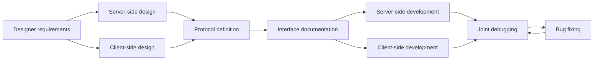

> This is general knowledge or an external-engine reference, not an Apollo architecture or implementation claim. See [Apollo's architecture status](../analysis/architecture-review.md) for target terminology and verified implementation boundaries.

# Q111: How to collaborate with client-side developers?

## Problem Analysis

This question tests cross-team collaboration ability:
- Interface design
- Protocol definition
- Joint debugging process
- Problem troubleshooting

---

## 1. Collaboration Model

### 1.1 Collaboration Flow



---

## 2. Protocol Design

### 2.1 Protobuf Definition

```protobuf
// Game protocol definition

// Base definitions
syntax = "proto3";

package game;

// ========== Common messages ==========

message Empty {}

// Error message
message Error {
    int32 code = 1;
    string message = 2;
}

// Position message
message Vector3 {
    float x = 1;
    float y = 2;
    float z = 3;
}

// ========== Login protocol ==========

// Login request
message LoginRequest {
    string account = 1;
    string password = 2;
    string device_id = 3;
    string client_version = 4;
}

// Login response
message LoginResponse {
    int32 code = 1;
    string message = 2;
    string token = 3;
    repeated ServerInfo servers = 4;
}

message ServerInfo {
    int32 server_id = 1;
    string server_name = 2;
    string address = 3;
    int32 port = 4;
    int32 load = 5;
    bool is_recommend = 6;
}

// ========== Character protocol ==========

// Create character request
message CreateCharacterRequest {
    string name = 1;
    int32 class_id = 2;
    int32 gender = 3;
}

// Character info
message CharacterInfo {
    int64 character_id = 1;
    string name = 2;
    int32 level = 3;
    int32 class_id = 4;
    int32 exp = 5;
    Vector3 position = 6;
    int64 gold = 7;
}

// Create character response
message CreateCharacterResponse {
    int32 code = 1;
    string message = 2;
    CharacterInfo character = 3;
}

// ========== Game messages ==========

// Position sync
message PositionSync {
    int64 entity_id = 1;
    Vector3 position = 2;
    float yaw = 3;
    uint32 timestamp = 4;
}

// Cast skill request
message CastSkillRequest {
    int32 skill_id = 1;
    int64 target_id = 2;
    Vector3 target_position = 3;
}

// Cast skill notification
message CastSkillNotify {
    int64 caster_id = 1;
    int32 skill_id = 2;
    int64 target_id = 3;
    Vector3 position = 4;
    uint32 timestamp = 5;
}

// Damage notification
message DamageNotify {
    int64 target_id = 1;
    int64 attacker_id = 2;
    int32 damage = 3;
    int32 current_hp = 4;
    bool is_critical = 5;
}

// ========== Chat protocol ==========

// Chat request
message ChatRequest {
    int32 channel = 1;  // 1:World 2:Guild 3:Whisper
    string content = 2;
    int64 target_id = 3;  // Used for whisper
}

// Chat message
message ChatMessage {
    int64 sender_id = 1;
    string sender_name = 2;
    int32 channel = 3;
    string content = 4;
    uint32 timestamp = 5;
}

// Server message definition
message ServerMessage {
    uint32 msg_id = 1;
    uint64 sequence = 2;
    oneof body {
        LoginResponse login_response = 10;
        CreateCharacterResponse create_character_response = 11;
        CharacterInfo character_info = 12;
        PositionSync position_sync = 20;
        CastSkillNotify cast_skill_notify = 21;
        DamageNotify damage_notify = 22;
        ChatMessage chat_message = 30;
        Error error = 100;
    }
}
```

### 2.2 Interface Documentation

```markdown
# Interface Documentation Template

## Message: Login

### Request (Client -> Server)
```protobuf
LoginRequest {
    string account;      // Account
    string password;     // Password (MD5)
    string device_id;    // Device ID
    string client_version; // Client version
}
```

### Response (Server -> Client)
```protobuf
LoginResponse {
    int32 code;         // 0:Success, others:Failure
    string message;     // Prompt message
    string token;       // Login token
    repeated ServerInfo servers; // Optional server list
}
```

### Error Codes
| Code | Description |
|------|------|
| 0 | Success |
| 1001 | Account does not exist |
| 1002 | Wrong password |
| 1003 | Account banned |
| 1004 | Version mismatch |
| 1005 | Server full |

### Notes
1. Password must be MD5-encrypted before transmission
2. Token is valid for 24 hours
3. Client should cache the most recently logged-in server
```

---

## 3. Joint Debugging Tools

### 3.1 Testing Tools

```python
# Joint debugging test tool

import socket
import struct
import json
import time

class GameClientTester:
    """Game client tester"""

    def __init__(self, host, port):
        self.host = host
        self.port = port
        self.socket = None
        self.sequence = 0

    def connect(self):
        """Connect to server"""
        self.socket = socket.socket(socket.AF_INET, socket.SOCK_STREAM)
        self.socket.connect((self.host, self.port))
        print(f"Connected to {self.host}:{self.port}")

    def disconnect(self):
        """Disconnect"""
        if self.socket:
            self.socket.close()

    def send_message(self, msg_id, body):
        """Send a message"""
        self.sequence += 1

        # Serialize the message body
        if isinstance(body, str):
            body_bytes = body.encode('utf-8')
        else:
            body_bytes = json.dumps(body).encode('utf-8')

        # Construct the message header
        header = struct.pack('>IHH',
            len(body_bytes),  # Message length
            msg_id,           # Message ID
            self.sequence     # Sequence number
        )

        # Send
        self.socket.sendall(header + body_bytes)
        print(f"Sent: msg_id={msg_id}, seq={self.sequence}")

    def receive_message(self, timeout=5):
        """Receive a message"""
        self.socket.settimeout(timeout)

        try:
            # Receive the message header (8 bytes)
            header = self._recv_all(8)
            if not header:
                return None

            length, msg_id, sequence = struct.unpack('>IHH', header)

            # Receive the message body
            body = self._recv_all(length)
            if body:
                body_data = json.loads(body.decode('utf-8'))
                print(f"Recv: msg_id={msg_id}, seq={sequence}")
                return {'msg_id': msg_id, 'sequence': sequence, 'body': body_data}

        except socket.timeout:
            print("Receive timeout")
            return None

    def _recv_all(self, size):
        """Receive a specified amount of data"""
        data = b''
        while len(data) < size:
            packet = self.socket.recv(size - len(data))
            if not packet:
                return None
            data += packet
        return data

# Usage example
def test_login():
    """Test login"""
    client = GameClientTester('localhost', 9999)
    client.connect()

    # Send a login request
    login_request = {
        'account': 'test_user',
        'password': 'md5_hash_here',
        'device_id': 'test_device',
        'client_version': '1.0.0'
    }
    client.send_message(1001, login_request)

    # Receive the response
    response = client.receive_message()
    if response:
        print(f"Response: {response['body']}")

    client.disconnect()

if __name__ == '__main__':
    test_login()
```

---

## 4. Problem Troubleshooting

### 4.1 Common Problems

```python
# Common joint debugging problems

class CollaborationIssues:
    """Collaboration issues"""

    issues = {
        'Protocol_Mismatch': {
            '现象': 'Message parsing failed',
            '原因': [
                'Protobuf version mismatch',
                'Different field definitions',
                'Endianness issue'
            ],
            '解决': [
                'Unify the Protobuf definition file',
                'Version number verification',
                'Add logging to print raw data'
            ]
        },

        'State_Inconsistency': {
            '现象': 'Client display inconsistent with server',
            '原因': [
                'Client prediction error',
                'Server validation failure',
                'Caused by network latency'
            ],
            '解决': [
                'Add server-side correction',
                'Client displays server state',
                'Add deviation logging'
            ]
        },

        'Timing_Issues': {
            '现象': 'Operation order is wrong',
            '原因': [
                'Async processing timing',
                'Message out of order',
                'Concurrency race'
            ],
            '解决': [
                "Add sequence numbers",
                'Request-response matching',
                'State machine checks'
            ]
        },

        'Performance_Issues': {
            '现象': 'Stuttering / frame drops',
            '原因': [
                'Too many messages',
                'Untimely processing',
                'Main thread blocked'
            ],
            '解决': [
                'Message merging',
                'Async processing',
                'Profiling to locate the issue'
            ]
        }
    }
```

---

## 5. Best Practices

### 5.1 Collaboration Advice

| Practice | Description |
|------|------|
| **Protocol first** | Define the protocol before development |
| **Documentation sync** | Auto-generate documentation |
| **Version compatibility** | Support multi-version protocols |
| **Joint debugging environment** | A dedicated test environment |
| **Logging standards** | Unified log format |
| **Regular sync** | Weekly meetings to sync progress |

---

## 6. Summary

### The Core of Collaboration

```
Client collaboration = unified protocol + complete documentation + joint debugging tools + fast problem response
- Unified Protobuf definition
- Auto-generate documentation and code
- Test tools to assist development
- Timely communication to solve problems
```

---

## References

- [Protocol Buffers Guide](https://developers.google.com/protocol-buffers)
- [Game Client-Server Communication](https://www.gabrielgambetta.com/client-server-game-architecture/)
