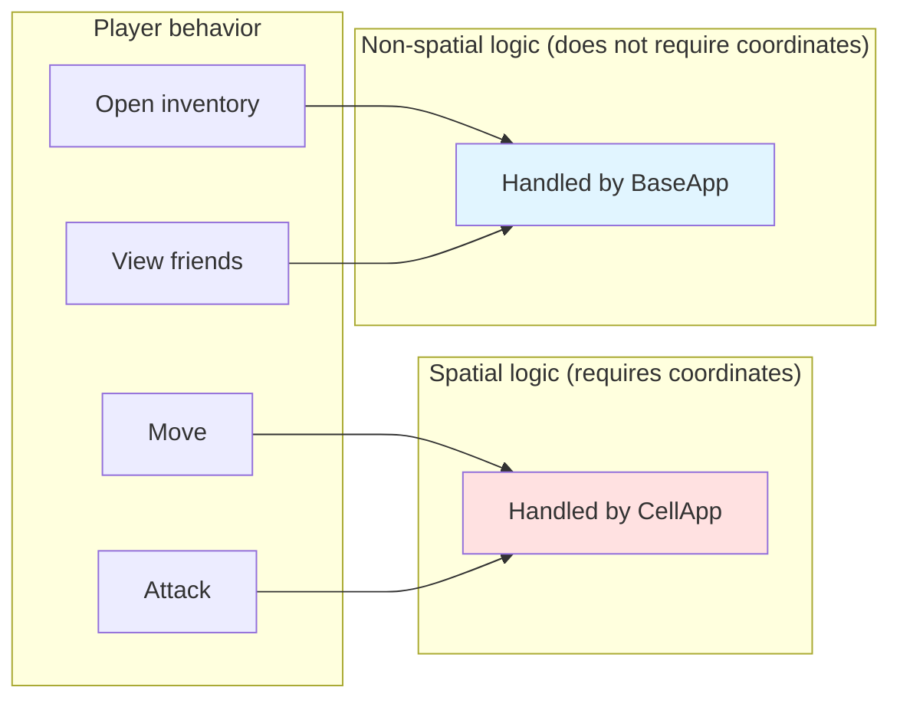
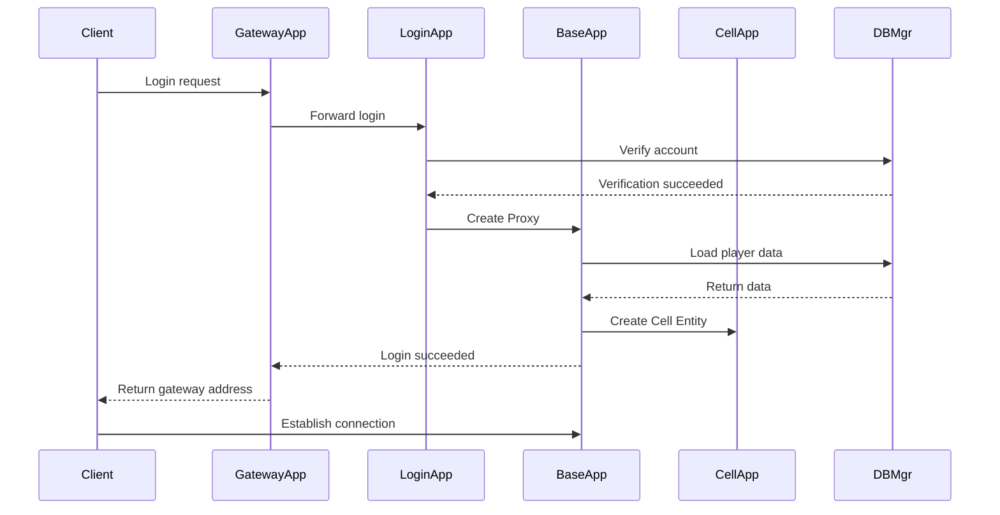
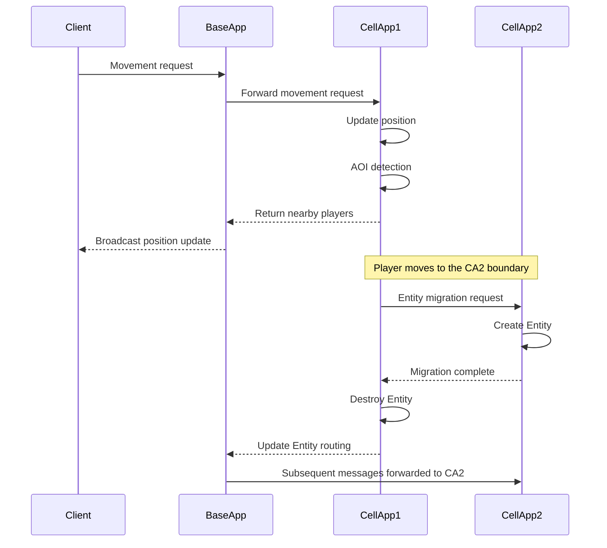
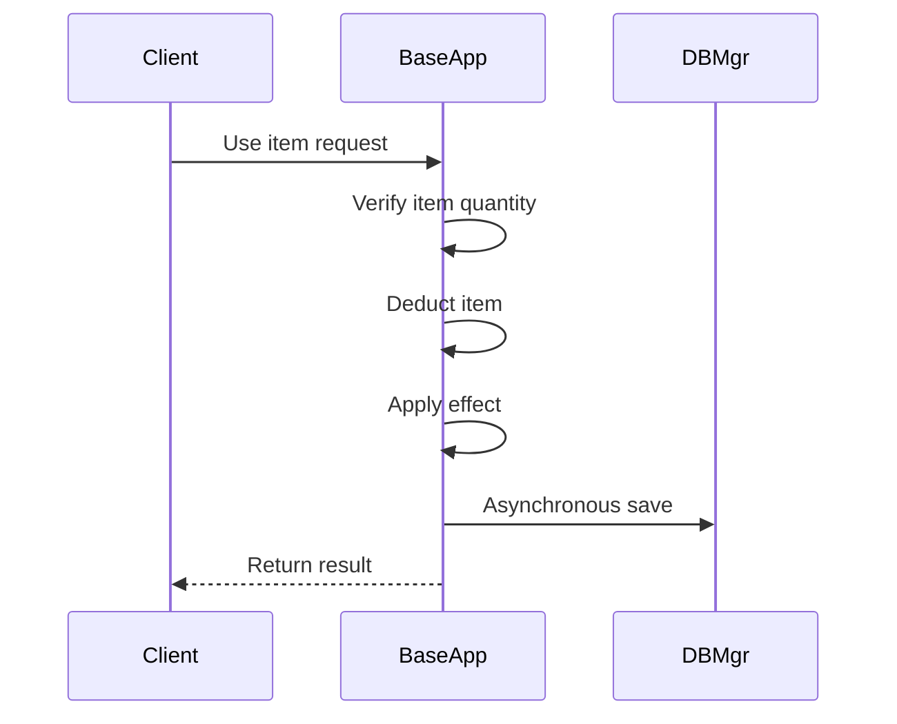

> This is general knowledge or an external-engine reference, not an Apollo architecture or implementation claim. See [Apollo's architecture status](../analysis/architecture-review.md) for target terminology and verified implementation boundaries.

# Q2: What Are CellApp and BaseApp Each Responsible for in the BigWorld Architecture? Why Separate Them?

## Problem Analysis

This question tests your understanding of the **spatial separation design** in the BigWorld/KBEngine architecture:
- The division of responsibilities between CellApp and BaseApp
- Why separate them this way
- The advantages and challenges of this design

---

## CellApp vs BaseApp Comparison

### Responsibility Comparison Table

| Dimension | BaseApp | CellApp |
|-----------|---------|---------|
| **Core responsibility** | Manages non-spatial Entities | Manages spatial Entities |
| **Has coordinates** | No | Yes (x, y, z) |
| **Entity characteristics** | Fixed and immutable | Migrates (across CellApps) |
| **Client anchor** | Proxy serves as the communication anchor | Does not interface with clients directly |
| **Typical functions** | Inventory, friends, quests, mail | Combat, movement, AOI, AI |
| **Count** | Multiple (load balancing) | Multiple (spatial partitioning) |
| **Scaling method** | Add instances to share players | Add instances to share space |

### Detailed Responsibilities

#### BaseApp Responsibilities

```
┌─────────────────────────────────────────────────────────────┐
│                        BaseApp                               │
├─────────────────────────────────────────────────────────────┤
│  1. Player Proxy management                                 │
│     - Each Proxy corresponds to one client                  │
│     - Serves as the communication anchor for the client     │
│     - Responsible for message redirection                   │
├─────────────────────────────────────────────────────────────┤
│  2. Non-spatial logic                                       │
│     ├── Inventory system (items, equipment)                 │
│     ├── Friend system (friend list, relationships)          │
│     ├── Mail system (sending/receiving mail, attachments)   │
│     ├── Quest system (quest state, progress)                │
│     ├── Mall system (buying, selling)                       │
│     ├── Leaderboard system                                  │
│     └── Guild system (basic management)                     │
├─────────────────────────────────────────────────────────────┤
│  3. Data persistence coordination                           │
│     - Periodically save player data to DBMgr                │
│     - Dirty data detection and synchronization              │
├─────────────────────────────────────────────────────────────┤
│  4. Message routing                                         │
│     - Forward client messages to the correct CellApp        │
│     - Receive CellApp messages and forward to clients       │
└─────────────────────────────────────────────────────────────┘
```

#### CellApp Responsibilities

```
┌─────────────────────────────────────────────────────────────┐
│                        CellApp                               │
├─────────────────────────────────────────────────────────────┤
│  1. Spatial region management                               │
│     - Manages Cells (spatial regions)                       │
│     - Maintains Entity position information                 │
│     - Handles Cell boundaries                               │
├─────────────────────────────────────────────────────────────┤
│  2. AOI system                                              │
│     - 3×3 grid / cross-linked list                          │
│     - View management                                       │
│     - Enter/leave events                                    │
├─────────────────────────────────────────────────────────────┤
│  3. Spatial logic                                           │
│     ├── Player movement                                     │
│     ├── Combat system (skills, damage)                       │
│     ├── NPC AI behavior                                     │
│     ├── Pathfinding system                                  │
│     ├── Scene object management                             │
│     └── State synchronization (position, animation)          │
├─────────────────────────────────────────────────────────────┤
│  4. Entity migration                                        │
│     - Cross-CellApp migration                               │
│     - Cross-Cell boundary handling                          │
├─────────────────────────────────────────────────────────────┤
│  5. Ghost synchronization                                   │
│     - Read-only copies of Entities across boundaries        │
│     - Ensures interaction consistency                       │
└─────────────────────────────────────────────────────────────┘
```

---

## Why Separate Them This Way?

### Reason 1: The Essential Difference Between Spatial and Non-Spatial Logic



| Feature | Spatial logic | Non-spatial logic |
|---------|---------------|-------------------|
| **Depends on coordinates** | Yes | No |
| **Compute intensive** | Yes (AOI, collision, pathfinding) | No |
| **Entity migration** | Frequent | Almost none |
| **Communication pattern** | Area broadcast | Point-to-point |

### Reason 2: Supports Dynamic Load Balancing

```
Spatial scenarios:
┌─────────────────────────────────────────────────────────────┐
│                      Game world map                          │
│                                                              │
│  ┌────────────┐  ┌────────────┐  ┌────────────┐            │
│  │ CellApp 1  │  │ CellApp 2  │  │ CellApp 3  │            │
│  │ Load 30%   │  │ Load 85%   │  │ Load 20%   │            │
│  │ Newbie     │  │ Main city  │  │ Wilderness │            │
│  │ village    │  │            │  │            │            │
│  └────────────┘  └────────────┘  └────────────┘            │
│                                                              │
│  CellApp 2 overloaded → dynamic split → add CellApp 4       │
└─────────────────────────────────────────────────────────────┘

Non-spatial logic:
┌─────────────────────────────────────────────────────────────┐
│                      BaseApp cluster                         │
│                                                              │
│  ┌──────────┐  ┌──────────┐  ┌──────────┐  ┌──────────┐   │
│  │BaseApp 1 │  │BaseApp 2 │  │BaseApp 3 │  │BaseApp 4 │   │
│  │ 1000     │  │ 1000     │  │ 1000     │  │ 1000     │   │
│  │ players  │  │ players  │  │ players  │  │ players  │   │
│  └──────────┘  └──────────┘  └──────────┘  └──────────┘   │
│                                                              │
│  Player A logs in → BaseAppMgr assigns → least-loaded       │
│  BaseApp                                                     │
└─────────────────────────────────────────────────────────────┘
```

### Reason 3: The Complexity of Entity Migration

**The dual nature of the player Entity**:
```
┌─────────────────────────────────────────────────────────────┐
│                        Player Entity                         │
├─────────────────────────────┬───────────────────────────────┤
│      Base Entity (Proxy)    │      Cell Entity              │
│      (on BaseApp)           │      (on CellApp)             │
├─────────────────────────────┼───────────────────────────────┤
│ - Fixed and immutable       │ - Migrates (across CellApps)  │
│ - No coordinates            │ - Has coordinates (x, y, z)   │
│ - Client's communication    │ - Spatial logic               │
│   anchor                    │                               │
│ - Inventory, friends, mail,  │ - Combat, movement, AOI, etc. │
│   etc.                      │                               │
└─────────────────────────────┴───────────────────────────────┘
```

**Only the Cell Entity needs to migrate during migration**:
```
Player moves from CellApp1 to CellApp2:

┌─────────────┐                    ┌─────────────┐
│  BaseApp    │                    │  BaseApp    │
│  (unchanged)│                    │  (unchanged)│
│  ┌──────┐   │                    │  ┌──────┐   │
│  │Proxy │◄──┼────────────────────┼──┤Proxy │   │
│  └──────┘   │  Communication     │  └──────┘   │
└─────────────┘  anchor never      └─────────────┘
                  changes
       ▲                                   ▲
       │ Message redirection               │ Message redirection
       │                                   │
┌───────┴────────┐              ┌─────────┴────────┐
│   CellApp 1    │              │   CellApp 2     │
│  Cell Entity   │ ───────────► │   Cell Entity   │
│  (old position)│  migration   │   (new position)│
└────────────────┘              └─────────────────┘
```

### Reason 4: Network Communication Optimization

```
Client communication pattern:

┌─────────┐                              ┌─────────┐
│ Client  │ ──────────────────────────►│ BaseApp │
│         │   All messages go here      │  Proxy  │
└─────────┘                              └────────┘
                                              │
                    ┌─────────────────────────┼─────────────────────────┐
                    │                         │                         │
                    ▼                         ▼                         ▼
            ┌───────────┐             ┌───────────┐             ┌───────────┐
            │ CellApp 1 │             │ CellApp 2 │             │ CellApp 3 │
            │ (nearby   │             │ (empty    │             │ (nearby   │
            │ players)  │             │ area)     │             │ players)  │
            └───────────┘             └───────────┘             └───────────┘

Advantages:
1. The client only needs to know one address (BaseApp/Proxy)
2. The Proxy handles message routing; the client does not need to care which CellApp the Entity is on
3. Entity migration is transparent to the client
```

---

## Advantages and Challenges

### Advantages

| Advantage | Description |
|-----------|-------------|
| **Independent scaling** | CellApp scales by space, BaseApp scales by player count |
| **Fault isolation** | One CellApp failure only affects a local area |
| **Flexible deployment** | Component counts can be dynamically adjusted based on load |
| **Transparent migration** | Entity migration is transparent to the client |
| **Clear responsibilities** | Spatial and non-spatial logic are separated, with clear code organization |

### Challenges

| Challenge | Description |
|-----------|-------------|
| **Increased complexity** | Need to manage two sets of Entities and their relationships |
| **Cross-component communication** | BaseApp ↔ CellApp communication overhead |
| **Data consistency** | Base/Cell data synchronization issues |
| **Difficult debugging** | Problems may span multiple components |
| **Ghost mechanism** | Cross-boundary Entities need extra synchronization |

---

## Data Flow Examples

### Player Login Flow



### Player Movement Flow



### Using the Inventory Flow



---

## References

- [KBEngine Technical Overview - Software Components](https://imgamer.gitbooks.io/kbengine-overview/content/content/5_2DesignIntroduction.html)
- [BigWorld Cell Architecture Design Introduction](https://blog.csdn.net/monokai/article/details/151142091)
- [BigWorld Server Architecture: Framework and Implementation](https://developer.baidu.com/article/details/3089473)
