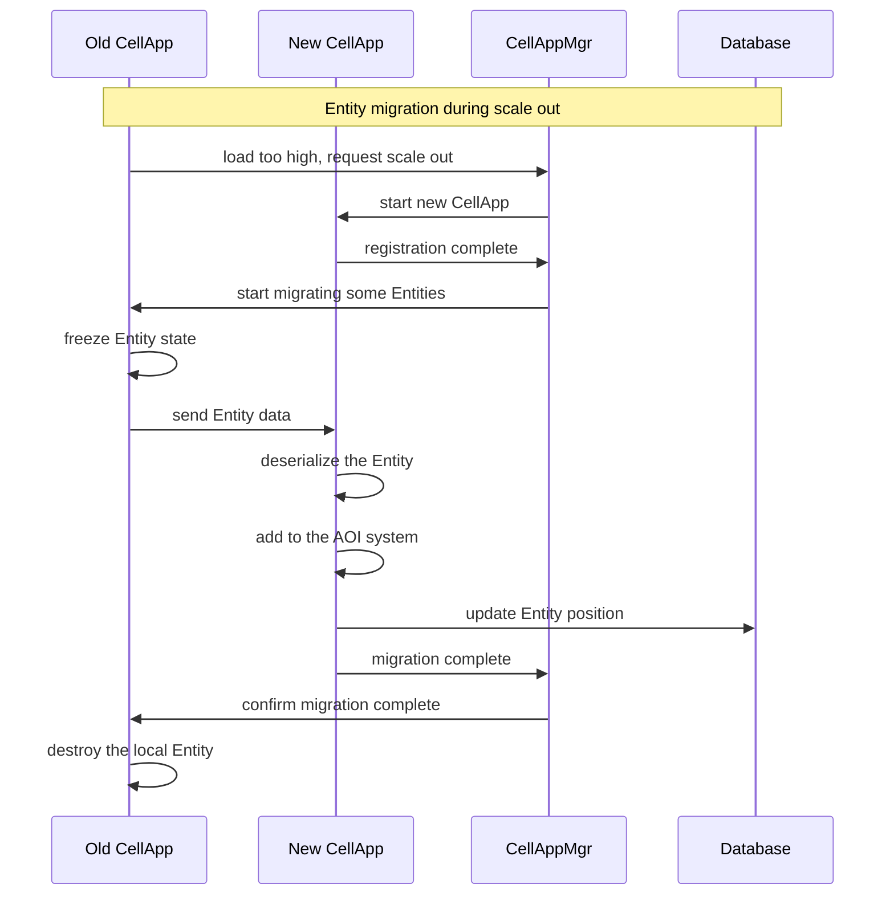

> This is general knowledge or an external-engine reference, not an Apollo architecture or implementation claim. See [Apollo's architecture status](../analysis/architecture-review.md) for target terminology and verified implementation boundaries.

# Q5: How should the server be designed to support dynamic scaling?

## Problem Analysis

This question tests the design of server-side **dynamic scaling**:
- How to architect so that horizontal scaling is supported
- Load balancing strategies
- The concrete implementation and source-code evidence in KBEngine/BigWorld

---

## 1. Core Concepts of Dynamic Scaling

### What is dynamic scaling

```
Static scaling vs dynamic scaling:

┌─────────────────────────────────────────────────────────────┐
│  Static scaling (traditional approach)                      │
│                                                             │
│  Server A (fixed) ── load reaches limit ── stop for         │
│  maintenance ───→ add Server B ── restart service ──        │
│  resume                                                      │
│                                                             │
│  Problems:                                                  │
│  - Requires stopping the server for maintenance             │
│  - Scaling is inflexible                                    │
│  - Wasted resources (at low-peak times)                     │
│                                                             │
└─────────────────────────────────────────────────────────────┘

┌─────────────────────────────────────────────────────────────┐
│  Dynamic scaling (modern approach)                          │
│                                                             │
│  Server A + B + C (pooled)                                  │
│       │                                                      │
│       │  load rises ──→ automatically add Server D           │
│       │  load falls ──→ automatically remove Server D       │
│       │                                                      │
│  Advantages:                                                │
│  - No server stop needed                                    │
│  - Scale out / in on demand                                 │
│  - Cost optimization                                        │
│                                                             │
└─────────────────────────────────────────────────────────────┘
```

### Two types of scaling

| Type | Description | Implementation Difficulty |
|------|------|----------|
| **Vertical scaling (Scale Up)** | Increase single-machine configuration (CPU/memory) | Simple |
| **Horizontal scaling (Scale Out)** | Increase the number of servers | Complex |

---

## 2. KBEngine's Dynamic Scaling Architecture

### Official design philosophy

According to the official description at [KBEngine GitHub](https://github.com/kbengine/kbengine):

> **The underlying architecture is designed as a multi-process distributed dynamic load balancing solution. In theory, only by continuously expanding hardware can the carrying capacity be continuously increased. The carrying limit of a single machine depends on the complexity of the game logic itself.**

```
KBEngine scaling architecture:

                    ┌─────────────────────────────────────┐
                    │          KBEngine cluster            │
                    │                                     │
                    │  ┌──────────┐  ┌──────────┐         │
                    │  │ LoginApp │  │ BaseApp  │         │
                    │  │ (scalable)│  │ (scalable)│         │
                    │  └──────────┘  └────┬─────┘         │
                    │                      │              │
                    │  ┌─────────────────────┴───────┐     │
                    │  │         CellAppMgr           │     │
                    │  │   (load balancing           │     │
                    │  │    coordinator) ★            │     │
                    │  └─────────────────────┬───────┘     │
                    │                        │              │
                    │     ┌──────────────────┼──────────┐  │
                    │     │                  │          │  │
                    │  ┌───▼────┐  ┌────────▼──┐  ┌───▼──┐│
                    │  │CellApp1│  │  CellApp2 │  │Cell..││
                    │  │load 30%│  │  load 60% │  │load..││
                    │  └────────┘  └─────┬─────┘  └──────┘│
                    │                     │               │
                    └─────────────────────┴───────────────┘

                          CellApp processes can be
                          dynamically added
```

### Source-code evidence: CellAppMgr load balancing

According to [KBEngine source code analysis](https://www.cnblogs.com/losophy/p/9416954.html):

> **CellappMgr**: responsible for coordinating the work of all Cellapps, including load balancing. In one KBE architecture, only one CellappMgr appears.

```cpp
// KBEngine source location: kbe/src/server/cellappmgr/

// CellappMgr class definition (simplified)
class CellappMgr : public ServerApp {
public:
    // Core load balancing method
    COMPONENT_ID findFreeCellapp(void);

    // Manage the Cellapp list
    std::map<COMPONENT_ID, Cellapp> cellapps_;

    // Load balancing timer
    TimerHandle loadBalanceTimer_;
};

// Source analysis: findFreeCellapp implementation
COMPONENT_ID Cellappmgr::findFreeCellapp(void) {
    COMPONENT_ID bestCellapp = 0;
    float minLoad = 1.0f;

    // Iterate over all Cellapps and find the one with the lowest load
    std::map<COMPONENT_ID, Cellapp>::iterator iter = cellapps_.begin();
    for (; iter != cellapps_.end(); ++iter) {
        Cellapp& cellapp = iter->second;

        // Skip uninitialized or overloaded ones
        if (!cellapp.isInitialized() || cellapp.load() >= 1.0f)
            continue;

        if (cellapp.load() < minLoad) {
            minLoad = cellapp.load();
            bestCellapp = iter->first;
        }
    }

    return bestCellapp;
}
```

---

## 3. BigWorld's Dynamic Load Balancing Algorithm

According to [BigWorld Load Balance algorithm analysis](https://blog.csdn.net/antsmall/article/details/139994315):

### Core algorithm: dynamic region splitting + dynamic boundary adjustment

```
BigWorld load balancing flow:

┌─────────────────────────────────────────────────────────────┐
│  Stage 1: initial state                                     │
│                                                             │
│     ┌─────────────────────────────────────┐                │
│     │                                      │                │
│     │         Single Cell (CellApp1)       │                │
│     │         load: 60%                    │                │
│     │                                      │                │
│     └─────────────────────────────────────┘                │
│                                                             │
└─────────────────────────────────────────────────────────────┘
                            ↓
┌─────────────────────────────────────────────────────────────┐
│  Stage 2: load too high, trigger splitting                 │
│                                                             │
│     ┌────────────────┬────────────────┐                    │
│     │   Cell 1       │   Cell 2       │  ← New Cell       │
│     │   CellApp1     │   CellApp2     │                    │
│     │   load: 85%    │   load: 0%     │  (initial area 0)  │
│     └────────────────┴────────────────┘                    │
│                                                             │
│     Average load > threshold → metaLoadBalance() → addCell() │
│                                                             │
└─────────────────────────────────────────────────────────────┘
                            ↓
┌─────────────────────────────────────────────────────────────┐
│  Stage 3: dynamic boundary adjustment                       │
│                                                             │
│     ┌────────────────┬────────────────┐                    │
│     │   Cell 1       │   Cell 2       │                    │
│     │   load: 50%    │   load: 35%    │  ← Entity          │
│     │   area: 60%    │   area: 40%    │     migration      │
│     └────────────────┴────────────────┘                    │
│                                                             │
│     loadBalance() → balance() → adjust boundary to balance   │
│     load                                                 │
│                                                             │
└─────────────────────────────────────────────────────────────┘
```

### Source-code evidence: BSP tree splitting

According to BigWorld source code analysis:

| Class name | Description | Source file |
|------|------|----------|
| **BSPNode** | BSP node base class | `cellappmgr/bsp_node.cpp` |
| **CellData** | BSP leaf node class | `cellappmgr/cell_data.cpp` |
| **InternalNode** | BSP intermediate node class | `cellappmgr/internal_node.cpp` |

```cpp
// BigWorld source: cellappmgr/cell_data.cpp

// CellData::balance - dynamic boundary adjustment
void CellData::balance(bool isHorizontal)
{
    // Calculate the load difference between left and right subtrees
    float leftLoad = pLeft_->load();
    float rightLoad = pRight_->load();
    float diff = rightLoad - leftLoad;

    // If the load difference is too large, adjust the boundary
    if (fabs(diff) > loadBalanceThreshold_) {
        // Get EntityBoundLevels - load distribution information
        EntityBoundLevels& levels = entityBoundLevels_;

        // Decide how much boundary to move based on load distribution
        float boundaryAdjust = calculateBoundaryAdjust(diff, levels);

        // Move the boundary
        if (isHorizontal) {
            range_.x_ += boundaryAdjust;
        } else {
            range_.z_ += boundaryAdjust;
        }

        // Entities need to be migrated
        markEntitiesForMigration();
    }
}
```

---

## 4. Key Designs for Dynamic Scaling

### 1. Making services stateless

```
Stateful vs stateless:

┌─────────────────────────────────────────────────────────────┐
│  Stateful service (hard to scale)                           │
│                                                             │
│  Server A: [Player 1 data, Player 2 data, Player 3 data]     │
│                                                             │
│  Scaling problems:                                          │
│  - Player data is bound to a specific server                │
│  - Scaling requires migrating a large amount of state        │
│  - A crash causes data loss                                 │
│                                                             │
└─────────────────────────────────────────────────────────────┘

┌─────────────────────────────────────────────────────────────┐
│  Stateless service (easy to scale)                          │
│                                                             │
│  Server A: [processing logic]  ───→  Redis/DB [shared state] │
│  Server B: [processing logic]  ───→  Redis/DB [shared state] │
│  Server C: [processing logic]  ───→  Redis/DB [shared state] │
│                                                             │
│  Advantages:                                                │
│  - Any server can handle any request                        │
│  - Scaling only requires adding instances                    │
│  - Automatic failover on crash                              │
│                                                             │
└─────────────────────────────────────────────────────────────┘
```

### KBEngine's state separation design

According to [KBEngine component scheme](https://www.cnblogs.com/losophy/p/9416954.html):

| Component | State | Responsibility | Scalability |
|------|------|------|--------|
| **LoginApp** | Stateless | Login validation | Easy to scale |
| **BaseApp** | Stateful (player data) | Player management, data sync | Scalable (requires migration) |
| **CellApp** | Stateful (spatial data) | Game, space, position logic | Scalable (requires migration) |
| **DBMgr** | State proxy | Database access | Scalable (database sharding) |

```python
# KBEngine script: dynamically create an entity on the
# lowest-load process

# scripts/base/spaces.py
def createSpaceOnTimer(self, tid, tno):
    """ Create a Space on the lowest-load BaseApp/CellApp """
    if len(self._tmpDatas) > 0:
        spaceUType = self._tmpDatas.pop(0)

        # createBaseAnywhere automatically picks the lowest-load
        # BaseApp
        self._spaceAllocs[spaceUType].init()

# KBEngine internal implementation (simplified)
def createBaseAnywhere(entityType, params):
    """ Automatically pick the lowest-load process to create
        an entity """
    if entityType == "Space":
        # Query BaseAppMgr for the lowest-load BaseApp
        bestBaseapp = BaseAppMgr.findBestBaseapp()
        return bestBaseapp.createEntity(entityType, params)
    elif entityType == "Avatar":
        # Query CellAppMgr for the lowest-load CellApp
        bestCellapp = CellAppMgr.findFreeCellapp()
        return bestCellapp.createEntity(entityType, params)
```

### 2. Service discovery mechanism

```
Two service discovery approaches:

┌─────────────────────────────────────────────────────────────┐
│  Approach 1: centralized service discovery                  │
│                                                             │
│     All components ──register──→  Service registry          │
│       (CellAppMgr/Machine)                                   │
│        │                         │                          │
│        │──query service list─────→│                          │
│        │←──────return addresses──│                          │
│                                                             │
│  KBEngine uses:                                             │
│  - CellAppMgr as the registry for CellApp                   │
│  - BaseAppMgr as the registry for BaseApp                   │
│  - Machine service as hardware node governance              │
│                                                             │
└─────────────────────────────────────────────────────────────┘

┌─────────────────────────────────────────────────────────────┐
│  Approach 2: decentralized service discovery (UDP          │
│  broadcast)                                                 │
│                                                             │
│     CellApp1  ◄────UDP broadcast────►  CellApp2             │
│         │                              │                     │
│         └──────────discover each other┘                     │
│                                                             │
│  KBEngine Machine service:                                  │
│  - Uses UDP broadcast to notify all Machine services        │
│  - Each node collects its own component information         │
│  - Provides a component query interface                     │
│                                                             │
└─────────────────────────────────────────────────────────────┘
```

### Source-code evidence: KBEngine service discovery

According to [KBEngine networking logic analysis](https://blog.csdn.net/u013272009/article/details/147629050):

```cpp
// Machine service: UDP broadcast service discovery
class Machine : public ServerApp {
public:
    // Receive UDP broadcasts from components
    void onReceiveUDPBroadcast(Bundle* bundle) {
        std::string componentType = bundle->readString();
        std::string address = bundle->readString();
        uint16_t port = bundle->readUint16();

        // Record component information
        registerComponent(componentType, address, port);
    }

    // Return the component list to the requesting component
    void sendComponentList(const std::string& requestor) {
        for (auto& comp : components_) {
            sendComponentInfo(requestor, comp);
        }
    }
};

// Broadcast registration when a component starts
void ServerApp::registerToMachine() {
    BundleBroadcast broadcast;
    broadcast.bind(udpPort);

    // Broadcast own information
    broadcast.broadcast(componentType_, internalIP_, internalPort_);
}
```

### 3. Load balancing strategies

### Strategy 1: least load first

```cpp
// KBEngine: findFreeCellapp implementation
COMPONENT_ID Cellappmgr::findFreeCellapp(void) {
    COMPONENT_ID best = 0;
    float minLoad = FLT_MAX;

    for (auto& kv : cellapps_) {
        Cellapp& app = kv.second;

        if (app.isInitialized() && app.load() < minLoad) {
            minLoad = app.load();
            best = kv.first;
        }
    }

    return best;
}
```

### Strategy 2: weighted round robin

```cpp
// Weighted round robin implementation
class WeightedRoundRobin {
private:
    std::vector<Server> servers_;
    size_t currentIndex_ = 0;
    int currentWeight_ = 0;

public:
    Server* selectServer() {
        while (true) {
            currentIndex_ = (currentIndex_ + 1) % servers_.size();

            if (currentIndex_ == 0) {
                currentWeight_ -= gcdWeights();
                if (currentWeight_ <= 0) {
                    currentWeight_ = maxWeight();
                    if (currentWeight_ == 0) return nullptr;
                }
            }

            Server& server = servers_[currentIndex_];
            if (server.weight >= currentWeight_) {
                return &server;
            }
        }
    }
};
```

### Strategy 3: consistent hashing

```cpp
// Consistent hashing: used for data sharding
class ConsistentHash {
private:
    std::map<size_t, Server> ring_;

public:
    void addServer(const Server& server, int replicas = 150) {
        for (int i = 0; i < replicas; ++i) {
            size_t hash = hashKey(server.id + "_" + std::to_string(i));
            ring_[hash] = server;
        }
    }

    Server* getServer(const std::string& key) {
        size_t hash = hashKey(key);
        auto it = ring_.lower_bound(hash);

        if (it == ring_.end()) {
            it = ring_.begin();  // ring
        }

        return &it->second;
    }
};
```

---

## 5. Implementation Steps for Dynamic Scaling

### Step 1: monitor load

```cpp
// Load monitoring interface
class LoadMonitor {
public:
    struct LoadInfo {
        float cpuUsage;        // CPU usage
        float memoryUsage;     // Memory usage
        int entityCount;       // Entity count
        float networkBandwidth; // Network bandwidth
    };

    virtual LoadInfo getLoad() = 0;
    virtual bool isOverloaded() = 0;
};

// CellApp load monitoring
class CellApp : public LoadMonitor {
public:
    LoadInfo getLoad() override {
        LoadInfo info;
        info.cpuUsage = calculateCPUUsage();
        info.memoryUsage = calculateMemoryUsage();
        info.entityCount = entities_.size();
        info.networkBandwidth = networkInterface_->getBandwidth();
        return info;
    }

    bool isOverloaded() override {
        return getLoad().cpuUsage > loadThreshold_;
    }
};
```

### Step 2: trigger scaling

```cpp
// Scaling decision maker
class ScalingDecision {
public:
    // Check whether scale out is needed
    bool shouldScaleUp(const std::vector<CellApp*>& apps) {
        float avgLoad = calculateAverageLoad(apps);

        // Condition 1: average load too high
        if (avgLoad > scaleUpThreshold_) {
            return true;
        }

        // Condition 2: all applications are overloaded
        bool allOverloaded = true;
        for (auto* app : apps) {
            if (!app->isOverloaded()) {
                allOverloaded = false;
                break;
            }
        }

        return allOverloaded;
    }

    // Check whether scale in is needed
    bool shouldScaleDown(const std::vector<CellApp*>& apps) {
        if (apps.size() <= minInstances_) {
            return false;
        }

        // Check whether there is an idle instance
        for (auto* app : apps) {
            if (app->getLoad().cpuUsage < scaleDownThreshold_) {
                return true;
            }
        }

        return false;
    }
};
```

### Step 3: execute scaling

```cpp
// Scaling executor
class ScalingExecutor {
public:
    // Scale out: add a CellApp
    CellApp* scaleUp() {
        // 1. Notify Machine to start a new process
        Machine* targetMachine = selectBestMachine();

        // 2. Start the new CellApp process
        std::string command = "start_cellapp.sh";
        targetMachine->executeCommand(command);

        // 3. Wait for the new CellApp to register
        CellApp* newApp = waitForRegistration();

        // 4. Notify CellAppMgr that the new CellApp is ready
        CellAppMgr::instance().onNewCellApp(newApp);

        return newApp;
    }

    // Scale in: remove a CellApp
    void scaleDown(CellApp* app) {
        // 1. Check whether there are Entities
        if (app->getEntityCount() > 0) {
            // Migrate Entities to other CellApps
            migrateEntities(app);
        }

        // 2. Notify CellAppMgr to remove
        CellAppMgr::instance().onRemoveCellApp(app);

        // 3. Shut down the process
        app->shutdown();
    }

private:
    void migrateEntities(CellApp* sourceApp) {
        // Iterate over all Entities
        for (auto* entity : sourceApp->entities_) {
            // Find the lowest-load target CellApp
            CellApp* targetApp = CellAppMgr::instance().findFreeCellapp();

            // Migrate the Entity
            entity->migrateTo(targetApp);
        }
    }
};
```

---

## 6. Entity Migration Mechanism

### Migration flow



### Code implementation

```cpp
// Entity migration implementation
class EntityMigration {
public:
    // Source side: initiate migration
    void migrateTo(CellApp* targetApp) {
        // 1. Freeze the Entity
        freeze();

        // 2. Serialize state
        MemoryStream stream;
        serializeTo(stream);

        // 3. Send to the target
        targetApp->receiveEntity(id_, stream.getData(), stream.size());

        // 4. Wait for confirmation
        waitForConfirmation();
    }

    // Target side: receive the Entity
    void onReceiveEntity(EntityID id, const void* data, size_t size) {
        // 1. Deserialize and create the Entity
        Entity* entity = deserializeEntity(id, data, size);

        // 2. Add to CoordinateSystem (AOI)
        coordinateSystem_->insert(entity);

        // 3. Restore state
        entity->unfreeze();

        // 4. Notify the source side of completion
        sourceApp_->onMigrationComplete(id);
    }
};
```

---

## 7. Challenges and Solutions for Dynamic Scaling

### Challenge 1: state consistency

```
Problem: players may keep operating during migration

Solution: dual-write buffer

┌─────────────────────────────────────────────────────────────┐
│                                                             │
│   T0: start migration                                       │
│       ├─ Source Entity: frozen, accepts no new operations   │
│       ├─ Target Entity: created                             │
│       └─ Client: operations buffered into a queue           │
│                                                             │
│   T1: migrating                                             │
│       ├─ Source Entity: dual-write operations to the target │
│       ├─ Target Entity: receives and processes operations   │
│       └─ Client: switch connection to the new CellApp       │
│                                                             │
│   T2: migration complete                                    │
│       ├─ Source Entity: destroyed                           │
│       ├─ Target Entity: becomes the only Real               │
│       └─ Client: resume normal operations                   │
│                                                             │
└─────────────────────────────────────────────────────────────┘
```

### Challenge 2: hot data

```
Problem: players are too concentrated in certain regions

Solution: spatial splitting + instances

┌─────────────────────────────────────────────────────────────┐
│                                                             │
│   Large map splitting:                                      │
│                                                             │
│   ┌────┬────┬────┬────┐                                     │
│   │ C1 │ C2 │ C3 │ C4 │  ← managed by different CellApps   │
│   ├────┼────┼────┼────┤                                     │
│   │ C5 │Main │ C7 │ C8 │  ← the main city may have its own │
│   ├────┼────┼────┼────┤    CellApp                          │
│   │ C9 │C10 │C11 │C12│                                     │
│   └────┴────┴────┴────┘                                     │
│                                                             │
│   Instance offloading:                                      │
│   - The main city uses channel lines (planes)               │
│   - Players are automatically assigned to different        │
│     instances                                               │
│   - Players cannot see each other across instances          │
│                                                             │
└─────────────────────────────────────────────────────────────┘
```

### Challenge 3: database bottleneck

```
Problem: a single-machine database cannot support a large
number of writes

Solution: database sharding

┌─────────────────────────────────────────────────────────────┐
│                                                             │
│   Sharding strategy:                                        │
│                                                             │
│   Shard by UserID:                                          │
│   ┌──────────┬──────────┬──────────┬──────────┐            │
│   │  DB_0    │  DB_1    │  DB_2    │  DB_3    │            │
│   │ User%4=0 │ User%4=1 │ User%4=2 │ User%4=3 │            │
│   └──────────┴──────────┴──────────┴──────────┘            │
│                                                             │
│   KBEngine DBMgr supports:                                  │
│   - Up to 65535 databases can be attached                    │
│   - Storage location is designated by algorithm             │
│   - Supports load balancing across multiple databases       │
│                                                             │
└─────────────────────────────────────────────────────────────┘
```

---

## 8. Actual Deployment Architecture

### Recommended architecture: three-layer separation

```
┌─────────────────────────────────────────────────────────────────┐
│                      Complete MMO architecture                    │
│                                                                 │
│  ┌─────────────────────────────────────────────────────────────┐ │
│  │                  Access layer (horizontally scalable)        │ │
│  │  ┌──────────┐  ┌──────────┐  ┌──────────┐  ┌──────────┐   │ │
│  │  │LoginApp 1│  │LoginApp 2│  │LoginApp N│  │ Gateway  │   │ │
│  │  └──────────┘  └──────────┘  └──────────┘  │(LVS/Nginx)│ │ │
│  └─────────────────────────────────────────────────────────────┘ │
│                                    │                            │
│  ┌────────────────────────────────┼─────────────────────────────┐│
│  │                                ▼                             ││
│  │                     Logic layer (horizontally scalable)      ││
│  │  ┌──────────┐  ┌──────────┐  ┌──────────┐                    ││
│  │  │BaseApp 1 │  │BaseApp 2 │  │BaseApp N │                    ││
│  │  │(player   │  │(player   │  │(player   │                    ││
│  │  │ data)    │  │ data)    │  │ data)    │                   ││
│  │  └────┬─────┘  └────┬─────┘  └────┬─────┘                    ││
│  │       │             │             │                          ││
│  │       └──────┬──────┴──────┬──────┘                          ││
│  │              │             │                                 ││
│  │       ┌──────▼─────────────▼──────┐                         ││
│  │       │    BaseAppMgr (load       │                         ││
│  │       │         balancing)        │                         ││
│  │       └───────────────────────────┘                         ││
│  └─────────────────────────────────────────────────────────────┘│
│                                  │                               │
│  ┌───────────────────────────────┼─────────────────────────────┐│
│  │                               ▼                             ││
│  │                    Game logic layer (horizontally            ││
│  │                           scalable)                         ││
│  │  ┌──────────┐  ┌──────────┐  ┌──────────┐                    ││
│  │  │CellApp 1 │  │CellApp 2 │  │CellApp N │                    ││
│  │  │(space A) │  │(space B) │  │(space N) │                    ││
│  │  └────┬─────┘  └────┬─────┘  └────┬─────┘                    ││
│  │       │             │             │                          ││
│  │       └──────┬──────┴──────┬──────┘                          ││
│  │              │             │                                 ││
│  │       ┌──────▼─────────────▼──────┐                         ││
│  │       │   CellAppMgr (spatial     │                         ││
│  │       │          splitting)       │                         ││
│  │       └───────────────────────────┘                         ││
│  └─────────────────────────────────────────────────────────────┘│
│                                  │                               │
│  ┌───────────────────────────────┼─────────────────────────────┐│
│  │                               ▼                             ││
│  │                     Data layer (horizontally scalable)       ││
│  │  ┌──────────┐  ┌──────────┐  ┌──────────┐                    ││
│  │  │  DB_0    │  │  DB_1    │  │  DB_N    │                    ││
│  │  │(shard 0) │  │(shard 1) │  │(shard N) │                   ││
│  │  └──────────┘  └──────────┘  └──────────┘                    ││
│  │       ┌─────────────────────────────┐                         ││
│  │       │     DBMgr (shard            │                         ││
│  │       │          coordinator)       │                         ││
│  │       └─────────────────────────────┘                         ││
│  └─────────────────────────────────────────────────────────────┘│
│                                                                 │
└─────────────────────────────────────────────────────────────────┘
```

---

## 9. Performance Monitoring and Auto Scaling

### Monitoring metrics

| Metric | Threshold | Action |
|------|------|------|
| CPU usage | > 80% | Scale out |
| CPU usage | < 30% | Scale in |
| Memory usage | > 85% | Scale out |
| Network bandwidth | > 80% | Scale out |
| Entity count | > threshold | Scale out |

### Auto scaling script

```bash
#!/bin/bash
# auto_scale.sh - KBEngine auto scaling script

THRESHOLD_CPU=80
MIN_INSTANCES=2
MAX_INSTANCES=10

# Get the current CellApp count
current_count=$(ps aux | grep CellApp | grep -v grep | wc -l)

# Get the average CPU
avg_cpu=$(top -bn1 | grep CellApp | awk '{sum+=$9; count++} END {print sum/count}')

# Determine whether scale out is needed
if (( $(echo "$avg_cpu > $THRESHOLD_CPU" | bc -l) )); then
    if [ $current_count -lt $MAX_INSTANCES ]; then
        echo "Scaling UP: CPU $avg_cpu% > $THRESHOLD_CPU%"
        ./start_cellapp.sh
    fi
fi

# Determine whether scale in is needed
if (( $(echo "$avg_cpu < 30" | bc -l) )); then
    if [ $current_count -gt $MIN_INSTANCES ]; then
        echo "Scaling DOWN: CPU $avg_cpu% < 30%"
        # Entities must be migrated first
        ./stop_cellapp.sh --graceful
    fi
fi
```

---

## 10. Summary

### The core design of KBEngine dynamic scaling

```
KBEngine dynamic scaling design summary:

1. Architecture design
   ├─ Multi-process distributed architecture
   ├─ Component responsibility separation
   │  (LoginApp/BaseApp/CellApp)
   └─ Load balancing coordinated through Managers

2. Load balancing
   ├─ CellAppMgr: findFreeCellapp() finds the lowest-load
   │  CellApp
   ├─ BaseAppMgr: coordinates BaseApp load
   └─ Dynamic Entity migration

3. Service discovery
   ├─ Machine service: UDP broadcast discovery
   ├─ Components register to the Manager
   └─ The Manager maintains the component list

4. Scaling flow
   ├─ Monitor load → trigger scaling
   ├─ Start a new process → register to the Manager
   └─ Migrate Entities → redistribute load

5. Limitations
   ├─ The Entity count within a single Space is limited by
   │  a single machine
   ├─ There is synchronization overhead across CellApp
   │  boundaries
   └─ DBMgr may become a bottleneck
```

### References

| Source | Link | Description |
|------|------|------|
| **KBEngine GitHub** | [github.com/kbengine/kbengine](https://github.com/kbengine/kbengine) | Official source code |
| **KBEngine component scheme** | [CNBlogs](https://www.cnblogs.com/losophy/p/9416954.html) | Component responsibility description |
| **KBEngine networking logic** | [CSDN](https://blog.csdn.net/u013272009/article/details/147629050) | Service discovery mechanism |
| **BigWorld load balancing** | [CSDN](https://blog.csdn.net/antsmall/article/details/139994315) | BSP tree algorithm |
| **KBEngine source: Entity** | [CNBlogs](https://www.cnblogs.com/losophy/p/9277278.html) | Dynamic load balancing scheme |
