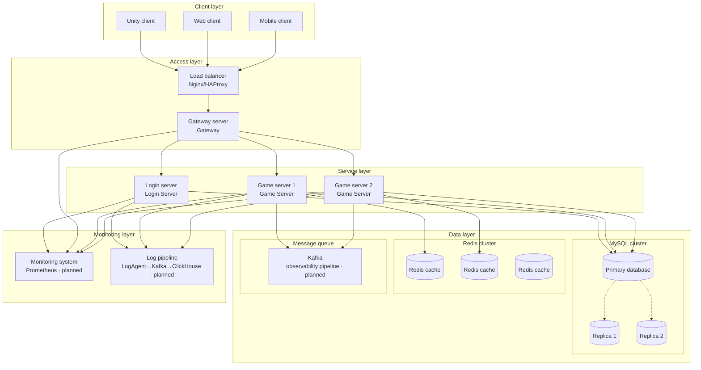
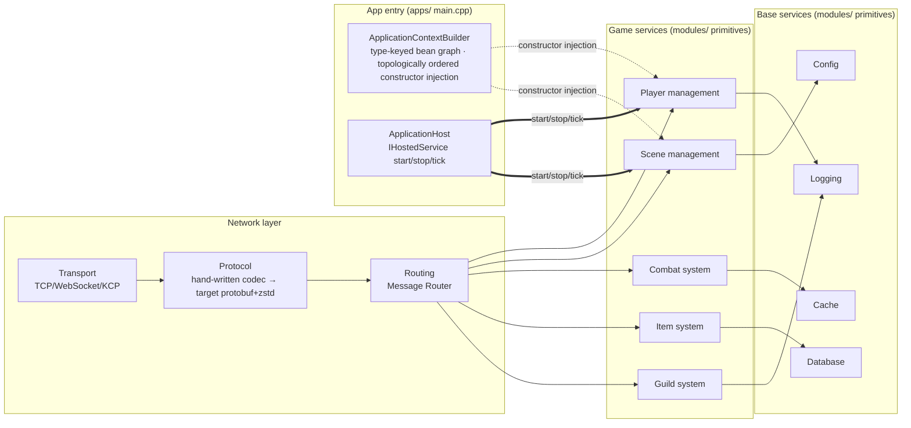
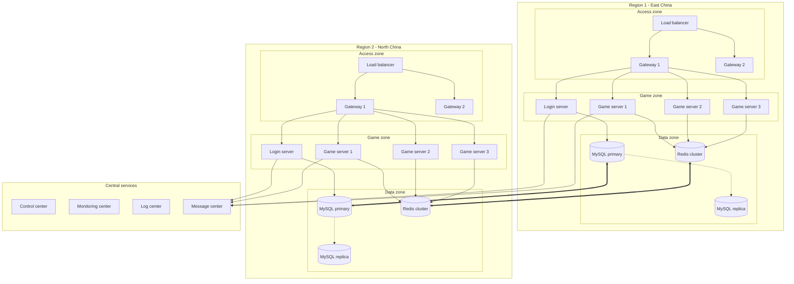

[English](architecture.en.md) | [中文](architecture.md)

# Architecture Overview

> Target-form panorama (landing per `docs/todo.md` batches). The three diagrams on this page are the architecture figures migrated from the README; for the current-state design of the process fleet (eight pieces), authority decomposition, and the baseapp/seamless analysis see the [Architecture Review Report](/analysis/architecture-review) §31, and for the Compact single-process form see [Compact GameServer Design](/30-Compact_GameServer_Design).

## System architecture overview (target form)

> 2026-10-01 migration note: the original README diagram's service layer contained two nodes, "chat server / matchmaking server" — a full search of `docs/todo.md` and `docs/design/*` found zero hits (**not registered**; a leftover from the BW topology era, the same dead end as C-93 chat-app), removed with the migration; the third Redis instance's chat connections were cleaned up as well. If chat/matchmaking is ever chartered, add the diagram back through the gap-registration process.

## Core module architecture

> Inter-module dependencies are **compile-time constructor injection** (solid line = direct dependency, no runtime container intermediary); assembly and lifecycle hosting exist only at the application entry `apps/` (`ApplicationContextBuilder` builds the graph in topological order, `ApplicationHost` hosts the frame driving); modules are unaware of the container internally.

## Distributed deployment architecture (target form)

> Same note as above: the original diagram's game zone contained "chat server" nodes (region 1 CS1 / region 2 CS2) with their connections — not registered, removed with the migration.
