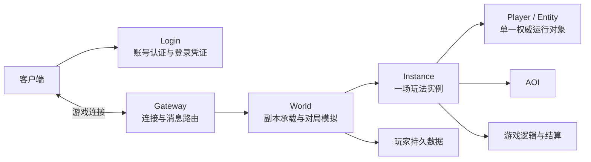

# 架构总览

Apollo 面向以副本和对局为边界的轻量多人游戏，例如塔防、合作玩法、竞技场和副本。一个副本承载一场玩法；一个 `World` 进程可以运行多个副本。Apollo 当前不以持久化无缝大世界为设计目标，也不采用按空间切片的进程模型。

## 目标模型

| 名字 | 职责 |
|---|---|
| `Login` | 认证账号，签发进入游戏的凭证。 |
| `Gateway` | 接受客户端游戏连接，并按会话路由消息。它不持有权威对局状态。 |
| `World` | 创建、运行和销毁副本；执行副本内权威游戏逻辑。一个进程可承载多个副本。 |
| `Instance` | 一场对局的生命周期和临时状态。对局结束后回收。 |
| `Player` / `Entity` | 玩家在当前对局中的运行对象。每个玩家同一时刻只有一个权威对象。 |

跨服玩法是玩家权威对象的迁移：源 `World` 暂停该对象的权威处理，目标进程接收状态并确认接管，然后更新 Gateway 路由，最后清理源对象。迁移期间可能同时存在传输中的状态数据，但只能有一端处理请求、推进状态和提交权威写入。

## 更新边界

Gateway 负责连接和路由，不会自动提供不停机更新。World 滚动更新可通过停止分配新副本、让已有副本自然结束，再退出旧进程来实现服务持续可用；这不保证已有 TCP 连接不间断，也不保证正在进行的副本跨版本继续运行。若要求在线副本连续运行，必须另行实现并验证副本状态迁移、路由切换和失败回滚。

## 代码现状

上图描述目标概念模型。当前业务程序为 `login-app`、`gateway-app`、`world-app`，`machined` 提供可选的进程监督；World 托管玩家资料与持久化，Login 托管在线目录与落点控制。完整的多 Instance 应用生命周期仍待接通。各程序的实际代码状态见[服务器应用](../apps/index.md)。BigWorld/KBEngine 术语只在[兼容层和引擎对照文档](../33-BigWorld_Compatibility.md)中作为参考。

## 临时副本生命周期

几名玩家组队发起 → World 创建 Instance 及临时 Scene → 校验成员并进入 → 刷怪与完成目标 → 结算 → 玩家离开 → 销毁 Instance、场景和临时资源。

复用现有 Instance 八态状态机。Scene 负责实体、AOI 和 tick，Instance 负责玩法起止。小队创建、成员进入、目标判定、结算和临时资源回收已接入 World；SquadInstanceTests 与 SquadWireE2eTests 覆盖受理规则、隔离及上行和结果下行。跨进程结算账持久化与跨 Gateway 会话恢复仍需完善。
