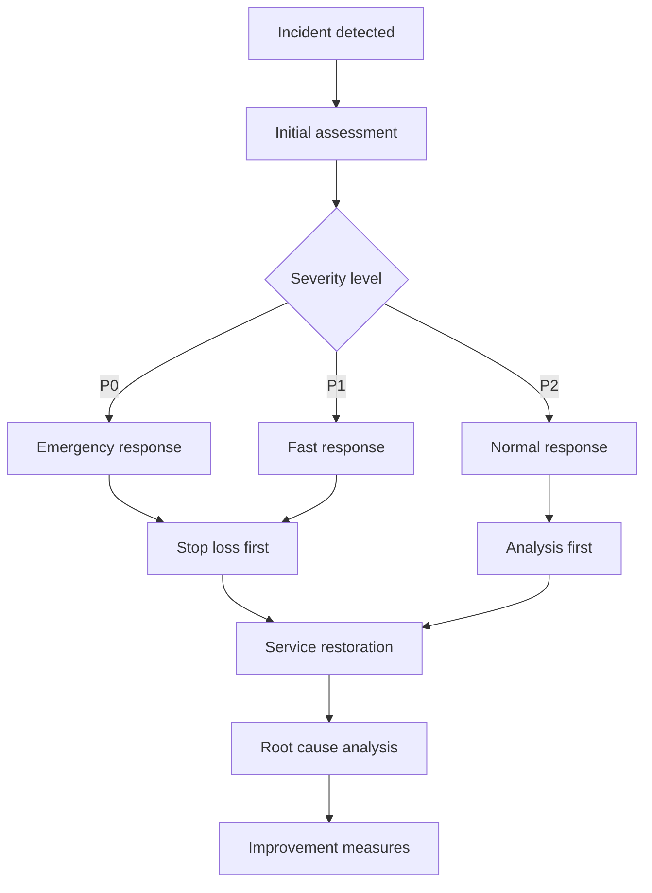

[English](q107-production-incident.en.md) | [中文](q107-production-incident.md)

# Q107: What Serious Production Incident Have You Had? How Did You Handle It?

## Problem Analysis

This question examines production incident handling capability:
- Incident cases
- Emergency response
- Root cause analysis
- Improvement measures

---

## I. Incident Case Library

### 1.1 Common Incident Types

```
┌─────────────────────────────────────────────────────────────┐
│                 Production Incident Classification           │
├─────────────────────────────────────────────────────────────┤
│                                                             │
│  Data incidents:                                            │
│  ├── Data loss                                              │
│  ├── Data corruption                                        │
│  ├── Rollback failure                                       │
│  └── Impact: massive player losses                          │
│                                                             │
│  Service incidents:                                         │
│  ├── Service outage                                         │
│  ├── Response timeout                                       │
│  ├── Connection drops                                       │
│  └── Impact: cannot log in / play                           │
│                                                             │
│  Security incidents:                                        │
│  ├── Item duplication                                       │
│  ├── Cheat proliferation                                    │
│  ├── Data leak                                              │
│  └── Impact: economy system collapse                        │
│                                                             │
│  Performance incidents:                                     │
│  ├── Overload                                               │
│  ├── Out of memory                                          │
│  ├── Database locks                                         │
│  └── Impact: service unavailable                            │
│                                                             │
└─────────────────────────────────────────────────────────────┘
```

---

## II. Incident Handling Process

### 2.1 Emergency Response



### 2.2 Incident Severity

| Level | Description | Response time | Example |
|------|------|----------|------|
| P0 | Core functionality completely unavailable | 5 minutes | All players cannot log in |
| P1 | Seriously affects some players | 15 minutes | A server goes offline |
| P2 | Minor impact | 1 hour | Individual features abnormal |
| P3 | Observational issues | 4 hours | Occasional lag |

---

## III. Case Study: Database Accidental Deletion

### 3.1 Incident Description

```python
# Production incident case study (生产事故案例)

"""
Incident description (事故描述):
Time (时间): Saturday 20:00 (peak hours) (周六晚 20:00 高峰期)
Impact (影响): Full server player data loss (全服玩家数据丢失)
Duration (持续时间): 2 hours

What happened (事故经过):
1. Ran the database cleanup script (执行数据库清理脚本)
2. Wrote the WHERE condition wrong (误将 WHERE 条件写错)
3. Emptied the player data table (清空了玩家数据表)
4. Stopped the service immediately upon discovery (发现后立即停止服务)
"""

# Problematic script (error example) (问题脚本 错误示例)
def cleanup_old_players():
    """
    Error: a commented-out condition caused a full-table delete (错误: 注释掉的条件导致全表删除)
    """
    # WHERE last_login < DATE_SUB(NOW(), INTERVAL 180 DAY)
    sql = "DELETE FROM players"  # Forgot the WHERE condition! (忘记 WHERE 条件!)
    db.execute(sql)

# Correct script (正确脚本)
def cleanup_old_players_safe():
    """Safe cleanup script (安全的清理脚本)"""
    # 1. Query to confirm first (先查询确认)
    check_sql = """
        SELECT COUNT(*)
        FROM players
        WHERE last_login < DATE_SUB(NOW(), INTERVAL 180 DAY)
    """
    count = db.query_one(check_sql)

    print(f"Will delete {count} old players")

    if count > 10000:
        # Abnormal count check (异常数量检查)
        raise Exception(f"Too many rows to delete: {count}")

    # 2. Delete in batches (分批删除)
    batch_size = 1000
    offset = 0

    while True:
        delete_sql = """
            DELETE FROM players
            WHERE last_login < DATE_SUB(NOW(), INTERVAL 180 DAY)
            LIMIT %s
        """
        affected = db.execute(delete_sql, (batch_size,))

        if affected == 0:
            break

        offset += affected
        print(f"Deleted {offset} rows")
```

### 3.2 Emergency Handling

```python
# Emergency recovery flow (应急恢复流程)

class IncidentHandler:
    """Incident handler (事故处理器)"""

    def handle_data_loss(self):
        """Handle data loss (处理数据丢失)"""
        # 1. Stop services immediately (立即停止服务)
        self.stop_all_services()

        # 2. Assess the loss (评估损失)
        loss_assessment = self.assess_data_loss()
        INFO_MSG(f"Data loss assessment: {loss_assessment}")

        # 3. Recover the data (恢复数据)
        recovery_result = self.recover_data()

        # 4. Validate the data (验证数据)
        validation_result = self.validate_recovery()

        # 5. Restore services (恢复服务)
        if validation_result['success']:
            self.restore_services()
        else:
            CRITICAL_MSG("Recovery validation failed!")
            # Start the fallback plan (启动备份方案)
            self.fallback_recovery()

    def assess_data_loss(self):
        """Assess data loss (评估数据损失)"""
        assessment = {
            'affected_tables': [],
            'affected_players': 0,
            'data_range': None,
            'recovery_options': []
        }

        # Check each table (检查每个表)
        for table in ['players', 'inventory', 'guilds']:
            count = self.query(f"SELECT COUNT(*) FROM {table}")
            assessment['affected_tables'].append({
                'table': table,
                'count': count
            })

        return assessment

    def recover_data(self):
        """Recover data (恢复数据)"""
        # Option 1: restore from the latest backup (选项 1: 从最新备份恢复)
        backup_time = self.get_latest_backup_time()
        INFO_MSG(f"Latest backup from: {backup_time}")

        # Option 2: restore from binlog (选项 2: 从 binlog 恢复)
        binlog_position = self.get_binlog_position()
        INFO_MSG(f"Binlog position: {binlog_position}")

        # Execute recovery (执行恢复)
        try:
            # Stop applications (停止应用)
            self.stop_applications()

            # Restore the backup (恢复备份)
            self.restore_from_backup(backup_time)

            # Apply the binlog (应用 binlog)
            self.apply_binlog(binlog_position)

            return {'success': True, 'method': 'backup+binlog'}

        except Exception as e:
            ERROR_MSG(f"Recovery failed: {e}")
            return {'success': False, 'error': str(e)}

    def validate_recovery(self):
        """Validate the recovery result (验证恢复结果)"""
        # Check data integrity (检查数据完整性)
        checks = [
            self.check_player_count(),
            self.check_data_consistency(),
            self.check_critical_accounts()
        ]

        all_passed = all(check['passed'] for check in checks)

        return {
            'success': all_passed,
            'checks': checks
        }
```

---

## IV. Case Study: Item Duplication Vulnerability

### 4.1 Incident Description

```
Incident description (事故描述):
Time (时间): 10 minutes after the event went live (活动上线后 10 分钟)
Impact (影响): Game economy collapse (游戏经济崩溃)
Loss (损失): Hundreds of billions of in-game coins (数百亿游戏币)

What happened (事故经过):
1. New trading feature added (新增交易功能)
2. Balance was not validated (未校验余额)
3. Players found they could duplicate gold infinitely (玩家发现可无限刷钱)
4. Spread widely in a short time (短时间内大量传播)
```

### 4.2 Vulnerability Fix

```python
# Item duplication vulnerability fix (刷物品漏洞修复)

class TradingSystem:
    """Trading system, fixed version (交易系统 修复版)"""

    def trade_item(self, player_id, item_id, count, price):
        """Trade an item (交易物品)"""

        # 1. Begin transaction (开启事务)
        with self.db.transaction():

            # 2. Locking query, pessimistic lock (加锁查询 悲观锁)
            player = self.db.query_for_update(
                "SELECT * FROM players WHERE id = ? FOR UPDATE",
                (player_id,)
            )

            if not player:
                raise Exception("Player not found")

            # 3. Validate item count (校验物品数量)
            inventory = self.get_inventory(player_id, item_id)

            if inventory['count'] < count:
                raise Exception("Insufficient items")

            # 4. Validate balance if buying (校验余额 如果购买)
            if price < 0:  # Buying (购买)
                if player['gold'] < abs(price):
                    raise Exception("Insufficient gold")

            # 5. Deduct items (扣除物品)
            self.remove_item(player_id, item_id, count)

            # 6. Update balance (更新余额)
            self.update_gold(player_id, player['gold'] + price)

            # 7. Record the log (记录日志)
            self.log_transaction({
                'player_id': player_id,
                'item_id': item_id,
                'count': count,
                'price': price,
                'timestamp': time.time()
            })

        # 8. Notify the client (通知客户端)
        self.notify_client(player_id, {
            'action': 'trade_complete',
            'item_id': item_id,
            'count': count,
            'new_gold': player['gold'] + price
        })


class AntiAbuse:
    """Anti-abuse system (防刷系统)"""

    def __init__(self):
        self.player_limits = {}
        self.global_limits = {
            'transactions_per_minute': 1000,
            'gold_change_per_minute': 1000000
        }

    def check_transaction_limit(self, player_id, action, amount):
        """Check transaction limits (检查交易限制)"""
        current_time = time.time()
        key = (player_id, action)

        # Get player history (获取玩家历史)
        if key not in self.player_limits:
            self.player_limits[key] = []

        history = self.player_limits[key]

        # Clean up records older than 1 minute (清理 1 分钟前的记录)
        history[:] = [t for t in history if current_time - t < 60]

        # Check frequency (检查频率)
        if len(history) > 100:  # Max 100 times per minute (每分钟最多 100 次)
            WARNING_MSG(f"Player {player_id} exceeded transaction limit")
            return False

        # Check the amount (检查金额)
        if action == 'gold_change':
            total = sum(h['amount'] for h in history)
            if total + amount > 100000:  # Max 100k per minute (每分钟最多 10 万)
                WARNING_MSG(f"Player {player_id} exceeded gold limit")
                return False

        # Record (记录)
        history.append({'time': current_time, 'amount': amount})

        return True
```

### 4.3 Data Rollback

```python
# Data rollback plan (数据回滚方案)

class DataRollback:
    """Data rollback (数据回滚)"""

    def rollback_economy(self):
        """Roll back economy data (回滚经济数据)"""

        # 1. Determine the rollback point (确定回滚点)
        exploit_detected_time = self.get_exploit_detected_time()
        rollback_time = exploit_detected_time - 300  # 5 minutes before (前5分钟)

        INFO_MSG(f"Rolling back to {rollback_time}")

        # 2. Back up current data (备份当前数据)
        self.backup_current_state("before_rollback")

        # 3. Roll back player gold (回滚玩家金币)
        self.rollback_player_gold(rollback_time)

        # 4. Roll back item transactions (回滚物品交易)
        self.rollback_item_transactions(rollback_time)

        # 5. Recover illegal gains (追缴非法所得)
        self.confiscate_illegal_assets()

        # 6. Compensate legitimate players (补偿正常玩家)
        self.compensate_players()

    def confiscate_illegal_assets(self):
        """Recover illegal gains (追缴非法所得)"""
        # Find players who acquired items abnormally (查找异常获取物品的玩家)
        suspicious_players = self.find_suspicious_players()

        for player_id in suspicious_players:
            # Calculate illegal gains (计算非法所得)
            illegal_amount = self.calculate_illegal_amount(player_id)

            # Deduct (扣除)
            self.deduct_gold(player_id, illegal_amount)

            # Record (记录)
            INFO_MSG(f"Confiscated {illegal_amount} gold from player {player_id}")

            # Ban (封禁)
            if illegal_amount > 100000:
                self.ban_player(player_id, reason="exploit_abuse")
```

---

## V. Post-Incident Analysis

### 5.1 Root Cause Analysis

```python
# 5 Whys analysis (5 Whys 分析法)

"""
Incident (事故): Player data deleted by a database mistake (数据库误删玩家数据)

Why 1: Why was the data deleted? (为什么数据被删除?)
Answer: The cleanup script deleted it by mistake (答: 清理脚本误删)

Why 2: Why did the cleanup script delete it by mistake? (为什么清理脚本会误删?)
Answer: The WHERE condition was commented out (答: WHERE 条件被注释掉)

Why 3: Why was the WHERE condition commented out? (为什么 WHERE 条件被注释?)
Answer: Temporarily commented out during testing, forgot to restore it (答: 测试时临时注释，忘记恢复)

Why 4: Why was it shipped without testing? (为什么没有测试就上线?)
Answer: Lacking a code review process (答: 缺少代码审查流程)

Why 5: Why is there no process? (为什么缺少流程?)
Answer: No complete release standard was established (答: 没有建立完善的上线规范)

Root cause (根本原因): Lacking a complete code review and release process (缺少完善的代码审查和上线流程)
"""
```

### 5.2 Improvement Measures

| Measure | Description |
|------|------|
| Code review | All database operations must be reviewed |
| Script validation | Preview before script execution |
| Backup testing | Regularly test backup restoration |
| Permission control | Restrict production environment operations |
| Monitoring alerts | Alert immediately on abnormal operations |

---

## VI. Best Practices

### 6.1 Incident Handling Recommendations

| Practice | Description |
|------|------|
| **Fast stop-loss** | Prioritize service restoration |
| **Stay calm** | Follow the process |
| **Detailed records** | Keep all logs |
| **Timely communication** | Notify relevant personnel |
| **Post-mortem** | Produce an incident report |
| **Prevention first** | Build protective mechanisms |

---

## VII. Summary

### Production Incident Handling Core

```
Incident handling = fast response + stop-loss recovery + root cause analysis + improvement and prevention
- Tiered response
- Prioritize service restoration
- Record the process in detail
- Establish improvement mechanisms
```

---

## References

- [Incident Response Guide](https://www.us-cert.gov/sites/default/files/publications/incident_response_guidance.pdf)
- [Post-Mortem Culture](https://www.amazon.com/Google-SRE-Book-Site-Reliability/dp/1491950358)
