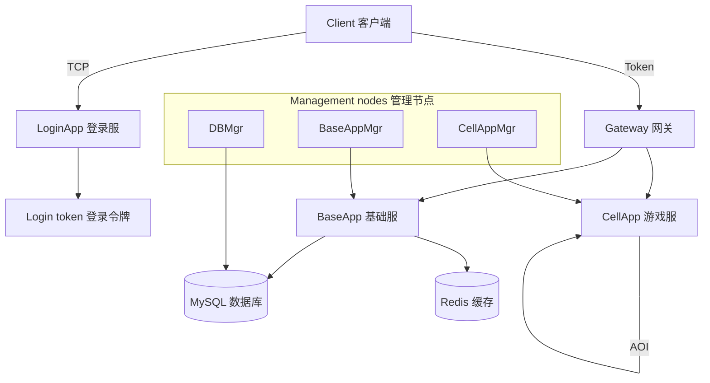
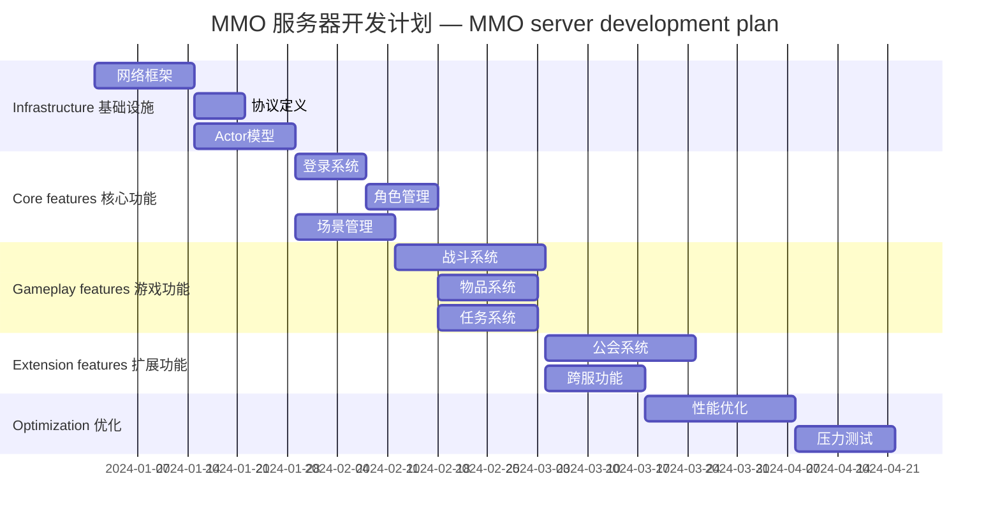

[English](q108-mmo-from-scratch.en.md) | [中文](q108-mmo-from-scratch.md)

# Q108: Building an MMO Server From 0 to 1 — What Is Your Approach?

## Core Conclusion

This question tests system design ability:

- Requirements analysis
- Architecture design
- Technology selection
- Implementation roadmap

---

## I. Requirements Analysis

### 1.1 Core Requirements

```
┌─────────────────────────────────────────────────────────────┐
│                    MMO Server Requirements                   │
├─────────────────────────────────────────────────────────────┤
│                                                             │
│  Functional requirements:                                    │
│  ├── Player registration/login                               │
│  ├── Character creation/management                           │
│  ├── 3D scene movement                                       │
│  ├── Chat system                                             │
│  ├── Combat system                                           │
│  ├── Inventory/items                                         │
│  ├── Quest system                                            │
│  └── Guild system                                            │
│                                                             │
│  Non-functional requirements:                                │
│  ├── Capacity: 5000+ CCU                                     │
│  ├── Latency: < 100ms (same region)                          │
│  ├── Availability: 99.9%                                     │
│  ├── Scalability: supports dynamic scale-out                  │
│  └── Security: anti-cheat, anti-farming                      │
│                                                             │
└─────────────────────────────────────────────────────────────┘
```

---

## II. Technology Selection

### 2.1 Tech Stack

| Layer | Technology Choice | Reason |
|------|----------|------|
| Network layer | TCP/KCP | Reliable transport |
| Protocol layer | Protobuf | Efficient serialization |
| Communication model | Actor | Distributed-friendly |
| Scripting language | Python | Fast development |
| Database | MySQL + Redis | Persistence + cache |
| Message queue | Self-built | Game-specific |

### 2.2 Architecture Decisions

```python
# 技术选型分析 — technology selection analysis

class ArchitectureDecision:
    """架构决策 — architecture decision"""

    @staticmethod
    def choose_communication_model():
        """选择通信模型 — choose the communication model"""
        return {
            'model': 'Actor',
            'reasons': [
                '避免锁竞争',  # Avoid lock contention
                '天然分布式',  # Naturally distributed
                '消息隔离',  # Message isolation
                '易于扩展'  # Easy to extend
            ],
            'alternatives': {
                '线程模型': '锁竞争复杂',  # Thread model: complex lock contention
                '协程模型': '阻塞风险',  # Coroutine model: blocking risk
                '进程模型': '通信成本高'  # Process model: high communication cost
            }
        }

    @staticmethod
    def choose_serialization():
        """选择序列化方案 — choose the serialization scheme"""
        return {
            'primary': 'Protobuf',
            'reasons': [
                '性能优异',  # Excellent performance
                '跨语言',  # Cross-language
                '字段兼容',  # Field compatibility
                '体积小'  # Small size
            ],
            'comparison': {
                'Protobuf': {'speed': 9, 'size': 8, 'readability': 5},
                'JSON': {'speed': 5, 'size': 4, 'readability': 10},
                'MsgPack': {'speed': 8, 'size': 9, 'readability': 4},
                'FlatBuffers': {'speed': 10, 'size': 9, 'readability': 3}
            }
        }
```

---

## III. Architecture Design

### 3.1 System Architecture



### 3.2 Component Responsibilities

```python
# 组件定义 — component definitions

class ComponentArchitecture:
    """组件架构 — component architecture"""

    components = {
        'LoginApp': {
            '职责': ['玩家登录验证', '令牌发放', '负载均衡'],  # responsibilities
            '技术': 'Python/Tornado',  # technology
            '端口': 8000,  # port
            '实例数': 2  # instance count
        },
        'Gateway': {
            '职责': ['连接管理', '消息转发', '流量控制'],
            '技术': 'C++/Epoll',
            '端口': 9000,
            '实例数': 4
        },
        'BaseApp': {
            '职责': ['玩家数据管理', '背包/任务', '跨服功能'],
            '技术': 'Python/Actor',
            '端口': 10000,
            '实例数': 4
        },
        'CellApp': {
            '职责': ['场景逻辑', '战斗系统', 'AOI 广播'],
            '技术': 'Python/Actor',
            '端口': 11000,
            '实例数': 8
        },
        'DBMgr': {
            '职责': ['数据库操作', '数据缓存', '异步保存'],
            '技术': 'Python/MySQL',
            '端口': 12000,
            '实例数': 1
        }
    }
```

---

## IV. Implementation Roadmap

### 4.1 Phased Plan



### 4.2 Detailed Plan

```
Phase 1: Infrastructure (4 weeks)
├── Week 1-2: Network framework
│   ├── TCP/KCP communication
│   ├── Protobuf protocol
│   ├── Message dispatch
│   └── Heartbeat mechanism
├── Week 3: Actor model
│   ├── Message queue
│   ├── Actor scheduling
│   ├── Mailbox mechanism
│   └── Remote calls
└── Week 4: Base components
    ├── Timers
    ├── Logging system
    ├── Configuration management
    └── Monitoring interfaces

Phase 2: Core features (6 weeks)
├── Week 5-6: Login system
│   ├── Account verification
│   ├── Token mechanism
│   ├── Gateway access
│   └── Load balancing
├── Week 7-8: Character system
│   ├── Character creation
│   ├── Attribute system
│   ├── Data persistence
│   └── Cache management
└── Week 9-10: Scene system
    ├── Space management
    ├── Position synchronization
    ├── AOI implementation
    └── Scene switching

Phase 3: Gameplay features (8 weeks)
├── Week 11-13: Combat system
│   ├── Skill system
│   ├── Damage calculation
│   ├── Status effects
│   └── AI behavior
├── Week 14-15: Item system
│   ├── Inventory management
│   ├── Item usage
│   ├── Trading system
│   └── Auction house
└── Week 16-18: Social system
    ├── Friend system
    ├── Chat system
    ├── Guild system
    └── Party system

Phase 4: Optimization and testing (5 weeks)
├── Week 19-20: Performance optimization
│   ├── Memory optimization
│   ├── Network optimization
│   ├── Database optimization
│   └── Concurrency optimization
└── Week 21-23: Testing and release
    ├── Unit tests
    ├── Integration tests
    ├── Stress tests
    └── Trial operation
```

---

## V. Key Designs

### 5.1 Message Protocol

```protobuf
// 消息协议定义 — message protocol definitions

// 基础消息 — base message
message BaseMessage {
    uint32 msg_id = 1;        // 消息 ID — message ID
    uint64 sequence = 2;      // 序列号 — sequence number
    uint64 timestamp = 3;     // 时间戳 — timestamp
    bytes body = 4;           // 消息体 — message body
}

// 登录请求 — login request
message LoginRequest {
    string account = 1;
    string password = 2;
    string client_version = 3;
}

// 登录响应 — login response
message LoginResponse {
    int32 code = 1;
    string message = 2;
    string token = 3;
    repeated string servers = 4;  // 可选服务器 — optional servers
}

// 位置同步 — position synchronization
message PositionUpdate {
    uint64 entity_id = 1;
    float x = 2;
    float y = 3;
    float z = 4;
    float yaw = 5;
    uint32 timestamp = 6;
}
```

### 5.2 Data Model

```python
# 数据模型设计 — data model design

class PlayerSchema:
    """玩家数据模式 — player data schema"""

    # 数据库表结构 — database table structure
    TABLE_SQL = """
    CREATE TABLE players (
        id BIGINT PRIMARY KEY AUTO_INCREMENT,
        account_id BIGINT NOT NULL,
        name VARCHAR(32) NOT NULL UNIQUE,
        level INT DEFAULT 1,
        exp BIGINT DEFAULT 0,
        gold BIGINT DEFAULT 0,

        -- 位置 — position
        space_id INT,
        position_x FLOAT,
        position_y FLOAT,
        position_z FLOAT,

        -- 时间戳 — timestamps
        created_at TIMESTAMP DEFAULT CURRENT_TIMESTAMP,
        updated_at TIMESTAMP DEFAULT CURRENT_TIMESTAMP ON UPDATE CURRENT_TIMESTAMP,
        last_login_at TIMESTAMP,

        -- 索引 — indexes
        INDEX idx_account (account_id),
        INDEX idx_level (level),
        INDEX idx_space (space_id)
    ) ENGINE=InnoDB DEFAULT CHARSET=utf8mb4;
    """

    # Redis 缓存结构 — Redis cache structure
    CACHE_KEY = "player:{player_id}"
    CACHE_FIELDS = [
        'id', 'account_id', 'name', 'level', 'exp', 'gold',
        'space_id', 'position_x', 'position_y', 'position_z'
    ]


class ItemSchema:
    """物品数据模式 — item data schema"""

    TABLE_SQL = """
    CREATE TABLE player_items (
        id BIGINT PRIMARY KEY AUTO_INCREMENT,
        player_id BIGINT NOT NULL,
        item_id INT NOT NULL,
        count INT DEFAULT 1,
        quality INT DEFAULT 1,

        -- 装备属性 — equipment attributes
        enchant_level INT DEFAULT 0,
        extra_data JSON,

        created_at TIMESTAMP DEFAULT CURRENT_TIMESTAMP,
        updated_at TIMESTAMP DEFAULT CURRENT_TIMESTAMP ON UPDATE CURRENT_TIMESTAMP,

        INDEX idx_player (player_id),
        INDEX idx_item (item_id)
    ) ENGINE=InnoDB DEFAULT CHARSET=utf8mb4;
    """
```

---

## VI. Core Code Framework

### 6.1 Actor Implementation

```python
# Actor 框架 — Actor framework

import queue
import threading

class Actor:
    """Actor 基类 — Actor base class"""

    def __init__(self, actor_id):
        self.actor_id = actor_id
        self.mailbox = queue.Queue()
        self.running = False
        self.thread = None

    def start(self):
        """启动 Actor — start the Actor"""
        self.running = True
        self.thread = threading.Thread(target=self._loop, daemon=True)
        self.thread.start()

    def stop(self):
        """停止 Actor — stop the Actor"""
        self.running = False
        if self.thread:
            self.thread.join()

    def _loop(self):
        """消息循环 — message loop"""
        while self.running:
            try:
                message = self.mailbox.get(timeout=0.1)
                self.handle_message(message)
            except queue.Empty:
                continue
            except Exception as e:
                ERROR_MSG(f"Actor {self.actor_id} error: {e}")

    def send(self, message):
        """发送消息 — send a message"""
        self.mailbox.put(message)

    def handle_message(self, message):
        """处理消息 (子类实现) — handle a message (implemented by subclasses)"""
        raise NotImplementedError

    def ask(self, message, timeout=5):
        """请求-响应模式 — request-response pattern"""
        response_queue = queue.Queue()

        # 添加回调地址 — add the callback address
        message.reply_to = response_queue

        self.send(message)

        try:
            return response_queue.get(timeout=timeout)
        except queue.Empty:
            raise TimeoutError("Actor response timeout")


# 远程 Actor — remote Actor
class RemoteActor:
    """远程 Actor 代理 — remote Actor proxy"""

    def __init__(self, actor_id, address, port):
        self.actor_id = actor_id
        self.address = address
        self.port = port
        self.transport = None

    def send(self, message):
        """发送远程消息 — send a remote message"""
        # 通过网络发送 — send over the network
        self.transport.send(self.actor_id, message)

    def ask(self, message, timeout=5):
        """远程请求 — remote request"""
        # 实现请求-响应 — implement request-response
        pass
```

---

## VII. Summary

### The Core Points of Going From 0 to 1

```
MMO server build = requirements analysis + architecture design + phased implementation
- Requirements first; avoid over-design
- Technology selection considers the team and the scenario
- The Actor model simplifies concurrency
- Iterate and validate in phases
- Performance and security are ongoing work
```

---

## References

- [MMO Server Architecture](https://www.gamedev.net/blogs/entry/2264963-mmo-server-security-the-unspoken-challenges/)
- [Game Server Patterns](https://www.gameprogrammingpatterns.com/game-server-patterns.html)
