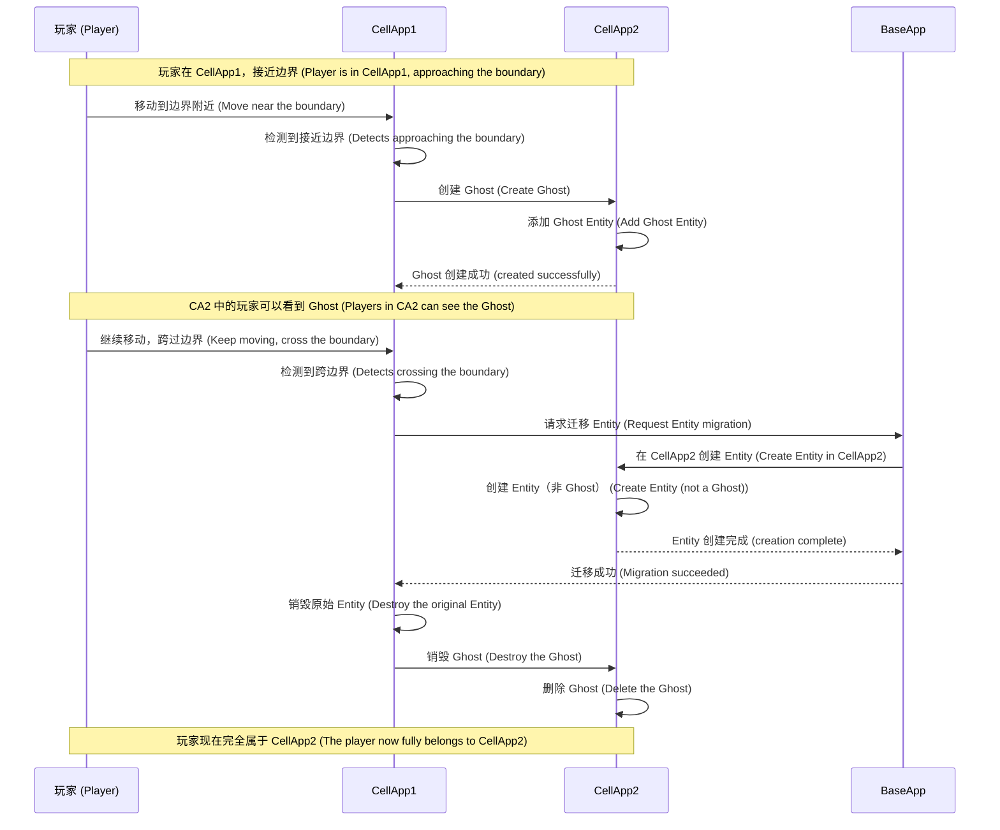

[English](q3-aoi-implementation.en.md) | [中文](q3-aoi-implementation.md)

# Q3: What is AOI (Area of Interest)? What implementation approaches exist? What are their advantages and disadvantages?

## Problem Analysis

AOI (Area of Interest, area of interest / view management) is a crucial technology in MMORPGs:
- Determines which other players/NPCs a player can see
- Affects the scope of network synchronization
- Directly affects server performance

This question tests:
1. The concept and role of AOI
2. Layered AOI design
3. AOI implementation in CellApp
4. Handling of overlapping CellApp regions

---

## Basic AOI Concepts

### What Is AOI?

```
┌─────────────────────────────────────────────────────────────┐
│                        游戏世界                              │ (Game World                            │)
│                                                              │
│        P                                                   │
│       ┌───┐                                                  │
│       │玩家│ ────► AOI 半径 100m                           │ (Player│ ────► AOI radius 100m                        │)
│       └───┘                                                  │
│         ╱                                                  │
│        ╱ 100m                                              │
│       ╱                                                    │
│      o o o                                             │
│     (可见的玩家/NPC)                                        │ (Visible players/NPCs)                                 │)
│                                                              │
│      x x x                                              │
│    (AOI 范围外，不可见)                                      │ (Outside AOI range, invisible)                          │)
└─────────────────────────────────────────────────────────────┘
```

**Definition**: AOI determines which other entities an entity can "perceive" (see, interact with).

### The Role of AOI

| Function | Description |
|------|------|
| **View management** | Determines which other players/NPCs a player can see |
| **Message broadcast** | Only broadcasts messages to players within AOI |
| **Event notification** | Triggers events when entering/leaving AOI |
| **Performance optimization** | Avoids global synchronization, reduces network overhead |

---

## Layered AOI Design

### Why Layered Design Is Needed?

Different types of entities need different AOI ranges:

| Entity Type | AOI Radius | Reason |
|----------|----------|------|
| Player | 100m | Needs to see surrounding players and NPCs |
| NPC | 50m | Only needs to interact with nearby players |
| Gatherable | 20m | Can only be gathered when close |
| World BOSS | 500m | Needs to be seen by distant players |
| Guild Mark | Whole server | Visible to guild members |

### Layered AOI Architecture

```mermaid
flowchart TB
    subgraph World["游戏世界"] (Game World"])
        P["玩家"] (Player"])
        NPC1["NPC"]
        NPC2["怪物"] (Monster"])
        Resource["采集物"] (Gatherable"])
        BOSS["世界BOSS"] (World BOSS"])
        GuildMark["公会标记"] (Guild Mark"])
    end

    subgraph AOI_Layers["AOI 分层"] (Layers"])
        L1["Layer 1: 全服<br/>公会标记、系统消息"] (Whole server<br/>Guild marks, system messages"])
        L2["Layer 2: 远程<br/>世界BOSS: 500m"] (Long range<br/>World BOSS: 500m"])
        L3["Layer 3: 中程<br/>玩家: 100m<br/>NPC: 50m"] (Normal<br/>Player: 100m<br/>NPC: 50m"])
        L4["Layer 4: 近程<br/>采集物: 20m"] (Near range<br/>Gatherable: 20m"])
    end

    P --> L1
    P --> L2
    P --> L3
    P --> L4

    BOSS --> L2
    NPC1 --> L3
    NPC2 --> L3
    Resource --> L4
    GuildMark --> L1
```

### Layered AOI Implementation

```cpp
// 分层 AOI 设计 (Layered AOI design)
class LayeredAOI {
public:
    // 定义 AOI 层级 (Define AOI layers)
    enum Layer {
        LAYER_GLOBAL = 0,    // 全服范围（公会、世界BOSS） (Whole-server range (guild, world BOSS))
        LAYER_REMOTE = 1,    // 远程范围（500m） (Long-range (500m))
        LAYER_NORMAL = 2,    // 正常范围（100m） (Normal range (100m))
        LAYER_NEARBY = 3,    // 近距离范围（20m） (Near range (20m))
        LAYER_COUNT
    };

    // 每层使用不同的数据结构 (Each layer uses a different data structure)
    struct LayerConfig {
        float viewRadius;           // 视野半径 (View radius)
        bool useGrid;               // 是否使用网格 (Whether to use a grid)
        bool useTower;              // 是否使用兴趣索引 (Whether to use an interest index)
    };

    LayerConfig configs[LAYER_COUNT] = {
        {FLT_MAX, false, false},    // 全服：使用列表 (Whole server: use a list)
        {500.0f,  true,  false},    // 远程：大网格 (Long range: large grid)
        {100.0f,  true,  true },    // 正常：网格 + 索引 (Normal: grid + index)
        {20.0f,   true,  true }     // 近距离：小网格 (Near range: small grid)
    };

    // 实体可以属于多个层级 (An entity can belong to multiple layers)
    struct EntityLayers {
        std::bitset<LAYER_COUNT> layers;
    };

    // 查询某个实体的可见实体 (Query the visible entities of an entity)
    std::vector<Entity*> queryVisible(Entity* entity) {
        std::vector<Entity*> result;
        auto& layers = getEntityLayers(entity);

        for (int i = 0; i < LAYER_COUNT; ++i) {
            if (layers.test(i)) {
                auto visible = queryInLayer(entity, i);
                result.insert(result.end(), visible.begin(), visible.end());
            }
        }

        return result;
    }
};
```

### Advantages of Layered AOI

| Advantage | Description |
|------|------|
| **Performance optimization** | Different entity types use different algorithms, avoiding one-size-fits-all |
| **Flexible configuration** | View ranges can be configured independently per layer |
| **Precise control** | Important events (like world BOSS) can broadcast farther |
| **Reduced redundancy** | Small-range objects like gatherables do not need global synchronization |

### Layered AOI Is Not Just "Different Radii"

Many people understand layered AOI as "configuring different visible radii for different objects", which is not enough.

True engineering layering usually divides into at least three layers:

#### 1. Entity-Layer Layering

Different object types use different ranges of interest:

- Player: around 100m
- Normal monster: 30m to 50m
- Gatherable: 10m to 20m
- World event/BOSS: 300m to 500m

#### 2. Algorithm-Layer Layering

Different layers can use different spatial indexes:

- Near-range high-frequency objects: 3×3 grid / spatial hash
- Mid-range regular objects: cross list or grid
- Low-frequency large-range objects: quadtree / R-Tree / global index

#### 3. Update Frequency Layering

Not every AOI layer needs precise updates every tick:

- Player movement layer: high-frequency updates
- Monster perception layer: medium-frequency updates
- World mark / large event layer: low-frequency updates

### A More Reasonable Layered AOI Architecture

```text
Layer 0: Global Layer
- 系统公告、公会标记、世界事件 (System announcements, guild marks, world events)
- 查询方式：订阅列表 / 全局索引 (Query method: subscription list / global index)
- 更新频率：低 (Update frequency: low)

Layer 1: Long-range Layer
- 世界 BOSS、攻城器械、远距离可见目标 (World BOSS, siege weapons, long-range visible targets)
- 查询方式：四叉树 / R-Tree (Query method: quadtree / R-Tree)
- 更新频率：中低 (Update frequency: medium-low)

Layer 2: Normal Gameplay Layer
- 玩家、怪物、可战斗对象 (Players, monsters, combatable objects)
- 查询方式：九宫格 / 十字链表 / 空间哈希 (Query method: 3×3 grid / cross list / spatial hash)
- 更新频率：高 (Update frequency: high)

Layer 3: Near-interaction Layer
- 采集物、掉落物、交互点 (Gatherables, drops, interaction points)
- 查询方式：小网格 / 小半径邻域 (Query method: small grid / small-radius neighborhood)
- 更新频率：中 (Update frequency: medium)
```

### More Complete Key Points

If asked "why layered AOI is needed", a better answer is not "because the radii differ", but:

1. Different entities have different visibility needs
2. Different entities have different movement frequencies
3. Different entities have different broadcast value
4. Different entities suit different data structures

In other words, the essence of layered AOI is not "multiple sets of radii", but "multiple sets of indexes + multiple sets of update strategies + multiple sets of broadcast strategies".

---

## Comparison of AOI Implementation Approaches

### 1. 3×3 Grid Algorithm

```
┌─────────┬─────────┬─────────┬─────────┬─────────┐
│   (0,0) │   (1,0) │   (2,0) │   (3,0) │   (4,0) │
├─────────┼─────────┼─────────┼─────────┼─────────┤
│   (0,1) │   (1,1) │   (2,1) │   (3,1) │   (4,1) │
├─────────┼─────────┼─────────┼─────────┼─────────┤
│   (0,2) │   (1,2) │   (2,2) │   (3,2) │   (4,2) │
├─────────┼─────────┼─────────┼─────────┼─────────┤
│   (0,3) │   (1,3) │   (2,3) │   (3,3) │   (4,3) │
├─────────┼─────────┼─────────┼─────────┼─────────┤
│   (0,4) │   (1,4) │   (2,4) │   (3,4) │   (4,4) │
└─────────┴─────────┴─────────┴─────────┴─────────┘

玩家在 (2,2) 格子，视野覆盖周围 9 个格子： (The player is in grid (2,2); the view covers the surrounding 9 grids:)
  (1,1) (2,1) (3,1)
  (1,2) (2,2) (3,2)
  (1,3) (2,3) (3,3)
```

**Implementation code**:
```cpp
class GridAOI {
    struct Grid {
        std::unordered_set<Entity*> entities;
    };

    // 网格大小 = AOI 半径 (Grid size = AOI radius)
    const float GRID_SIZE = 100.0f;
    int gridWidth, gridHeight;
    std::vector<std::vector<Grid>> grids;

    // 获取实体所在格子 (Get the grid an entity is in)
    std::pair<int, int> getGridPos(float x, float y) {
        return {
            (int)(x / GRID_SIZE),
            (int)(y / GRID_SIZE)
        };
    }

    // 获取九宫格范围内的实体 (Get entities within the 3×3 grid range)
    std::vector<Entity*> getVisibleEntities(Entity* entity) {
        auto [gx, gy] = getGridPos(entity->x, entity->y);
        std::vector<Entity*> result;

        // 遍历九宫格 (Iterate the 3×3 grid)
        for (int dy = -1; dy <= 1; ++dy) {
            for (int dx = -1; dx <= 1; ++dx) {
                int nx = gx + dx;
                int ny = gy + dy;
                if (isValidGrid(nx, ny)) {
                    auto& grid = grids[ny][nx];
                    result.insert(result.end(),
                               grid.entities.begin(),
                               grid.entities.end());
                }
            }
        }

        return result;
    }

    // 移动实体 (Move an entity)
    void onEntityMove(Entity* entity, float newX, float newY) {
        auto [oldGx, oldGy] = getGridPos(entity->x, entity->y);
        auto [newGx, newGy] = getGridPos(newX, newY);

        if (oldGx != newGx || oldGy != newGy) {
            // 跨格子移动 (Cross-grid movement)
            removeFromGrid(entity, oldGx, oldGy);
            addToGrid(entity, newGx, newGy);

            // 检查九宫格变化，触发进入/离开事件 (Check 3×3 grid changes, trigger enter/leave events)
            checkAOIChange(entity, oldGx, oldGy, newGx, newGy);
        }
    }
};
```

### 2. Cross List

```
         Y轴链表 (-axis list)
          │
    ┌───┬───┼───┬───┐
    │   │   │   │   │
    ├───┼───┼───┼───┤
    │   │ P│   │   │
    ├───┼───┼───┼───┤
    │   │   │   │   │
    └───┴───┼───┴───┘
          │
         X轴链表 (-axis list)

每个实体维护: (Each entity maintains:)
- xPrev, xNext (X轴方向的前后节点) (previous/next nodes along the X axis))
- yPrev, yNext (Y轴方向的前后节点) (previous/next nodes along the Y axis))
```

**Implementation code**:
```cpp
class CrossListAOI {
    struct Node {
        Entity* entity;
        Node* xPrev = nullptr;
        Node* xNext = nullptr;
        Node* yPrev = nullptr;
        Node* yNext = nullptr;
    };

    std::unordered_map<EntityID, Node*> nodes;

    // 获取 X 轴方向的可见实体 (Get visible entities along the X axis)
    std::vector<Entity*> getXAxisVisible(Entity* entity, float range) {
        std::vector<Entity*> result;
        Node* node = nodes[entity->id];

        // 向 X 正方向查找 (Search in the positive X direction)
        Node* p = node->xNext;
        while (p && p->entity->x - entity->x <= range) {
            if (abs(p->entity->y - entity->y) <= range) {
                result.push_back(p->entity);
            }
            p = p->xNext;
        }

        // 向 X 负方向查找 (Search in the negative X direction)
        p = node->xPrev;
        while (p && entity->x - p->entity->x <= range) {
            if (abs(p->entity->y - entity->y) <= range) {
                result.push_back(p->entity);
            }
            p = p->xPrev;
        }

        return result;
    }
};
```

### 3. Spatial Hash

```cpp
class SpatialHashAOI {
    // 使用哈希表而非二维数组 (Use a hash table instead of a 2D array)
    struct SpatialHash {
        std::unordered_map<uint64_t, std::unordered_set<Entity*>> buckets;

        // 空间坐标转哈希键 (Spatial coordinates to hash key)
        uint64_t hash(int gx, int gy) {
            return (uint64_t)gx << 32 | (uint32_t)gy;
        }
    };
};
```

### 4. Quadtree

A quadtree suits the "locally dense, globally sparse" scenario in 2D maps. Its core idea is:

- If a region has few entities, keep it as a leaf node
- If a region has many entities, split it further into four sub-regions
- When querying, only visit nodes that intersect the view range

#### Quadtree Diagram

```text
整个地图 (Entire map)
┌───────────────────────────────┐
│               root            │
│   ┌───────────┬───────────┐   │
│   │ NW        │ NE        │   │
│   │     ┌─────┼─────┐     │   │
│   │     │细分 │细分 │     │   │ (subdiv│subdiv│     │   │)
│   ├───────────┼───────────┤   │
│   │ SW        │ SE        │   │
│   └───────────┴───────────┘   │
└───────────────────────────────┘
```

#### Quadtree Implementation Idea

```cpp
class QuadTreeAOI {
    struct Rect {
        float minX, minY, maxX, maxY;

        bool intersectsCircle(float x, float y, float radius) const;
        bool contains(float x, float y) const;
    };

    struct Node {
        Rect bounds;
        std::vector<Entity*> entities;
        std::unique_ptr<Node> nw;
        std::unique_ptr<Node> ne;
        std::unique_ptr<Node> sw;
        std::unique_ptr<Node> se;
        bool divided = false;
    };

public:
    std::vector<Entity*> queryCircle(float x, float y, float radius) {
        std::vector<Entity*> result;
        queryCircle(root_.get(), x, y, radius, result);
        return result;
    }

private:
    void queryCircle(Node* node, float x, float y, float radius,
                     std::vector<Entity*>& out) {
        if (node == nullptr || !node->bounds.intersectsCircle(x, y, radius)) {
            return;
        }

        for (auto* entity : node->entities) {
            if (distance(entity->x, entity->y, x, y) <= radius) {
                out.push_back(entity);
            }
        }

        if (!node->divided) {
            return;
        }

        queryCircle(node->nw.get(), x, y, radius, out);
        queryCircle(node->ne.get(), x, y, radius, out);
        queryCircle(node->sw.get(), x, y, radius, out);
        queryCircle(node->se.get(), x, y, radius, out);
    }

    std::unique_ptr<Node> root_;
};
```

#### Quadtree Advantages and Disadvantages

| Dimension | Performance |
|------|------|
| Advantage | Suits maps with uneven distribution; hotspot regions can be subdivided further |
| Advantage | Query range is finer than a fixed large grid |
| Disadvantage | With high-frequency movement, node insert/delete/split/merge has maintenance cost |
| Disadvantage | Implementation complexity is higher than the 3×3 grid |
| Disadvantage | Not friendly to "very large radius queries" |

#### Quadtree Applicable Scenarios

- Large maps
- Clearly uneven entity distribution
- Want to avoid fixed grids being too coarse in hotspot regions
- But entity movement frequency must not be so high that continuous tree restructuring becomes a bottleneck

#### Key Judgment in Actual Use

Whether a quadtree "can be used" does not hinge on the query complexity being written as `O(log N)`, but on:

- Whether your entities move at high frequency
- Whether your map changes dynamically a lot
- Whether your hotspot regions are very dense

If objects move at extremely high frequency, many MMOs will actually still prefer a simple grid rather than a quadtree.

### 5. R-Tree

R-Tree is more suited to spatial indexing of "rectangles/bounding boxes". Its typical characteristics are:

- Nodes maintain multiple minimum bounding rectangles (MBR)
- During queries, recursive pruning based on rectangle intersection relationships
- Naturally suited to rectangular regions, range queries, and collision candidate filtering

It is very common in GIS, map retrieval, and rectangle object management.

#### Why R-Tree Is Sometimes Mentioned in MMOs

Because quite a few objects in an MMO are not "a single point":

- Buildings
- City walls
- Large monsters
- Trigger zones
- Safe zones / no-combat zones
- Gather zones / quest zones

These objects are more like "regions" than point coordinates. R-Tree handles this kind of data more naturally than an ordinary point grid.

#### R-Tree Example

```cpp
class RTreeAOI {
    struct AABB {
        float minX, minY, maxX, maxY;
    };

    struct Entry {
        AABB box;
        Entity* entity;
    };

public:
    void insert(Entity* entity, const AABB& box) {
        // 插入到最合适的叶子，必要时分裂节点 (Insert into the most suitable leaf, split nodes when necessary)
    }

    std::vector<Entity*> queryRange(const AABB& range) {
        std::vector<Entity*> result;
        // 遍历与 range 相交的节点 (Iterate nodes intersecting range)
        return result;
    }
};
```

#### R-Tree Advantages and Disadvantages

| Dimension | Performance |
|------|------|
| Advantage | Very well suited to rectangular range queries and region object management |
| Advantage | Natural for complex terrain blocks, building blocks, trigger zones |
| Disadvantage | High implementation and maintenance complexity |
| Disadvantage | High-frequency moving point objects are not necessarily more cost-effective than grids |
| Disadvantage | In scenarios with many moving point objects like players/NPCs, it is often not the first choice |

#### What R-Tree Is More Suited for in MMOs

A more reasonable positioning is usually not "the main AOI algorithm", but:

- Map static region index
- Building/obstacle/safe zone index
- Large rectangle trigger retrieval
- Low-frequency updated large object retrieval

In other words, R-Tree is often an "auxiliary spatial index", not necessarily the "player view main index".

### Comparison Summary

| Algorithm | Query Characteristics | Update Cost | More Suited Scenarios |
|------|----------|----------|----------------|
| **3×3 Grid** | Constant-time neighborhood query | Low | High-frequency player/NPC movement, regular maps |
| **Cross List** | Suited to ordered pruning by coordinate | Medium | Sparse distribution, requiring finer neighborhood filtering |
| **Spatial Hash** | Average O(1) | Low | Infinite maps, dynamic regions, hash bucket schemes |
| **Quadtree** | Strong region pruning | Medium-high | Unevenly distributed 2D maps |
| **R-Tree** | Strong rectangular range retrieval | Medium-high | Region objects, buildings, trigger zones, large objects |

### A Common Conclusion in Practice

Many MMOs end up not "choosing only one AOI".

A more common approach is a hybrid scheme:

- Players/NPCs: 3×3 grid or spatial hash
- Large static regions: R-Tree
- Non-uniform hotspot regions: quadtree or dynamic chunking
- Cross-Cell boundary objects: Ghost / Shadow

So a more mature answer is usually not "which algorithm is optimal", but:

> The main flow uses the most stable, lowest-update-cost structure; complex objects and special queries are handed to auxiliary indexes.

---

## AOI in CellApp

### AOI Responsibilities in CellApp

```
┌─────────────────────────────────────────────────────────────┐
│                        CellApp                               │
│  ┌──────────────────────────────────────────────────────┐  │
│  │                    AOI Manager                        │  │
│  │  ├── 管理本 Cell 内的所有 Entity                       │  │ (Manages all Entities in this Cell                │  │)
│  │  ├── 检测 Entity 之间的可见关系                         │  │ (Detects visibility relationships between Entities│  │)
│  │  ├── 触发进入/离开事件                                 │  │ (Triggers enter/leave events                      │  │)
│  │  └── 维护 Ghost Entity（跨边界）                       │  │ (Maintains Ghost Entities (cross-boundary)        │  │)
│  └──────────────────────────────────────────────────────┘  │
└─────────────────────────────────────────────────────────────┘
```

### CellApp AOI Implementation

```cpp
class CellAppAOI {
    // 本 Cell 的 AOI 管理 (AOI management for this Cell)
    GridAOI localAOI;

    // Ghost 管理：跨边界的 Entity (Ghost management: cross-boundary Entities)
    struct GhostEntity {
        Entity* original;       // 原始 Entity（在其他 Cell） (Original Entity (in another Cell))
        Entity* ghost;          // 本 Cell 的只读拷贝 (Read-only copy in this Cell)
        CellApp* owner;         // 所属 CellApp (Owning CellApp)
    };
    std::unordered_map<EntityID, GhostEntity> ghosts;

    // 获取玩家可见的所有 Entity (Get all Entities visible to a player)
    std::vector<Entity*> getVisibleEntities(Player* player) {
        std::vector<Entity*> result;

        // 1. 本 Cell 内的可见 Entity (1. Visible Entities within this Cell)
        auto local = localAOI.getVisibleEntities(player);
        result.insert(result.end(), local.begin(), local.end());

        // 2. 来自相邻 Cell 的 Ghost Entity (2. Ghost Entities from adjacent Cells)
        for (auto& [id, ghost] : ghosts) {
            if (isInAOI(player, ghost.ghost)) {
                result.push_back(ghost.ghost);
            }
        }

        return result;
    }

    // 当玩家移动时 (When the player moves)
    void onPlayerMove(Player* player, float newX, float newY) {
        // 1. 更新本 Cell AOI (1. Update this Cell's AOI)
        auto oldVisible = localAOI.getVisibleEntities(player);
        localAOI.updatePosition(player, newX, newY);
        auto newVisible = localAOI.getVisibleEntities(player);

        // 2. 计算差异 (2. Compute the difference)
        auto entered = difference(newVisible, oldVisible);
        auto left = difference(oldVisible, newVisible);

        // 3. 触发事件 (3. Trigger events)
        for (auto* e : entered) {
            player->onEnterAOI(e);
            e->onEnterAOI(player);
        }
        for (auto* e : left) {
            player->onLeaveAOI(e);
            e->onLeaveAOI(player);
        }

        // 4. 检查是否跨 CellApp 边界 (4. Check whether the CellApp boundary is crossed)
        if (isCrossCellAppBoundary(newX, newY)) {
            handleCrossCellApp(player);
        }
    }
};
```

---

## Handling Overlapping CellApp Regions

### The Problem: Entities at Boundaries

```
┌─────────────────────────────────────────────────────────────┐
│                     CellApp 1 区域                          │ (Region                        │)
│  ┌────────────────────────────────────┐                     │
│  │                                    │     ┌──────────────┐│
│  │        P 玩家在边界处            │◄────┤ CellApp 2    ││ (player at the boundary    │◄────┤ CellApp 2    ││)
│  │                                    │     │              ││
│  └────────────────────────────────────┘     │              ││
│                                           │              ││
│                                           └──────────────┘│
│                                            CellApp 2 区域  │ (Region│)
└─────────────────────────────────────────────────────────────┘

问题： (Questions:)
1. 玩家应该属于哪个 CellApp？ (Which CellApp should the player belong to?)
2. 两个 CellApp 中的玩家能否互相看到？ (Can players in the two CellApps see each other?)
3. 玩家跨边界移动时如何处理？ (How is it handled when the player moves across the boundary?)
```

### Solution: The Ghost Mechanism

#### What Is a Ghost?

```
正常情况： (Normal case:)
┌─────────────────┐         ┌─────────────────┐
│   CellApp 1     │         │   CellApp 2     │
│  ┌───────────┐  │         │  ┌───────────┐  │
│  │ Entity A  │  │         │  │ Entity B  │  │
│  └───────────┘  │         │  └───────────┘  │
└─────────────────┘         └─────────────────┘
      各自管理各自的 Entity (Each manages its own Entities)

边界情况： (Boundary case:)
┌─────────────────┐         ┌─────────────────┐
│   CellApp 1     │         │   CellApp 2     │
│  ┌───────────┐  │   Ghost │  ┌───────────┐  │
│  │ Entity A  │  │◄───────►│  │Ghost A    │  │
│  │ (主实体)  │  │  (只读)  │  │ (只读拷贝)│  │ (primary) │  │(read-only)│  │(read-only  │  │)
│  └───────────┘  │         │  │ copy)     │  │
└─────────────────┘         └─────────────────┘

同步： (Synchronization:)
- CellApp 1 的 Entity A 数据变化 → 同步到 CellApp 2 的 Ghost A (When Entity A's data in CellApp 1 changes → sync to Ghost A in CellApp 2)
- CellApp 2 的玩家可以看到 Ghost A (Players in CellApp 2 can see Ghost A)
- 对 CellApp 2 的玩家来说，Ghost A 是只读的 (For players in CellApp 2, Ghost A is read-only)
```

#### Ghost Implementation Code

```cpp
class GhostManager {
    // Ghost 管理 (Ghost management)
    struct GhostData {
        EntityID originalId;       // 原始 Entity ID (Original Entity ID)
        Entity* ghost;             // 本 Cell 的只读拷贝 (Read-only copy in this Cell)
        CellApp* sourceCellApp;    // 来源 CellApp (Source CellApp)
        Vector3 lastPosition;      // 最后同步的位置 (Last synchronized position)
        uint64_t lastSyncTime;     // 最后同步时间 (Last synchronization time)
    };

    std::unordered_map<EntityID, GhostData> ghosts;

    // 创建 Ghost (Create a Ghost)
    void createGhost(Entity* original, CellApp* targetCellApp) {
        GhostData ghost;
        ghost.originalId = original->id;
        ghost.sourceCellApp = original->ownerCellApp;
        ghost.lastPosition = original->position;
        ghost.lastSyncTime = now();

        // 创建只读拷贝 (Create a read-only copy)
        ghost.ghost = new Entity();
        ghost.ghost->id = original->id;
        ghost.ghost->position = original->position;
        ghost.ghost->isGhost = true;
        ghost.ghost->readonly = true;

        ghosts[original->id] = ghost;

        // 通知目标 CellApp 创建 Ghost (Notify the target CellApp to create the Ghost)
        targetCellApp->addGhost(ghost.ghost);
    }

    // 同步 Ghost 数据 (Synchronize Ghost data)
    void syncGhost(Entity* original) {
        auto it = ghosts.find(original->id);
        if (it == ghosts.end()) return;

        auto& ghost = it->second;

        // 同步关键数据 (Synchronize key data)
        ghost.ghost->position = original->position;
        ghost.ghost->rotation = original->rotation;
        ghost.ghost->health = original->health;
        ghost.ghost->mana = original->mana;

        // ... 其他需要同步的数据 (... other data that needs synchronization)

        ghost.lastSyncTime = now();
    }

    // 检测边界并创建 Ghost (Detect boundaries and create Ghosts)
    void checkBoundaryAndCreateGhost(Entity* entity) {
        float boundaryMargin = entity->aoiRadius;

        // 检查是否接近边界 (Check whether it is near a boundary)
        if (isNearBoundary(entity, boundaryMargin)) {
            // 获取相邻的 CellApp (Get adjacent CellApps)
            auto neighbors = getNeighborCellApps(entity->position);

            for (auto* neighbor : neighbors) {
                EntityID id = entity->id;
                // 如果该 CellApp 没有这个 Entity 的 Ghost (If that CellApp does not have a Ghost of this Entity)
                if (!neighbor->hasGhost(id)) {
                    createGhost(entity, neighbor);
                }
            }
        }
    }
};
```

#### Cross-Boundary Movement Handling



#### Boundary Detection Algorithm

```cpp
class BoundaryManager {
    struct CellBoundary {
        float minX, maxX;
        float minY, maxY;
        CellApp* owner;
        CellApp* neighbor;  // 相邻的 CellApp（如果有） (Adjacent CellApp (if any))
    };

    std::vector<CellBoundary> boundaries;

    // 判断是否接近边界 (Determine whether it is near a boundary)
    bool isNearBoundary(Entity* entity, float margin) {
        auto* cell = entity->ownerCell;
        auto bounds = getCellBounds(cell);

        return (entity->x - bounds.minX < margin ||
                bounds.maxX - entity->x < margin ||
                entity->y - bounds.minY < margin ||
                bounds.maxY - entity->y < margin);
    }

    // 判断是否跨过边界 (Determine whether the boundary is crossed)
    bool isCrossBoundary(Entity* entity, float newX, float newY) {
        auto* cell = entity->ownerCell;
        auto bounds = getCellBounds(cell);

        // 超出当前 Cell 的边界 (Outside the current Cell's bounds)
        return (newX < bounds.minX || newX > bounds.maxX ||
                newY < bounds.minY || newY > bounds.maxY);
    }

    // 获取目标 CellApp (Get the target CellApp)
    CellApp* getTargetCellApp(float x, float y) {
        for (auto& boundary : boundaries) {
            if (x >= boundary.minX && x <= boundary.maxX &&
                y >= boundary.minY && y <= boundary.maxY) {
                return boundary.owner;
            }
        }
        return nullptr;
    }
};
```

---

## Performance Optimization

### 1. Frame-Split Processing

```cpp
class AOIOptimizer {
    // 不要每帧都检测所有 Entity (Do not check all Entities every frame)
    void update() {
        // 分帧处理 Entity 移动 (Process Entity movement in frame splits)
        int batchSize = entities.size() / 10;
        int start = (frameCount % 10) * batchSize;

        for (int i = start; i < start + batchSize && i < entities.size(); ++i) {
            checkAndUpdateAOI(entities[i]);
        }

        frameCount++;
    }
};
```

### 2. Spatial Index

```cpp
// 使用 R-Tree 或四叉树加速空间查询 (Use an R-Tree or quadtree to accelerate spatial queries)
class IndexedAOI {
    RTree rtree;

    std::vector<Entity*> query(float x, float y, float radius) {
        return rtree.queryCircle(x, y, radius);
    }
};
```

### 3. Event Merging

```cpp
// 不要每个移动都发送事件，批量处理 (Do not send an event for every movement; process in batches)
class EventBatcher {
    struct PendingEvent {
        Entity* entity;
        EntityType type;
        std::vector<Entity*> entered;
        std::vector<Entity*> left;
    };

    std::vector<PendingEvent> pendingEvents;

    void flush() {
        for (auto& event : pendingEvents) {
            sendAOIChangeEvent(event);
        }
        pendingEvents.clear();
    }
};
```

---

## References

- [BigWorld AOI System Design](https://blog.csdn.net/monokai/article/details/151142091)
- [MMO Game Server AOI Implementation Comparison](https://zhuanlan.zhihu.com/p/432778921)
- [3×3 Grid AOI Algorithm Explained](https://blog.csdn.net/u014417568/article/details/84635472)
