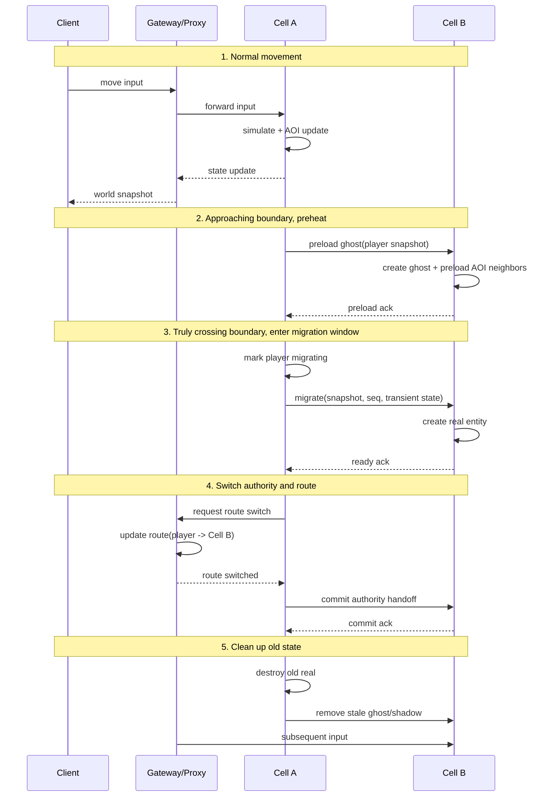

[English](q4-seamless-world.en.md) | [中文](q4-seamless-world.md)

# Q4: How to Implement Seamless Large-map Transitions? How to Handle Cross-server Player Movement?

## Problem Analysis

The core of this question is not just "how to switch servers when the player walks past a boundary", but to explain four things at the same time:

1. How the world is partitioned across multiple Cell/Scene processes
2. How to prepare in advance when the player approaches a boundary
3. Who is the authority when crossing the boundary, and when routing switches
4. How to converge on failure, rollback, and reconnection

If you only say "migrate the Entity when it reaches the boundary", the answer is usually not enough.

---

## I. First Distinguish Two Concepts

### 1. Client-side Seamless Loading

This is "world streaming loading" at the client level:

- Load terrain chunks in advance
- Load building, vegetation, and VFX resources in advance
- Avoid black screens and loading bars

It solves:

- Whether the picture is continuous
- Whether resources arrive in advance
- Whether the player perceives loading hitches

### 2. Server-side Seamless Migration

This is "Cell/Scene ownership switching" at the server level:

- The old Cell manages the player
- The new Cell takes over the player
- The gateway/Proxy updates message routing

It solves:

- Whose responsibility the player's logic is
- Whose responsibility AOI broadcast is
- How skill, movement, and combat state stay continuous

### The Easiest Mistake to Make

Mixing "client streaming loading" and "server-side cross-Cell migration" into one thing.

A more accurate statement is:

> Seamless experience comes from client resource preloading; seamless logic comes from server-side authoritative smooth switching. The two cooperate, but they are not the same problem.

---

## II. What Counts as Seamless Large-map Transition

### Non-seamless Approach

Typical symptoms:

- Switch maps through portals/instance entrances
- Loading bar during the switch
- All Entities in the old map are destroyed
- The player is recreated in the new map

This is more like "teleport between Spaces", not physically continuous movement.

### Seamless Approach

Typical symptoms:

- The player continuously walks across the region boundary
- The client has no obvious loading bar
- The server switches processing ownership in the background
- Visible objects near the player change smoothly

Essentially:

- The map is visually continuous
- The server is logically sharded
- The migration process is as invisible as possible to the player

---

## III. How to Do Server-side Space Partitioning

### 1. Fixed Partitioning

Cut the large world into multiple fixed regions, each managed by one CellApp.

Illustration:

```text
+-------------+-------------+-------------+
| CellApp A   | CellApp B   | CellApp C   |
| Newbie      | Main City   | Main City   |
| Village     | West        | East        |
+-------------+-------------+-------------+
| CellApp D   | CellApp E   | CellApp F   |
| Wild SW     | Wild Center | Wild SE     |
+-------------+-------------+-------------+
```

Advantages:

- Simple design
- Explicit configuration
- Stable boundary relationships

Disadvantages:

- Hot regions easily overload
- Idle regions waste resources

### 2. Dynamic Partitioning

Dynamically adjust Cell boundaries based on load, or further split hot regions.

Common approaches:

- The main city gets more Cells cut out for it alone
- Hot maps temporarily split horizontally
- Large battlefields cut into blocks a second time by hot region

Advantages:

- More balanced load
- Higher resource utilization

Disadvantages:

- Complex implementation
- Boundaries change
- Migration volume may spike suddenly

### 3. Common Engineering Conclusion

The real approach of many MMOs is not "purely fixed" or "purely dynamic", but a hybrid:

- The overall framework uses fixed regions
- Hot scenes are locally dynamically split
- Instance-type scenes directly use independent Space/Instance

---

## IV. First Unify the Terminology

In this kind of question the terminology must be unified, otherwise the explanation will fall apart later.

### 1. Real Entity

The real authoritative entity.

Characteristics:

- Only one Cell has write permission
- Responsible for combat, movement, attribute changes
- Responsible for the authoritative broadcast source in AOI

### 2. Ghost Entity

A read-only replica across the boundary.

Characteristics:

- Gives adjacent Cells boundary visibility preheating
- Read-only, not responsible for final logic adjudication
- Position, facing, and some state are synced over from Real

### 3. Shadow State

A temporary mirror state or transition state during migration.

Characteristics:

- Used for state replication/catch-up in the migration window
- Not a long-lived AOI object
- More of an internal concept of the migration protocol

### A Simplified Notation

- `Real`: the sole authority
- `Ghost`: boundary read-only replica
- `Shadow`: temporary sync state during migration

---

## V. The Standard Flow for Seamless Cross-Cell Movement

The following flow is more complete than "migrate as soon as you detect crossing the line".

### Phase 1: Normal Movement

- The player is currently handled by `Cell A`
- The Gateway/Proxy routes that player's input to `Cell A`
- `Cell A` is responsible for movement, skills, AOI, broadcast

### Phase 2: Approaching the Boundary, Start Preheating

When the player approaches the boundary threshold:

- `Cell A` judges the player's facing and velocity
- Predicts that they may cross into `Cell B` shortly
- Sends a "preheat request" to `Cell B`
- `Cell B` creates that player's `Ghost`
- `Cell B` starts preparing AOI data near the boundary in advance

The goal of this phase is not migration, but reducing the abruptness of the real switch.

### Phase 3: Entering the Migration Window

When the player truly crosses the migration threshold:

- `Cell A` marks the player as `migrating`
- Pauses new complex state-change entry points
- Takes one state snapshot of the player
- Sends the snapshot to `Cell B`

Note:

- This is not immediately destroying the old entity
- Nor is it immediately making the new Cell the authority

### Phase 4: Target Cell Establishes Real

After `Cell B` receives the snapshot:

- Creates a new `Real Entity` based on the snapshot
- Restores necessary state
- Establishes AOI subscription relationships
- Sends an ACK back to `Cell A`

At this point the system enters the most critical step:

> The target Cell is already capable of taking over, but the old Cell has not fully released yet.

### Phase 5: Switching Authority and Routing

The recommended order is:

1. `Cell B` finishes preparation
2. `Proxy/Base/Gateway` updates the player's route to `Cell B`
3. New input is only sent to `Cell B`
4. `Cell B` becomes the sole authority
5. `Cell A` is downgraded to read-only transition or directly cleaned up

The key points here are:

- **First confirm the target can take over**
- **Then switch the input route**
- **Finally release the old authority**

Don't do it the other way around.

### Phase 6: Cleaning Up Old State

After the switch completes:

- `Cell A` destroys the old `Real`
- `Cell B` deletes the `Ghost/Shadow` it no longer needs
- AOI relationships stabilize to the new topology

---

## VI. A More Reasonable Sequence Diagram



---

## VII. Boundary Detection Must Not Only Look at the Current Position

If you only migrate when "already past the line", the user experience usually gets worse.

A more reasonable judgment combines:

- Current position
- Velocity vector
- Facing direction
- Trajectory of the last few frames
- Hysteresis threshold

### Pseudocode Example

```cpp
class BoundaryDetector {
public:
    enum class Result {
        None,
        Preload,
        Migrate,
    };

    Result check(const Entity& entity, const Bounds& bounds) {
        const auto pos = entity.position();
        const auto vel = entity.velocity();

        if (!bounds.contains(pos)) {
            return Result::Migrate;
        }

        if (isNearBoundary(pos, bounds, preloadMargin_)) {
            auto futurePos = pos + vel * predictSeconds_;
            if (!bounds.contains(futurePos)) {
                return Result::Preload;
            }
        }

        return Result::None;
    }

private:
    float preloadMargin_ = 50.0f;
    float predictSeconds_ = 1.0f;
};
```

### Why a Hysteresis Zone Is Needed

Otherwise the player jumping back and forth near the boundary will cause:

- Migration jitter
- Ghosts being created and destroyed frequently
- Routing switching frequently
- Large amounts of meaningless broadcast

So you usually have to set:

- Preheat threshold
- Actual migration threshold
- Rollback threshold

These three thresholds should not be exactly the same.

---

## VIII. What Is Really Hard Is the Authority Switch

Many people easily focus on "how to serialize the Entity", but what is really harder is:

> During the migration window, who actually has the final say?

### A Recommended Principle

At any moment, only one Cell is allowed to have final write permission.

That is:

- `Cell A` writes, `Cell B` preheats read-only
- Or `Cell B` writes, `Cell A` wraps up read-only
- No long-term dual-writing

### Why Long-term Dual-writing Is Not Allowed

Otherwise you very quickly get:

- Skill settlement computed on both sides
- Each side advancing position on its own
- Inconsistent Buff timers
- The same player broadcast by both sides

So the migration protocol is best explicitly split into three phases:

1. `prepare`
2. `route-switch`
3. `commit`

And when necessary also support:

4. `rollback`

---

## IX. The Failure Paths Must Be Explained

This part is the key to distinguishing intermediate from advanced depth of understanding.

### Failure Scenario 1: Target Cell Created Successfully, but Route Switch Failed

Handling:

- `Cell B` keeps the temporary entity but does not take over authority
- `Cell A` continues handling as the authority
- The system retries the route switch
- On timeout, `rollback`, deleting `Cell B`'s temporary state

### Failure Scenario 2: Route Already Switched to the New Cell, but the Old Cell Did Not Get to Release

Handling:

- The new Cell is the sole authority
- The old Cell enters read-only/tombstone state
- Forbid the old Cell from producing new logic writes
- Background delayed cleanup

### Failure Scenario 3: Source Cell Crashes During Migration

This is the hardest scenario.

Because at this point you usually cannot get a complete and graceful `freeze + serialize`.

A more realistic approach is:

- Rely on the most recent snapshot or minimal recovery state
- Have Base/DB/Session services retain key state
- Rebuild the player on the new Cell after reconnection
- When necessary, roll back to a safe point/nearest checkpoint

This shows:

> "Active migration" and "failure migration" are not one flow.

### Failure Scenario 4: Player Disconnects During Migration

Recommended approach:

- Have Session/Proxy record the player's migration state
- Mark that player's current target Cell
- On reconnection, query the target Cell first
- If the target Cell has not completed the takeover, fall back to the source Cell or recovery point

---

## X. Different Types of Switching Should Be Explained Separately

### 1. Cross-Cell Within the Same Space

Characteristics:

- The map is continuous
- Position is continuous
- The player is usually unaware
- Needs Ghost, boundary preheating, authority switch

This is strictly "seamless cross-server/cross-Cell movement".

### 2. Switching Between Different Spaces

For example:

- Main city into an instance
- Wilds into a battlefield
- Cross-server lobby into a match server

This is usually not physically continuous movement, but "teleport/instance switch".

Characteristics:

- The old Space's Entity lifecycle ends
- The character entity is recreated in the new Space
- A loading bar or short transition animation is allowed

Here you should proactively state clearly:

> Not all cross-server movement pursues complete seamlessness. Open-world boundary crossing and instance teleport have different design goals.

---

## XI. What the Client Should Do and Should Not Do

### What the Client Should Do

- Stream-load terrain chunks/scene resources
- Show objects near the boundary in advance
- Smooth position interpolation
- Do visual continuity handling at the migration instant

### What the Client Should Not Take On

- Directly understanding Cell topology
- Directly establishing complex business connections with multiple Cells
- Participating in authority adjudication

A more reasonable network model is usually:

- The client only connects to the Gateway/Proxy
- The Gateway/Proxy internally forwards to the current authoritative Cell

This way the client does not need to perceive Cell migration details.

---

## XII. What Questions Usually Get Extended When Going Deeper

If you already understand to this point, the following usually get extended:

1. What happens if a skill is half-cast during boundary migration?
2. Who settles Buffs and DOTs during the migration window?
3. How to prevent an avalanche of boundary migration in large-scale nation wars?
4. If a hot region stays full, what is the dynamic boundary adjustment strategy?
5. How to avoid duplicate triggering of AOI enter/leave events?

So a more mature answer should proactively add:

> The migration plan is not just a movement-logic problem; it essentially also involves combat settlement authority, message ordering, AOI deduplication, and failure recovery.

---

## XIII. Recommended Organization

You can organize the answer in the following way:

### Layer 1: First Qualify

Seamless switching has two parts:

- Client streaming loading, guaranteeing picture continuity
- Server-side cross-Cell migration, guaranteeing logic continuity

### Layer 2: Explain the Main Flow

- The player moves normally in the old Cell
- Approaching the boundary, pre-create a Ghost in the new Cell
- Truly crossing the line, do snapshot migration
- After the target Cell is ready, switch the route
- After the route is switched, release the old authority

### Layer 3: Explain the Key Principles

- At the same moment only one Real Entity has write permission
- Ghost only does boundary visibility, not final adjudication
- Route switch must be later than target preparation completion
- Must design rollback and reconnection recovery paths

### Layer 4: Explain the Engineering Trade-offs

- Open-world boundary crossing pursues seamlessness
- Instance/battlefield switching allows semi-seamless or even a loading bar
- Fixed partitioning is simple; dynamic partitioning is more flexible but complex to implement

---

## XIV. Summary

The core of a seamless large map is not "moving house when the player crosses the line", but:

- Preheat first
- Then migrate
- Make the authority switch point explicit
- Finally clean up old state

What is really hard is not serialization, but:

- AOI handoff
- Authority switch
- Route switch
- Failure rollback
- Failure recovery

If you explain these clearly, this question basically already reaches the depth of a fairly high-watermark MMO server-side explanation.

---

## References

- [BigWorld Seamless World Design](https://www.bigworldtech.com/)
- [KBEngine Space Management](https://www.kbelab.com/guide/space/)
- [KBEngine Entity Migration](https://github.com/kbengine/kbengine)
- [Network Lag Compensation Techniques](https://gafferongames.com/post/snapshot_interpolation/)
