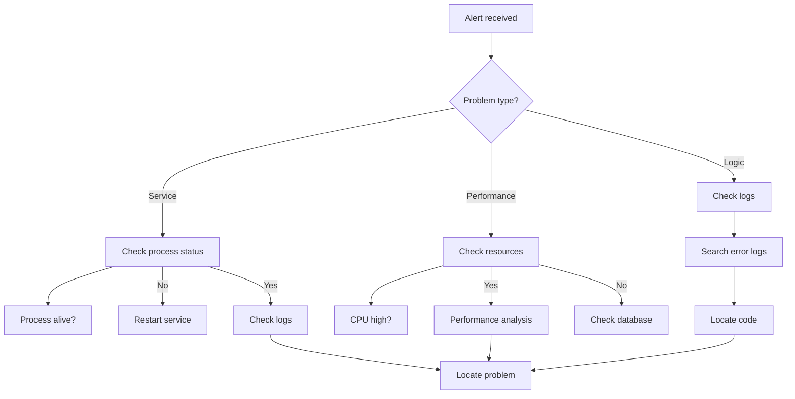

[English](q93-troubleshooting.en.md) | [中文](q93-troubleshooting.md)

# Q93: How to Quickly Localize Online Problems?

## Problem Analysis

This question tests understanding of problem localization:

- Problem classification
- Troubleshooting methods
- Debugging tools
- KBEngine debugging

---

## I. Problem Classification

### 1.1 Problem Types

```
┌─────────────────────────────────────────────────────────────┐
│                  Online Problem Classification                │
├─────────────────────────────────────────────────────────────┤
│                                                             │
│  Service problems:                                          │
│  ├── Process crash                                          │
│  ├── Service hang                                           │
│  ├── Slow response                                          │
│  └── Connection drop                                        │
│                                                             │
│  Performance problems:                                      │
│  ├── CPU spike                                              │
│  ├── Memory leak                                            │
│  ├── Slow database                                          │
│  └── Lock contention                                        │
│                                                             │
│  Logic problems:                                            │
│  ├── Bug triggered                                          │
│  ├── Data inconsistency                                     │
│  ├── Deadlock                                               │
│  └── Resource exhaustion                                    │
│                                                             │
│  Configuration problems:                                    │
│  ├── Wrong configuration                                    │
│  ├── Missing dependency                                     │
│  └── Environment differences                                │
│                                                             │
└─────────────────────────────────────────────────────────────┘
```

---

## II. Troubleshooting Process

### 2.1 Problem Localization Flowchart



### 2.2 Troubleshooting Script

```bash
#!/bin/bash
# 快速诊断脚本 — Quick diagnostic script

echo "=== Online Problem Diagnosis ==="

# 1. 检查进程状态 — Check process status
echo "--- Process status ---"
ps aux | grep -E "kbengine|cellapp|baseapp|dbmgr|loginapp"

# 2. 检查端口占用 — Check port usage
echo "--- Port listening ---"
netstat -tuln | grep -E ":(20013|20011|20012|20021|20004|20005)"

# 3. 检查内存 — Check memory
echo "--- Memory usage ---"
free -h

# 4. 检查磁盘 — Check disk
echo "--- Disk usage ---"
df -h

# 5. 检查错误日志 — Check error logs
echo "--- Recent errors ---"
tail -100 /path/to/kbengine/logs/*.log | grep -i "error\|fatal\|exception"

# 6. 检查数据库连接 — Check database connection
echo "--- Database connections ---"
mysql -h localhost -u kbengine -p -e "SHOW PROCESSLIST;"

# 7. 检查网络连接 — Check network connections
echo "--- Network connection count ---"
netstat -an | grep ESTABLISHED | wc -l
```

---

## III. KBEngine Debugging

### 3.1 KBEngine Debugging Tools

```python
# KBEngine 调试工具 — KBEngine debugging tools

class KBEngineDebug:
    """KBEngine 调试辅助 — KBEngine debugging helper"""

    @staticmethod
    def list_entities():
        """列出所有实体 — List all entities"""
        for entity_id, entity in KBEngine.entities.items():
            print(f"Entity: {entity_id}")
            print(f"  Type: {entity.__class__.__name__}")
            print(f"  Position: {entity.position}")
            print(f"  IsDestroyed: {entity.isDestroyed}")
            if hasattr(entity, 'base'):
                print(f"  Base: {entity.base}")
            print()

    @staticmethod
    def list_spaces():
        """列出所有空间 — List all spaces"""
        for space_id, space in KBEngine.spaces.items():
            print(f"Space: {space_id}")
            print(f"  Name: {space.spaceName}")
            print(f"  Entity Count: {space.entityCount}")
            print()

    @staticmethod
    def dump_entity(entity_id):
        """转储实体详细信息 — Dump entity details"""
        entity = KBEngine.getEntity(entity_id)
        if not entity:
            print(f"Entity {entity_id} not found")
            return

        print(f"=== Entity {entity_id} ===")
        print(f"Class: {entity.__class__.__name__}")
        print(f"Position: {entity.position}")
        print(f"Direction: {entity.direction}")
        print(f"ModelID: {entity.modelID}")

        # 打印所有属性 — Print all attributes
        print("Attributes:")
        for attr_name in dir(entity):
            if not attr_name.startswith('_'):
                try:
                    value = getattr(entity, attr_name)
                    if not callable(value):
                        print(f"  {attr_name}: {value}")
                except:
                    pass

    @staticmethod
    def check_memory():
        """检查内存使用 — Check memory usage"""
        mem = KBEngine.getWatcher().get("mem/allocated")
        print(f"Allocated Memory: {mem / 1024 / 1024:.2f} MB")

    @staticmethod
    def check_network():
        """检查网络统计 — Check network statistics"""
        stats = KBEngine.getWatcher().get("network/*")
        print("Network Statistics:")
        for key, value in stats.items():
            print(f"  {key}: {value}")
```

---

## IV. Common Tools

### 4.1 GDB Attach

```bash
# 生产环境 GDB 调试 — Production environment GDB debugging

# 1. 找到进程 ID — Find the process ID
PID=$(pgrep -f CellApp | head -1)

# 2. 附加 GDB — Attach GDB
gdb -p $PID

# 3. GDB 命令 — GDB commands
(gdb) thread apply all bt    # 查看所有线程堆栈 — View all thread stacks
(gdb) info threads         # 查看线程信息 — View thread info
(gdb) thread apply 1 bt   # 查看主线程堆栈 — View main thread stack
(gdb) quit

# 或使用 bt full 查看完整堆栈 — Or use bt full to view the full stack
```

### 4.2 CoreDump Analysis

```bash
# CoreDump 分析 — CoreDump analysis

# 1. 启用 coredump — Enable coredump
ulimit -c unlimited
echo "/tmp/core.%e.%p" > /proc/sys/kernel/core_pattern

# 2. 当进程崩溃后分析 — Analyze after the process crashes
gdb /path/to/CellApp /tmp/core.1234

# 3. GDB 分析 — GDB analysis
(gdb) bt full              # 完整堆栈 — Full stack
(gdb) thread apply all bt  # 所有线程 — All threads
(gdb) info locals        # 本地变量 — Local variables
```

---

## V. Quick Localization Tips

### 5.1 Quick Localization of Common Problems

```python
# 常见问题定位脚本 — Common problem localization script

class QuickTroubleshooter:
    """快速问题定位 — Quick problem localization"""

    @staticmethod
    def check_process_health(component_name):
        """检查组件健康状态 — Check component health status"""
        # 检查进程是否存在 — Check whether the process exists
        pid = get_process_pid(component_name)
        if not pid:
            print(f"[ERROR] {component_name} process not found!")
            return False

        # 检查进程响应 — Check process responsiveness
        if not ping_process(pid):
            print(f"[ERROR] {component_name} not responding!")
            return False

        # 检查端口监听 — Check port listening
        port = get_component_port(component_name)
        if not is_port_listening(port):
            print(f"[ERROR] {component_name} not listening on port {port}!")
            return False

        print(f"[OK] {component_name} is healthy")
        return True

    @staticmethod
    def check_database_connection():
        """检查数据库连接 — Check database connection"""
        try:
            conn = pymysql.connect(
                host='localhost',
                user='kbengine',
                password='kbengine',
                database='kbengine'
            )
            conn.ping()
            print("[OK] Database connection OK")
            return True
        except Exception as e:
            print(f"[ERROR] Database connection failed: {e}")
            return False

    @staticmethod
    def find_high_cpu():
        """查找高 CPU 进程 — Find high CPU processes"""
        import psutil
        for proc in psutil.process_iter(['pid', 'name', 'cpu_percent']):
            if proc.info['cpu_percent'] > 80:
                print(f"[WARN] High CPU: {proc.info['name']} ({proc.info['cpu_percent']}%)")

    @staticmethod
    def find_high_memory():
        """查找高内存进程 — Find high memory processes"""
        import psutil
        for proc in psutil.process_iter(['pid', 'name', 'memory_percent']):
            if proc.info['memory_percent'] > 80:
                print(f"[WARN] High Memory: {proc.info['name']} ({proc.info['memory_percent']}%)")
```

---

## VI. Best Practices

### 6.1 Localization Recommendations

| Step | Action |
|------|--------|
| 1 | Confirm the problem symptoms |
| 2 | Check error logs |
| 3 | Check process status |
| 4 | Analyze system resources |
| 5 | Locate the root cause |
| 6 | Apply the fix |

---

## VII. Summary

### Core of Problem Localization

```
Quick localization = log analysis + tool support + system monitoring + experience accumulation
- Look at logs to find errors
- Use tools to assist analysis
- Troubleshoot by category
- Build a problem knowledge base
```

---

## References

- [Linux Troubleshooting](https://access.redhat.com/documentation/en-us/red_hat_enterprise_linux/7/html/troubleshooting/)
- [KBEngine Debug](https://kbengine.github.io/docs/)
