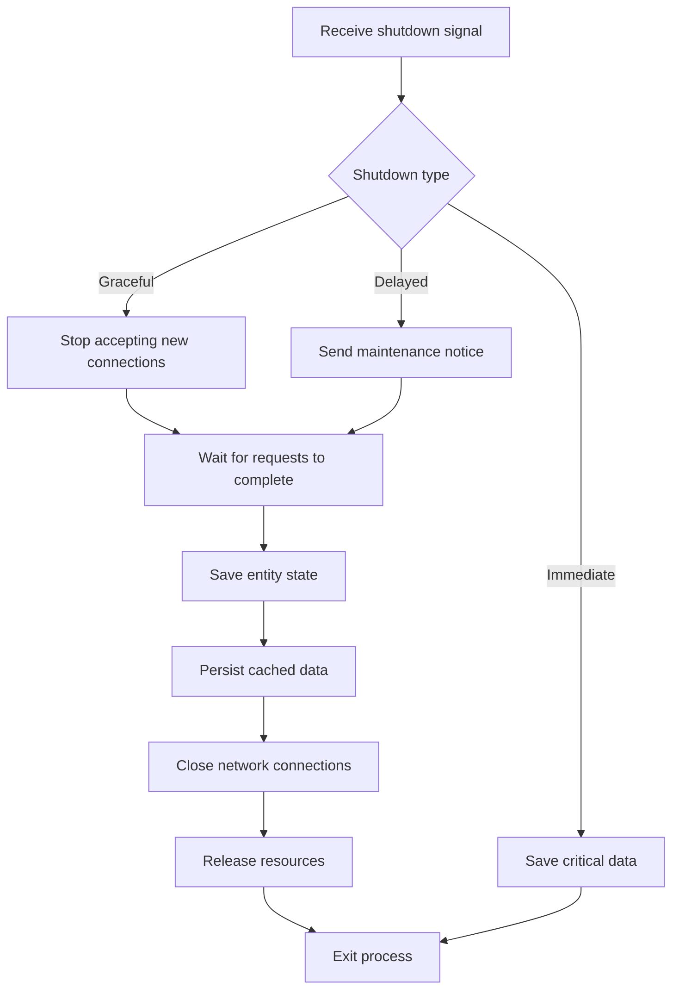

[English](q97-graceful-shutdown.en.md) | [中文](q97-graceful-shutdown.md)

# Q97: How Do You Implement Graceful Shutdown?

## Core Conclusion

This question tests understanding of graceful shutdown:

- Shutdown flow
- Connection cleanup
- Data persistence
- KBEngine shutdown mechanisms

---

## I. Principles of Graceful Shutdown

### 1.1 Shutdown Types

```
┌─────────────────────────────────────────────────────────────┐
│                    Shutdown Types                             │
├─────────────────────────────────────────────────────────────┤
│                                                             │
│  Immediate shutdown (立即关机):                              │
│  ├── SIGKILL signal                                          │
│  ├── Forceful termination                                    │
│  ├── Data may be lost                                        │
│  └── Example: kill -9, server power loss                     │
│                                                             │
│  Graceful shutdown (优雅关机):                              │
│  ├── SIGTERM signal                                          │
│  ├── Complete current requests                               │
│  ├── Save state                                              │
│  └── Example: normal shutdown script                         │
│                                                             │
│  Delayed shutdown (延迟关机):                                │
│  ├── Wait for players to exit                                │
│  ├── Timer-triggered                                         │
│  ├── Maintenance notice                                      │
│  └── Example: maintenance mode                               │
│                                                             │
└─────────────────────────────────────────────────────────────┘
```

---

## II. Shutdown Flow

### 2.1 Shutdown Flow Diagram



### 2.2 KBEngine Shutdown Flow

```python
# KBEngine 优雅关机 — KBEngine graceful shutdown

"""
KBEngine 关机机制:

1. 收到 SIGTERM 信号 — receive the SIGTERM signal
2. 调用 onKBEngineShutDown 闭包 — invoke the onKBEngineShutDown closure
3. 停止接收新连接 — stop accepting new connections
4. 等待实体保存 — wait for entities to be saved
5. 关闭网络 — close the network
6. 退出进程 — exit the process
"""

import KBEngine
import signal
import sys

class ShutdownManager:
    """关机管理器 — shutdown manager"""

    def __init__(self):
        self.shutdown initiated = False
        self.shutdown_timeout = 60  # 秒 — seconds
        self.players_to_save = set()

        # 注册信号处理 — register signal handlers
        signal.signal(signal.SIGTERM, self.on_signal)
        signal.signal(signal.SIGINT, self.on_signal)

        # 注册关机回调 — register the shutdown callback
        KBEngine.registerCallback("onShutdown", self.on_shutdown)

    def on_signal(self, signum, frame):
        """信号处理 — signal handler"""
        signal_name = signal.Signals(signum).name
        INFO_MSG(f"Received signal: {signal_name}")

        if not self.shutdown_initiated:
            self.initiate_shutdown("normal")
        else:
            WARNING_MSG("Shutdown already in progress, forcing...")
            self.force_shutdown()

    def initiate_shutdown(self, reason):
        """发起关机 — initiate shutdown"""
        if self.shutdown_initiated:
            return

        self.shutdown_initiated = True
        INFO_MSG(f"Initiating graceful shutdown: {reason}")

        # 1. 停止接收新连接 — stop accepting new connections
        self.stop_accepting_connections()

        # 2. 通知所有玩家 — notify all players
        self.notify_players_shutdown()

        # 3. 开始保存实体 — start saving entities
        self.save_all_entities()

    def stop_accepting_connections(self):
        """停止接收新连接 — stop accepting new connections"""
        # KBEngine 内置方法 — KBEngine built-in method
        KBEngine.setAcceptNewConnections(False)
        INFO_MSG("Stopped accepting new connections")

    def notify_players_shutdown(self):
        """通知玩家关机 — notify players of shutdown"""
        shutdown_msg = {
            "type": "server_shutdown",
            "reason": "maintenance",
            "timeout": self.shutdown_timeout
        }

        # 广播给所有在线玩家 — broadcast to all online players
        for entity_id, entity in KBEngine.entities.items():
            if hasattr(entity, 'client') and entity.client:
                entity.client.onServerShutdown(shutdown_msg)

    def save_all_entities(self):
        """保存所有实体 — save all entities"""
        INFO_MSG("Saving all entities...")

        # 获取需要保存的实体 — get the entities that need saving
        self.players_to_save = set(
            eid for eid, e in KBEngine.entities.items()
            if hasattr(e, 'accountEntity')
        )

        INFO_MSG(f"Entities to save: {len(self.players_to_save)}")

        # KBEngine 会自动触发实体写入 — KBEngine triggers entity writes automatically
        # 我们需要等待写入完成 — we need to wait for the writes to finish
        KBEngine.setShutdownTimer(self.shutdown_timeout)

    def on_entity_saved(self, entity_id):
        """实体保存回调 — entity-saved callback"""
        if entity_id in self.players_to_save:
            self.players_to_save.remove(entity_id)
            INFO_MSG(f"Entity {entity_id} saved, "
                    f"remaining: {len(self.players_to_save)}")

        if not self.players_to_save:
            INFO_MSG("All entities saved, shutting down...")
            self.final_shutdown()

    def final_shutdown(self):
        """最终关机 — final shutdown"""
        INFO_MSG("Performing final shutdown...")

        # 关闭数据库连接 — close the database connection
        self.close_database()

        # 退出 — exit
        sys.exit(0)

    def force_shutdown(self):
        """强制关机 — force shutdown"""
        WARNING_MSG("Forcing shutdown...")
        sys.exit(1)

    def close_database(self):
        """关闭数据库连接 — close the database connection"""
        # KBEngine DBMgr 会自动关闭 — KBEngine DBMgr closes automatically
        pass


# KBEngine 脚本中的关机处理 — shutdown handling in a KBEngine script
def onKBEngineShutDown():
    """
    KBEngine 关机回调 — KBEngine shutdown callback

    这个函数在 KBEngine 准备关闭时被调用 — this function is called when KBEngine is about to close
    """
    INFO_MSG("KBEngine is shutting down...")

    # 执行清理工作 — perform cleanup work
    cleanup_resources()

    # 保存全局状态 — save global state
    save_global_state()


def cleanup_resources():
    """清理资源 — clean up resources"""
    # 清理缓存 — clear caches
    clear_caches()

    # 关闭外部连接 — close external connections
    close_external_connections()

    # 取消定时器 — cancel all timers
    cancel_all_timers()


def save_global_state():
    """保存全局状态 — save global state"""
    # 保存游戏全局状态 — save the game's global state
    pass
```

---

## III. Data Persistence Guarantees

### 3.1 Entity Saving

```python
# 实体保存保证 — entity save guarantees

class SaveOnShutdown:
    """关机时保存 — save on shutdown"""

    def __init__(self):
        self.save_callbacks = []

    def register_save_callback(self, callback):
        """注册保存回调 — register a save callback"""
        self.save_callbacks.append(callback)

    def execute_saves(self):
        """执行所有保存 — execute all saves"""
        results = []

        for callback in self.save_callbacks:
            try:
                result = callback()
                results.append((callback.__name__, True, result))
            except Exception as e:
                ERROR_MSG(f"Save callback failed: {e}")
                results.append((callback.__name__, False, str(e)))

        return results


class Account(KBEngine.Account):
    """账号实体 - 支持关机保存 — account entity, supports save on shutdown"""

    def __init__(self):
        KBEngine.Account.__init__(self)
        self.pending_save = False

    def onShutdown(self):
        """关机时调用 — called on shutdown"""
        INFO_MSG(f"Account {self.id} onShutdown")

        # 标记需要保存 — mark that a save is needed
        self.pending_save = True

        # 立即写入数据库 — write to the database immediately
        self.writeToDB()

    def onWriteToDBCallback(self, success):
        """数据库写入回调 — database write callback"""
        if success:
            INFO_MSG(f"Account {self.id} saved successfully")
        else:
            ERROR_MSG(f"Account {self.id} save failed!")

        # 通知关机管理器 — notify the shutdown manager
        shutdown_mgr.on_entity_saved(self.id)
```

---

## IV. Connection Cleanup

### 4.1 Closing Connections

```python
# 连接清理 — connection cleanup

class ConnectionManager:
    """连接管理器 — connection manager"""

    def __init__(self):
        self.connections = {}

    def register_connection(self, conn_id, conn):
        """注册连接 — register a connection"""
        self.connections[conn_id] = conn

    def close_all_connections(self):
        """关闭所有连接 — close all connections"""
        INFO_MSG(f"Closing {len(self.connections)} connections...")

        for conn_id, conn in list(self.connections.items()):
            try:
                # 发送关机消息 — send a shutdown message
                conn.send_shutdown_notification()

                # 关闭连接 — close the connection
                conn.close()

                del self.connections[conn_id]

            except Exception as e:
                ERROR_MSG(f"Error closing connection {conn_id}: {e}")

    def wait_connections_empty(self, timeout=30):
        """等待所有连接关闭 — wait for all connections to close"""
        import time

        start = time.time()
        while self.connections and (time.time() - start) < timeout:
            INFO_MSG(f"Waiting for {len(self.connections)} connections...")
            time.sleep(1)

        if self.connections:
            WARNING_MSG(f"Timeout with {len(self.connections)} connections remaining")


class KBEngineConnection(KBEngine.Entity):
    """KBEngine 连接处理 — KBEngine connection handling"""

    def onClientDeath(self):
        """客户端断开 — client disconnected"""
        INFO_MSG(f"Client {self.id} disconnected")

    def onShutdownNotify(self):
        """关机通知 — shutdown notification"""
        if self.client:
            self.client.onServerShutdown({
                "message": "Server is shutting down",
                "timeout": 30
            })
```

---

## V. Maintenance Mode

### 5.1 Delayed Shutdown

```python
# 维护模式 — maintenance mode

class MaintenanceMode:
    """维护模式 — maintenance mode"""

    def __init__(self, shutdown_delay=300):
        self.shutdown_delay = shutdown_delay  # 5分钟 — 5 minutes
        self.shutdown_scheduled = False
        self.shutdown_time = 0

    def schedule_maintenance(self, delay):
        """安排维护 — schedule maintenance"""
        self.shutdown_scheduled = True
        self.shutdown_time = time.time() + delay

        INFO_MSG(f"Maintenance scheduled in {delay} seconds")

        # 通知所有玩家 — notify all players
        self.broadcast_maintenance_notice()

        # 设置定时器 — set a timer
        KBEngine.addTimer(delay, 0, self.execute_shutdown)

    def broadcast_maintenance_notice(self):
        """广播维护通知 — broadcast the maintenance notice"""
        remaining = int(self.shutdown_time - time.time())

        for entity_id, entity in KBEngine.entities.items():
            if hasattr(entity, 'client') and entity.client:
                # 每分钟通知一次 — notify once per minute
                for t in range(remaining, 0, -60):
                    KBEngine.addTimer(t, 0, lambda: self.send_notice(entity, remaining - t))

    def send_notice(self, entity, remaining):
        """发送通知 — send the notice"""
        if entity.client:
            entity.client.onMaintenanceNotice({
                "remaining": remaining,
                "message": f"Server will shutdown in {remaining} seconds"
            })

    def execute_shutdown(self):
        """执行关机 — execute the shutdown"""
        INFO_MSG("Maintenance shutdown executing...")
        shutdown_mgr.initiate_shutdown("scheduled_maintenance")
```

---

## VI. Best Practices

### 6.1 Suggestions for Graceful Shutdown

| Practice | Description |
|------|------|
| **Signal handling** | Catch SIGTERM/SIGINT |
| **Data persistence** | Ensure all entities are written to the database |
| **Connection notification** | Notify players ahead of time |
| **Timeout protection** | Set a shutdown timeout |
| **State check** | Check service health before shutting down |
| **Logging** | Record the shutdown process |

---

## VII. Summary

### The Core of Graceful Shutdown

```
Graceful shutdown = signal catching + connection notification + data persistence + resource cleanup
- KBEngine onKBEngineShutDown
- Stop accepting new connections
- Wait for entity saves to complete
- Timeout protection mechanism
```

---

## References

- [Graceful Shutdown Patterns](https://medium.com/@haxnus/graceful-shutdown-in-go-and-linux- signals-cb4db09e6a1a)
- [KBEngine Lifecycle](https://kbengine.github.io/docs/)
- [Linux Signal Handling](https://man7.org/linux/man-pages/man7/signal.7.html)
